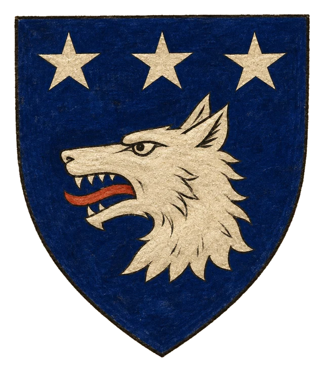
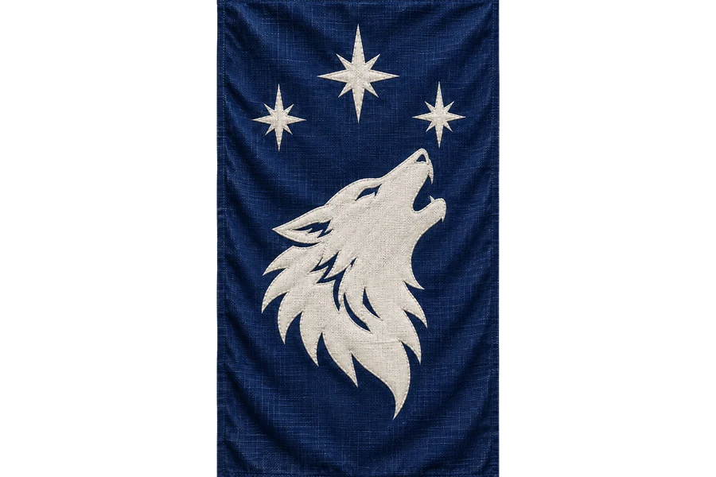

# Divoký Sever

> **Stav:** poloha = kánon (severozápad, potvrzeno DM); ostatní návrh

- **Typ:** divoký region – zamrzlý a temný severozápad – na mapě hornatý zalesněný poloostrov na severozápadě
- **Obyvatelé:** kočovné kmeny, zdivočelé stvůry Antemia, obři
- **Nebezpečí:** vysoké

## Kánon
Divoký, zamrzlý a temný severozápad Montelienu, o kterém koluje mnoho legend a odváží se tam jen ti nejstatečnější.

## Popis (návrh)
Jehličnaté hvozdy, ledové fjordy a pohoří, kde slunce v zimě vůbec nevychází. Na pobřeží stojí opuštěné strážní věže z doby císařství. Mezi kmeny se vypráví, že „sever patří snům“ – noc je tu delší a Antemiovi tvorové jsou drzejší.

## Háčky
- Lovec kožešin přinese do civilizace zmrzlé tělo tvora, který „nemá být stvořen k obrazu stvořitelovu“.
- Stará císařská věž na pobřeží skrývá mapu cesty k Fornheimu.

## Heraldika

> **Stav:** návrh

{.heraldika-img .heraldika-znak} {.heraldika-img .heraldika-vlajka}

**Znak:** Kmenové znamení: v tmavě modrém štítu bílá vlčí hlava pod třemi stříbrnými hvězdami.

**Vlajka:** Tmavě modrá kmenová korouhev s bílou vlčí hlavou.

**Proč:** Region bez státu, s kočovnými kmeny a dlouhou nocí. Jde o znamení kmenů, ne o státní znak.
