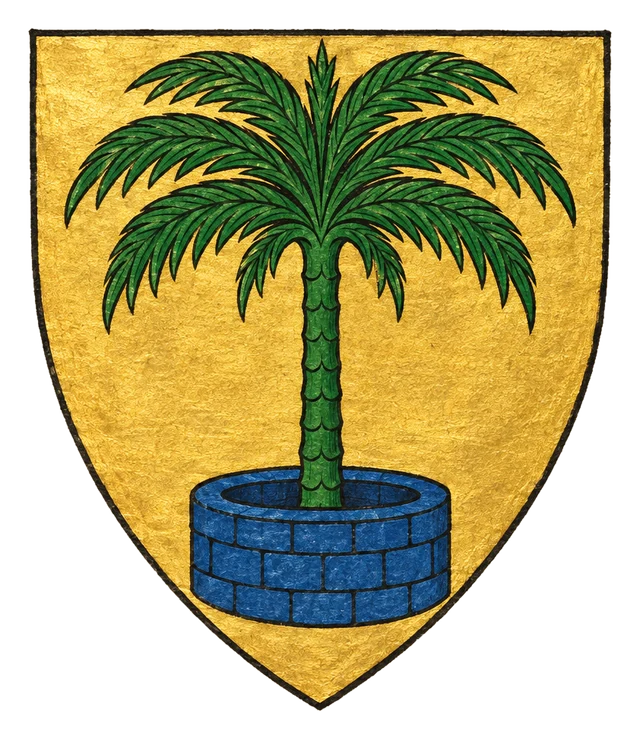
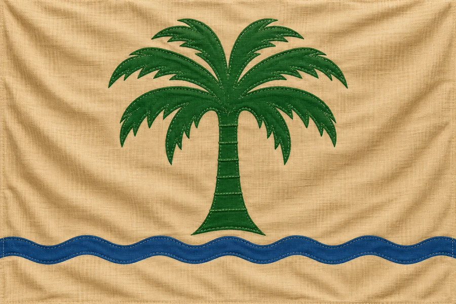

# Tali

> **Stav:** poloha, vládce a charakter země = kánon (DM); ostatní návrh

- **Typ:** země farmářů a horníků z pouště
- **Vládce:** král [Quento](../../04_Postavy/Vladci/Postava_Quento.md) (Gargoyle)
- **Poloha:** jihovýchod kontinentu, východně od [Laertmundu](../../02_Zeme/Kralovstvi_Laertmund.md), na západ od rokle oddělující [Zairam](../../02_Zeme/Zeme_Zairam.md); na severu sousedí s [Knärghe Zhiou](../../02_Zeme/Drzava_Knarghae_Zia.md)
- **Na mapě:** poušť s kaktusy, chrámy a hájem, na jihu pobřeží ([Geografie](../../11_Mapy/Geografie.md))

## Kánon
Tali je země pouštních farmářů a horníků. Vládne jí král Quento – Gargoyle. Pouštní oázy a zlaté doly živí tvrdý, pragmatický lid, který si drží odstup od ordenských vyslanců stejně jako od intrik pobřežních měst.

## Háčky (návrh)
- Quentovy gargoylové stráže hlídají doly i chrámy v poušti – kdo krade zlato, končí jako socha.
- Farmáři u oáz šíří zprávy o dávných pokladech v pyl pod hladinou písku.

## Heraldika

> **Stav:** kánon

{.heraldika-img .heraldika-znak} {.heraldika-img .heraldika-vlajka}

**Znak:** Ve zlatém štítu zelená palma nad modrou studnou (oázou).

**Vlajka:** Písková vlajka se zelenou palmou a modrým pruhem vody.

**Proč:** Poušť s oázou.
