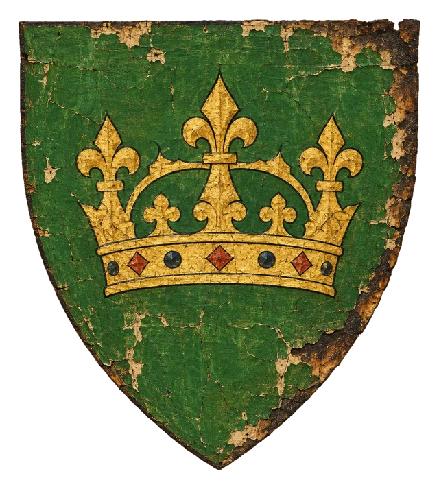
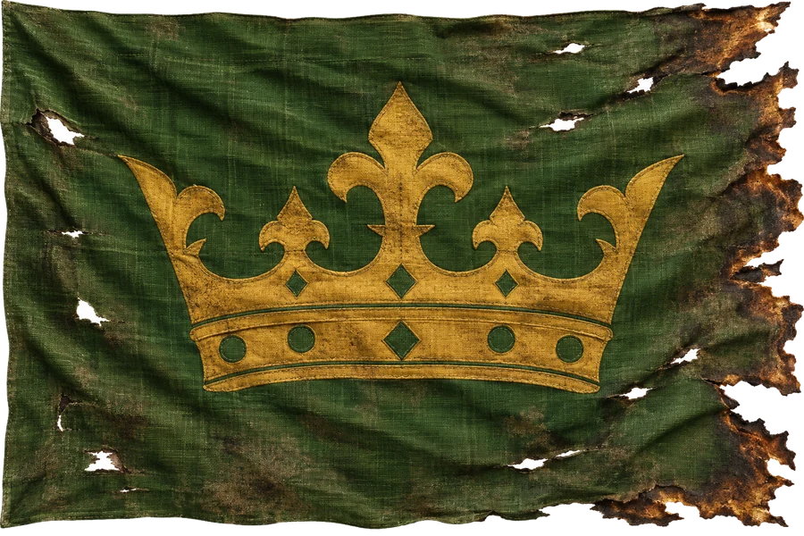

# Trosky Dräaru

> **Stav:** návrh (kánonové věty z historie a knih jsou zachovány, zbytek je návrh)

- **Typ:** divoký region – ostrov písku a rozvalin u jihozápadního pobřeží
- **Dříve:** **Dräar**, hlavní město říše a sídlo císaře, v zeleném Dräarském údolí
- **Přístup:** zakázán Kodexem bez písemného povolení ordenského inkvizitora; zákaz vstupu hlídá primas [Werenoru](../../03_Mesta/Mesto_Werenor.md)
- **Nebezpečí:** extrémní (doporučeno úrovně 11+)

## Kánon
- V Temný den bylo Dräarské údolí odtrženo od pevniny a stalo se ostrovem písku a rozvalin.
- [Irtis „Ohnivá“](../../04_Postavy/Stavitele_a_Bohove/Postava_Irtis.md) přísahala pomstu Ferienu a zmizela v **Dräarském podzemí**.
- Kdo se tam vydá, nejspíš se nevrátí, nebo se vrátí šílený. Démoni si hrají s myslí každého, kdo se přiblíží. Nekřičí – šeptají přímo do hlavy tónem tvé vlastní matky.
- Z moře jsou vidět černé útesy Dräaru.

## Popis (návrh)
Na mapě ostrov s pyramidami a troskami. Písečné duny pohřbily císařské bulváry; z písku trčí špičky pyramid – hrobek a chrámů císařů. Pod nimi se táhne Dräarské podzemí: zatopené kanály, katakomby a výhně, které podle pověstí stále žhnou.

## Mechaniky (2024)
- **Šepot:** každý dlouhý odpočinek na ostrově – Wisdom save DC 15, při neúspěchu 1 úroveň Exhaustion (2024: −2 k d20 testům za úroveň) a krátkodobé šílenství dle DMG 2024.
- Démoni: použij démony z MM 2025 (např. Shadow Demon, Vrock, Glabrezu) podle úrovně družiny.

## Háčky
- Ordenský inkvizitor nabízí povolení výměnou za artefakt z podzemí.
- Trpasličí kult Irtis z Wortmiru hledá cestu k „Matce v hlubinách“.

## Pro DM (tajné)
- Návrh: hlubiny Dräaru jsou dílnou Irtis, kde kuje zbraň proti Ferienu. Démoni nejsou její – jsou to stvůry Antemia, které ji tam drží v obležení (nebo naopak hlídají její tajemství).

## Heraldika

> **Stav:** kánon

{.heraldika-img .heraldika-znak} {.heraldika-img .heraldika-vlajka}

**Znak:** Historický znak císařství: v zeleném štítu zlatá císařská koruna; dnes zachovaný jen jako ohořelý, popraskaný štít.

**Vlajka:** Roztrhaná, ohořelá zelená císařská zástava se zlatou korunou.

**Proč:** Dräar byl hlavní město říše v zeleném Dräarském údolí. Po Temném dni z něj zbyl ostrov písku a rozvalin, proto je znak jen relikvie.
