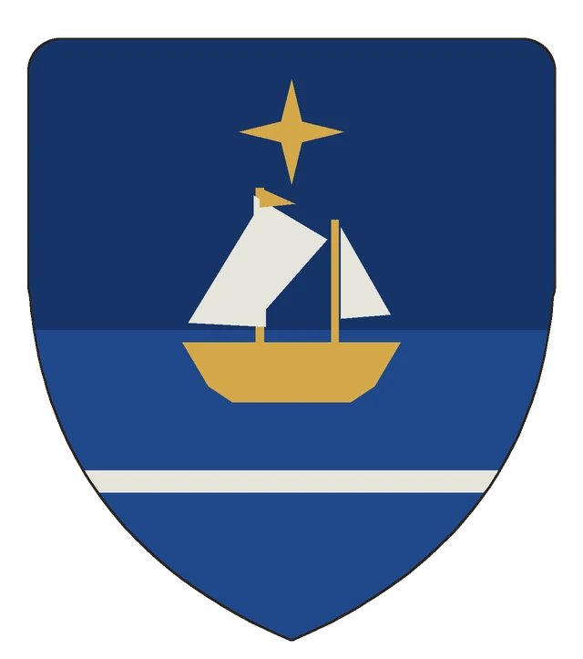
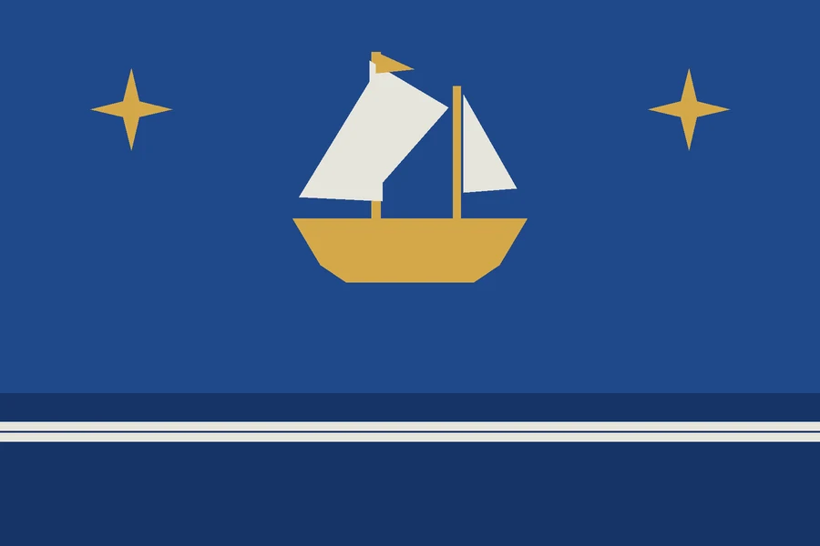

# Banerbo

## Základní Přehled

## Popis
„Synové vln“ jsou bohatý nezávislý národ objevitelů a obchodníků, zkušení námořníci.

## Geografie
> **Stav:** návrh

## Politika a vztah k Ordenu
> **Stav:** návrh

## Víra a kultura
> **Stav:** návrh

## Významná místa
> **Stav:** návrh

## Háčky pro dobrodružství
> **Stav:** návrh

## Heraldika

> **Stav:** návrh

{.heraldika-img .heraldika-znak} {.heraldika-img .heraldika-vlajka}

**Znak:** V modrém štítu zlatá plachetnice se stříbrnými plachtami na třech stříbrných vlnách, v čele zlatá čtyřcipá hvězda.

**Vlajka:** Modrá vlajka se zlatou plachetnicí, dvěma zlatými hvězdami ve vlajícím a tyčovém rohu a stříbrnými vlnami při dolním okraji.

**Proč:** „Synové vln“ – objevitelé a obchodníci; hvězda navigace, plachetnice a moře.

## Pro DM (tajné)

## Související
- [Khearaz](Khaeraz.md)
- [Mönohen](Klanove_Zeme_Monohen.md)
- [Analýza mapy](../11_Mapy/Analyza_mapy.md)
