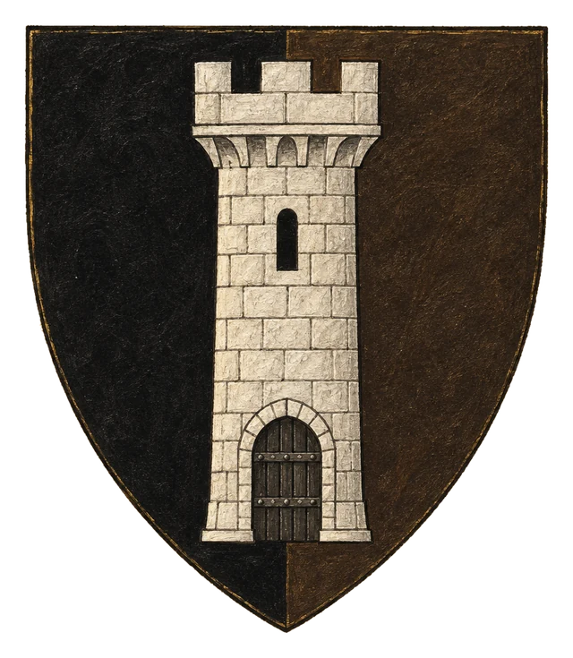
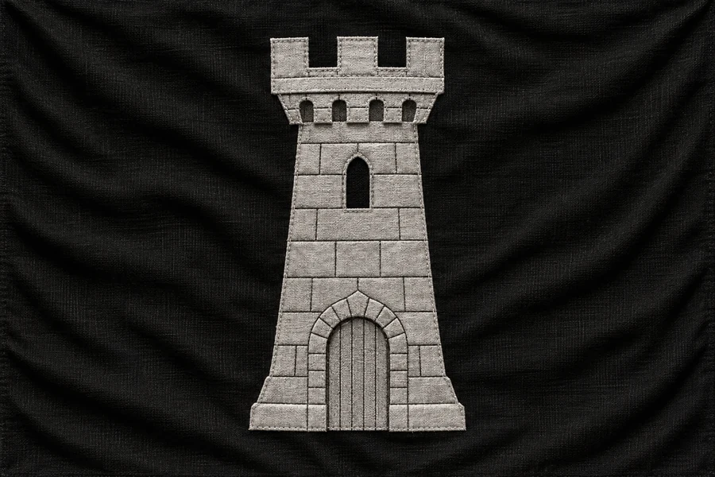

# Nezávislá Država Knärghae Zia

## Základní Přehled
- **Hlavní město:** Dar Kemmar
- **Hlava státu:** Neznámo
- **Podřízenost:** Nezávislá

## Tajemství a Uzavřenost
Horská pevnost Knärghae Zia ostře odmítá jakoukoliv nadvládu Bririe i Ordenského řádu. Vstup pro cizince je přísně zakázán a její vládci zůstávají zahaleni tajemstvím.

## Historie
Khärghae a Knärghae byly původně sesterská města jedné země – **Zia** (také **Zhia**, obě podoby jsou správné). Dnes je země rozdělená a polovinu **Knärghae Zia** ovládají temné síly: chodící mrtví a démoni. Severní polovina se po rozpadu prohlásila **Nezávislou Državou**, protože odmítá jakoukoliv nadvládu; jižní polovina nese titul **Knížectví**, protože ji vládne vévoda pod brirskou korunou.

## Heraldika

> **Stav:** kánon

{.heraldika-img .heraldika-znak} {.heraldika-img .heraldika-vlajka}

**Znak:** V černém štítu stříbrná vysoká věž se zavřenou branou; štít je svisle rozdělený a pravá půlka je ztmavlá do hnědočerna.

**Vlajka:** Černá vlajka se stříbrnou věží a zavřenou branou, bez dalších znaků.

**Proč:** Uzavřená horská pevnost, vysoká věž a zavřené brány. Rozpůlený štít připomíná sesterskou zemi Zia a půlku ovládanou mrtvými.

## Související
- Hlavní město: [Město Dar Kemmar](../03_Mesta/Mesto_Dar_Kemmar.md)
- Frakce: [Ordenský řád](../05_Frakce/Ordensky_Rad.md)
