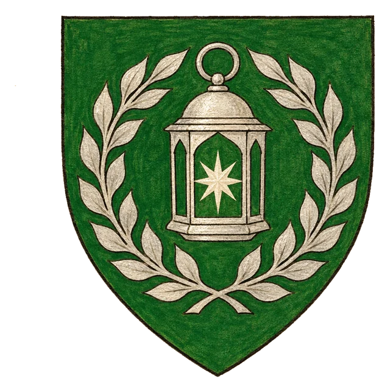
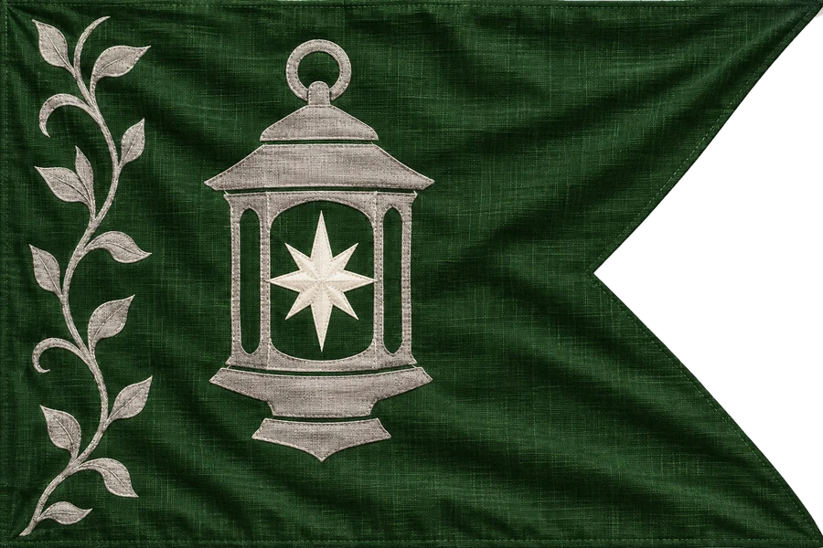

# Elfský Stát Nölien

## Základní Přehled
- **Hlavní město:** Tel Palentin
- **Hlava státu:** Král Veanor I. (Elf)
- **Podřízenost:** Nezávislý

## Vznešený Západ
Starobylá elfská říše. Elfové byli stvořeni Tirentem v dávno ztraceném městě [Sirinu](../01_Svet/Mista/Sirin.md), jež dnes leží někde v Zátoce olihní severně od Nölienu. Nölien býval říší sahající až na západ Montelienu – po Ertusově pádu a Temném dni však byla většina jeho území zničena a dnes zbývá jen hvozd na severu středu kontinentu, který král Veanor I. chrání prastarou magií z dob Stavitele Tirenta a před ordenskými vyslanci rázně zavírá hranice.

## Heraldika

> **Stav:** kánon

{.heraldika-img .heraldika-znak} {.heraldika-img .heraldika-vlajka}

**Znak:** V zeleném štítu stříbrná lucerna s hvězdným plamenem, obtočená věncem stříbrných listů.

**Vlajka:** Tmavě zelená vlaštovčí vlajka se stříbrnou lucernou.

**Proč:** Tirentova lucerna v listí: světlo v temnotách, starobylá magie hvozdu a elfské vědění.

## Související
- Hlavní město: [Město Tel Palentin](../03_Mesta/Mesto_Tel_Palentin.md)
- Hlava státu: [Král Veanor I.](../04_Postavy/Vladci/Postava_Veanor_I.md)
