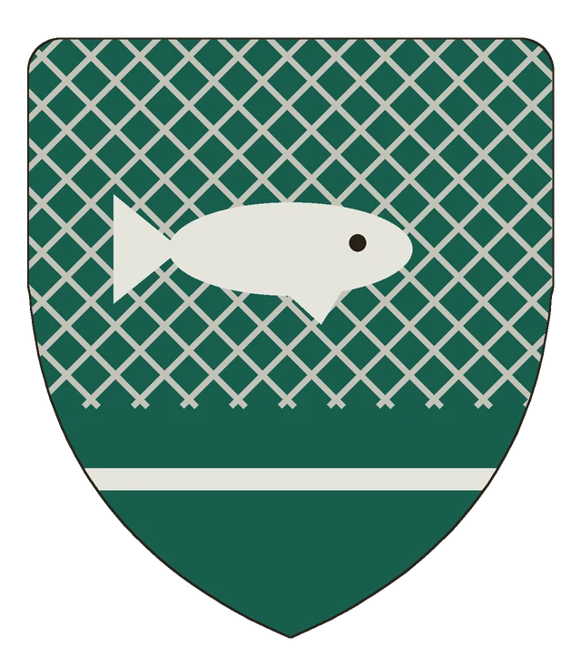
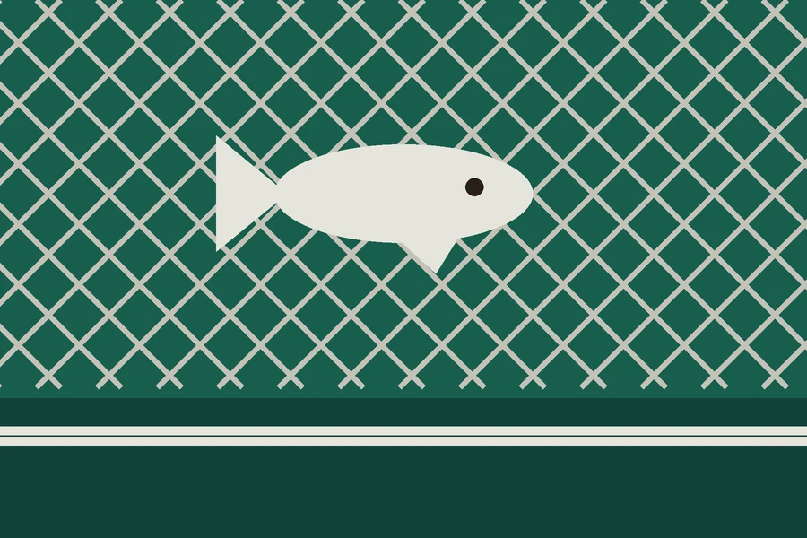

# Imatoma

## Základní Přehled

## Popis
Imatoma je „země lovců ryb“ a nepodléhá koruně. Po staletí na ni útočily armády, ale nezemřel jediný rybář a nevrátil se jediný nepřítel; všichni skončili v sítích na dně oceánu. Kdo nemá zlý úmysl, tomu Imatoma neublíží.

## Geografie
> **Stav:** návrh

## Politika a vztah k Ordenu
> **Stav:** návrh

## Víra a kultura
> **Stav:** návrh

## Významná místa
> **Stav:** návrh

## Háčky pro dobrodružství
> **Stav:** návrh

## Heraldika

> **Stav:** návrh

{.heraldika-img .heraldika-znak} {.heraldika-img .heraldika-vlajka}

**Znak:** V mořskozeleném štítu stříbrná rybářská síť, nad ní stříbrná ryba; v patě tři stříbrné vlny.

**Vlajka:** Mořskozelená vlajka prostředena stříbrnou rybářskou sítí, uprostřed stříbrná ryba, při dolním okraji stříbrné vlny.

**Proč:** „Země lovců ryb“ – síť, v níž končí nepřátelé na dně oceánu.

## Pro DM (tajné)

## Související
- [Khärghae Zia](Kralovstvi_Kharghae_Zia.md)
- [Knärghae Zia](Drzava_Knarghae_Zia.md)
- [Analýza mapy](../11_Mapy/Analyza_mapy.md)
