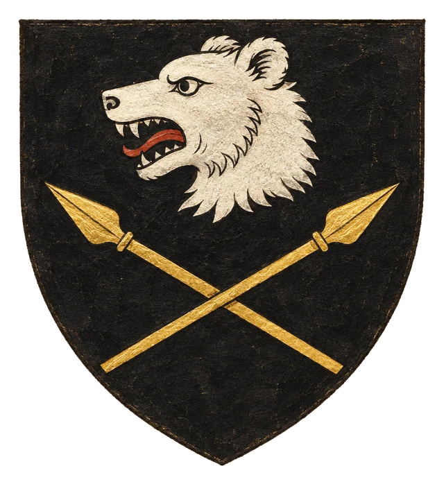
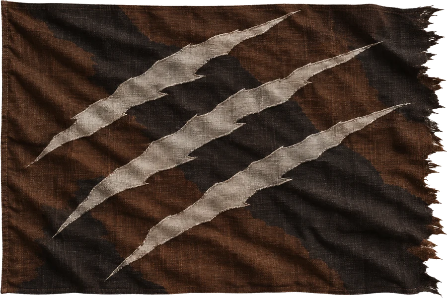

# Khaeraz

## Základní Přehled
- **Hlavní město:** Kaer
- **Hlava státu:** Náčelník Oltar
- **Podřízenost:** Briria (pod dohledem Ordenu)

## Popis
Drsná příhraniční oblast plná lovců a bojovníků. Náčelník Oltar se snaží udržet nezávislost svých kmenů pod neustálým tlakem ordenských posádek.

## Heraldika

> **Stav:** kánon

{.heraldika-img .heraldika-znak} {.heraldika-img .heraldika-vlajka}

**Znak:** V černém štítu stříbrná medvědí hlava nad dvěma zkříženými zlatými oštěpy.

**Vlajka:** Hnědočerná vlajka s nepravidelným okrajem, tři stříbrné šrámy po drápech.

**Proč:** Lovci a bojovníci, Medvědí síň náčelníka Oltara, kmeny vzdorující tlaku Ordenu.

## Související
- Hlavní město: [Město Kaer](../03_Mesta/Mesto_Kaer.md)
- Hlava státu: [Náčelník Oltar](../04_Postavy/Vladci/Postava_Oltar.md)
- Frakce: [Ordenský řád](../05_Frakce/Ordensky_Rad.md)
