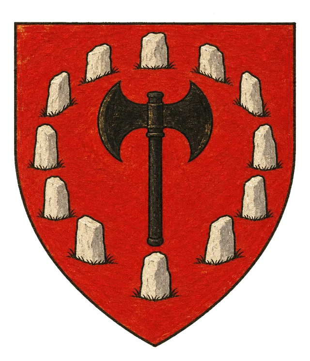
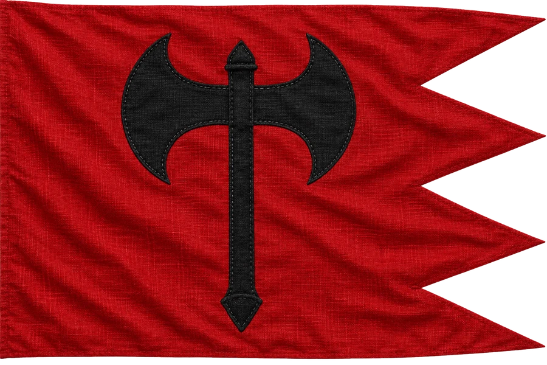

# Klanové Země Mönohen

## Základní Přehled
- **Hlavní město:** Yotter
- **Hlava státu:** Aettar Szkunzi (Polobr)
- **Podřízenost:** Briria (pod dohledem Ordenu)

## Popis
Drsná krajina obývaná kmeny polobrů a urostlých válečníků. Aettar Szkunzi udržuje křehké příměří s Bririí, ale ordenské výběrčí daní vítá s otevřenou sekyrou.

## Východní hvozd
V Mönohenu leží [Východní hvozd](../01_Svet/Mista/Vychodni_hvozd.md), který stvořil Tirent.

## Heraldika

> **Stav:** návrh

{.heraldika-img .heraldika-znak} {.heraldika-img .heraldika-vlajka}

**Znak:** V červeném štítu černá oboustranná sekera uvnitř stříbrného kamenného kruhu.

**Vlajka:** Červená vlajka s černou sekerou a třemi cípy na vlající straně.

**Proč:** Kruh náčelníků (kamenná aréna) a sekera, se kterou vítají ordenské výběrčí.

## Související
- Hlavní město: [Město Yotter](../03_Mesta/Mesto_Yotter.md)
- Hlava státu: [Aettar Szkunzi](../04_Postavy/Vladci/Postava_Szkunzi.md)
- Frakce: [Ordenský řád](../05_Frakce/Ordensky_Rad.md)
