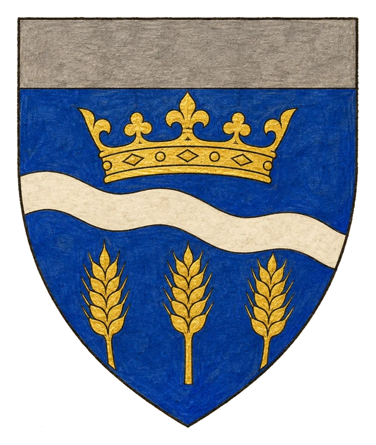
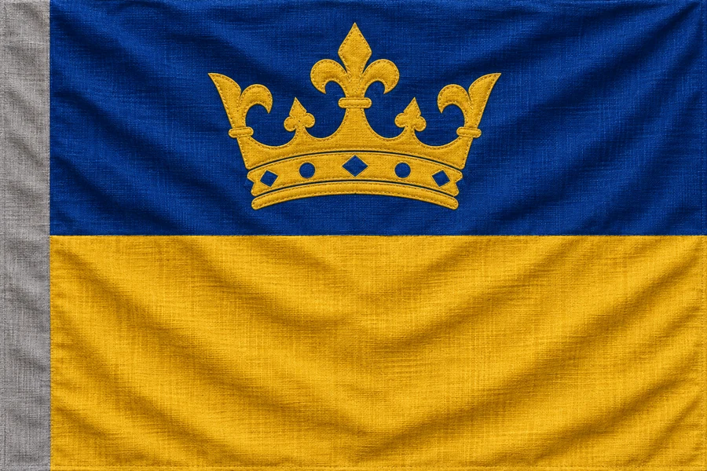

# Království Briria

## Základní Přehled
- **Hlavní město:** Octowerin
- **Hlava státu:** Král Forpa VII. (Člověk)
- **Podřízenost:** Pod přímým spravedlivým dohledem Ordenského řádu

## Geografie a Obyvatelstvo
Briria představuje geografické i politické srdce lidských území v Montelienu. Krajina je tvořena úrodnými nížinami, protkanými obchodními cestami a říčními tepnami. Populaci tvoří převážně lidé, avšak ve větších městech žijí smíšené komunity.

## Politická Situace a Vliv Ordenu
Král Forpa VII. je sice oficiálním panovníkem, jeho moc je však pouze iluzorní. Od Urkalského sněmu drží skutečnou kontrolu nad královstvím Ordenský řád. Veškeré legislativní i vojenské kroky podléhají schválení ordenských inkvizitorů. Ačkoliv byla vymýcena běžná kriminalita a ukončeny občanské války, v Octowerinu a dalších městech sílí podzemní odboj.

## Heraldika

> **Stav:** návrh

{.heraldika-img .heraldika-znak} {.heraldika-img .heraldika-vlajka}

**Znak:** V modrém štítu zlatá královská koruna nad stříbrným vlnitým kosmým břevnem (říční tepny), v patě tři zlaté klasy; šedá hlava štítu jako znamení ordenského dohledu.

**Vlajka:** Vodorovně modrá a zlatá, uprostřed zlatá koruna; u žerdi úzký šedý svislý pruh.

**Proč:** Lidské srdce Montelienu: koruna, úrodné nížiny a řeky. Šedá hlava štítu byla přidána po Urkalském sněmu jako znamení, že skutečnou moc drží Orden.

## Související
- Hlavní město: [Město Octowerin](../03_Mesta/Mesto_Octowerin.md)
- Hlava státu: [Král Forpa VII.](../04_Postavy/Vladci/Postava_Forpa_VII.md)
- Frakce: [Ordenský řád](../05_Frakce/Ordensky_Rad.md)
