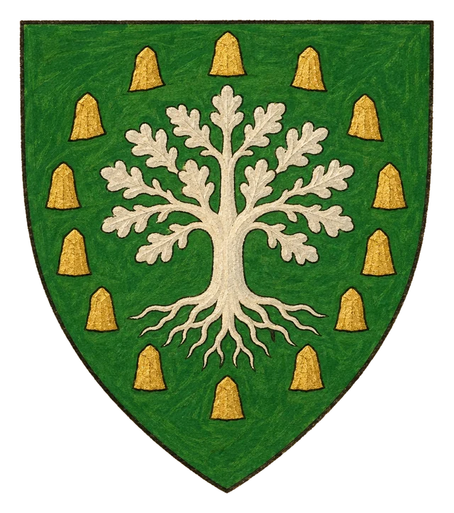
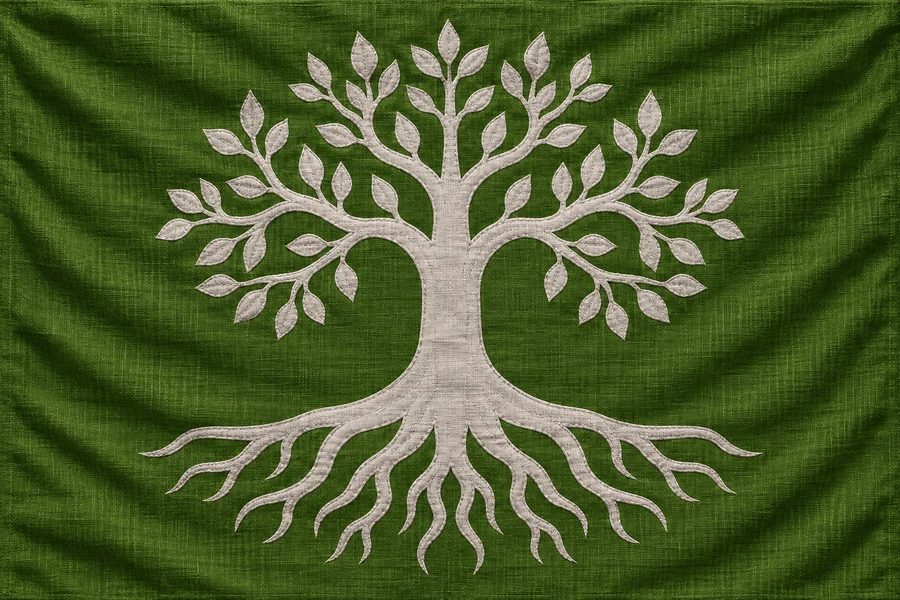

# Království Imonir

## Základní Přehled
- **Hlavní město:** Imonir
- **Hlava státu:** Král Istuvion (Firbolg)
- **Podřízenost:** Nezávislé

## Popis
Lesní království firbolgů a přírodních bytostí. Pod vedením krále Istuviona žije v plném splynutí s přírodou a hvozdem.
Imoniru náleží celý hlavní ostrov severně od Nölienu, na němž leží území u démona, i okolní malé ostrovy v severním moři západně od sopečné oblasti.

## Heraldika

> **Stav:** kánon

{.heraldika-img .heraldika-znak} {.heraldika-img .heraldika-vlajka}

**Znak:** V zeleném štítu stříbrný strom s kořeny v kruhu zlatých kamenů.

**Vlajka:** Zelená vlajka se stříbrným stromem s kořeny.

**Proč:** Královský strom krále Istuviona a kruhy druidů.

## Související
- Hlavní město: [Město Imonir](../03_Mesta/Mesto_Imonir.md)
- Hlava státu: [Král Istuvion](../04_Postavy/Vladci/Postava_Istuvion.md)
