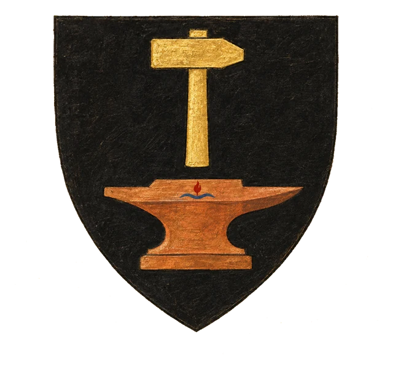
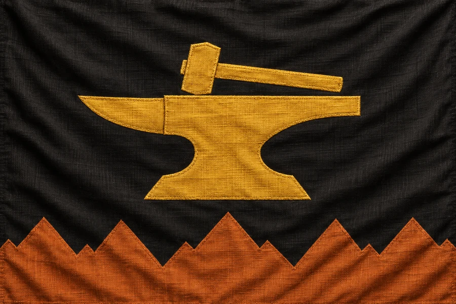

# Knížectví Khärghae Zia

## Základní Přehled
- **Hlavní město:** Wortmir
- **Hlava státu:** Vévoda Wort XXIV. (Trpaslík)
- **Podřízenost:** Briria (pod dohledem Ordenu)

## Popis
Jižní država trpaslíků známá svými hlubokými doly a zpracováním kovů. Ačkoliv spadá pod Bririi, podzemní cechy udržují starou tradici uctívání Irtis "Ohnivé" daleko od zraků ordenských inkvizitorů.

## Historie
Khärghae a Knärghae byly původně sesterská města jedné země – **Zia** (také **Zhia**, obě podoby jsou správné). Dnes je země rozdělená a polovinu **Knärghae Zia** ovládají temné síly: chodící mrtví a démoni.

## Heraldika

> **Stav:** návrh

{.heraldika-img .heraldika-znak} {.heraldika-img .heraldika-vlajka}

**Znak:** V černém štítu zlaté kladivo nad měděnou kovadlinou; v kovadlině skrytý malý červený plamen nad vlnou.

**Vlajka:** Černá vlajka s měděným geometrickým trpasličím vzorem hor a zlatou kovadlinou.

**Proč:** Doly a kovářství trpaslíků. Skrytý plamen nad vlnou je symbol Irtis „Ohnivé“, kterou tu tajně uctívají podzemní cechy.

## Související
- Hlavní město: [Město Wortmir](../03_Mesta/Mesto_Wortmir.md)
- Hlava státu: [Vévoda Wort XXIV.](../04_Postavy/Vladci/Postava_Wort_XXIV.md)
- Frakce: [Ordenský řád](../05_Frakce/Ordensky_Rad.md)
- [Stráž Wortmiru](../05_Frakce/Straz_Wortmiru.md)

## Obchody hlavního města
- [Prohlédnout katalog obchodů v Khärghae Zia](../obchody/?zeme=Knížectví%20Khärghae%20Zia)
- [Brannokova výheň](../12_Obchody/Obchod_Brannokova_vyhen.md)
- [Orrmakova zbrojnice](../12_Obchody/Obchod_Orrmakova_zbrojnice.md)
- [Kladivo a výheň](../12_Obchody/Obchod_Kladivo_a_vyhen.md)
- [Arkánum Al Benar](../12_Obchody/Obchod_Arkanum_Al_Benar.md)
- [Runová dílna](../12_Obchody/Obchod_Runova_dilna.md)
- [Bharrinův sklad](../12_Obchody/Obchod_Bharrinuv_sklad.md)
- [Léčivna a alchymie v Hlubinách](../12_Obchody/Obchod_Lecivna_Hlubiny.md)
- Frakce: [Stráž Wortmiru](../05_Frakce/Straz_Wortmiru.md)
