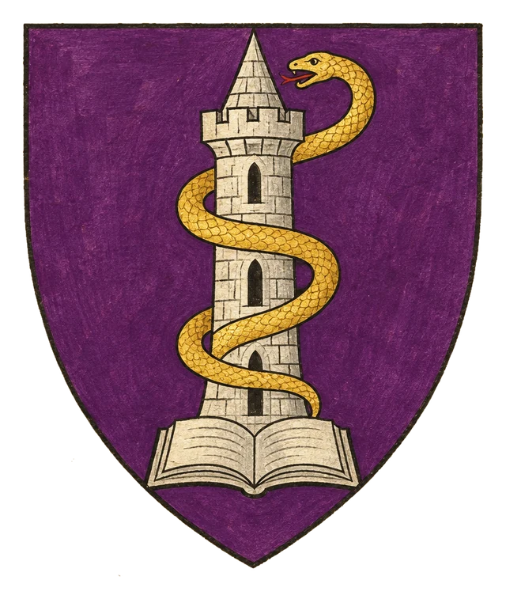
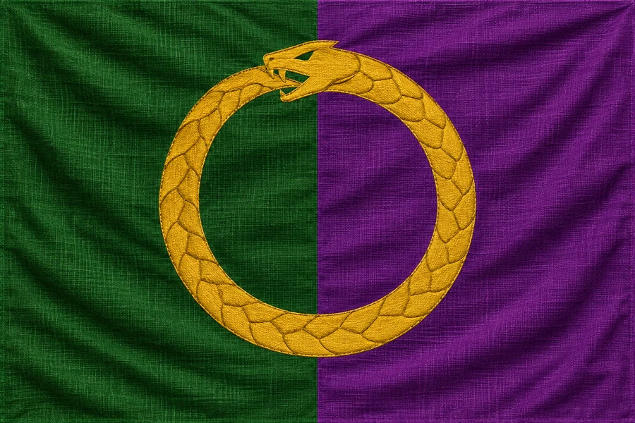

# Provincie Nöet

## Základní Přehled
- **Hlavní město:** Mictima
- **Hlava státu:** Arcimág Breffan (Yuan-ti)
- **Podřízenost:** Briria (pod dohledem Ordenu)

## Charakteristika a Magie
Nöet je země opředená tajemstvím a arcánními vědami. Spravuje ji chladnokrevný Yuan-ti arcimág Breffan. Na rozdíl od zbytku lidských držav má Nöet značnou autonomii výměnou za magické služby a výzkum pro potřeby vyšších elit.

## Vztah k Ordenu
Ordenský řád zde udržuje vojenské i duchovní posádky, avšak vůči Breffanovým magickým experimentům zavírá oči, dokud neohrožují doktrínu Pořádku. V Mictimě kolují zakázané svazky.

## Heraldika

> **Stav:** návrh

{.heraldika-img .heraldika-znak} {.heraldika-img .heraldika-vlajka}

**Znak:** V purpurovém štítu stříbrná věž obtočená zlatým hadem, v patě otevřená stříbrná kniha.

**Vlajka:** Svisle zelená a purpurová, přes střed zlatý had stočený do kruhu.

**Proč:** Breffanovy magické věže a hadí knihovny yuan-ti, zelená za džungle Nöetu.

## Související
- Hlavní město: [Město Mictima](../03_Mesta/Mesto_Mictima.md)
- Hlava státu: [Arcimág Breffan](../04_Postavy/Vladci/Postava_Breffan.md)
- Frakce: [Ordenský řád](../05_Frakce/Ordensky_Rad.md)
