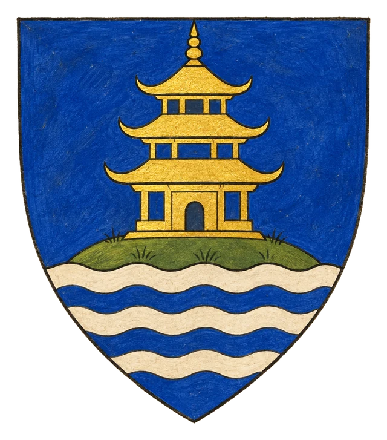
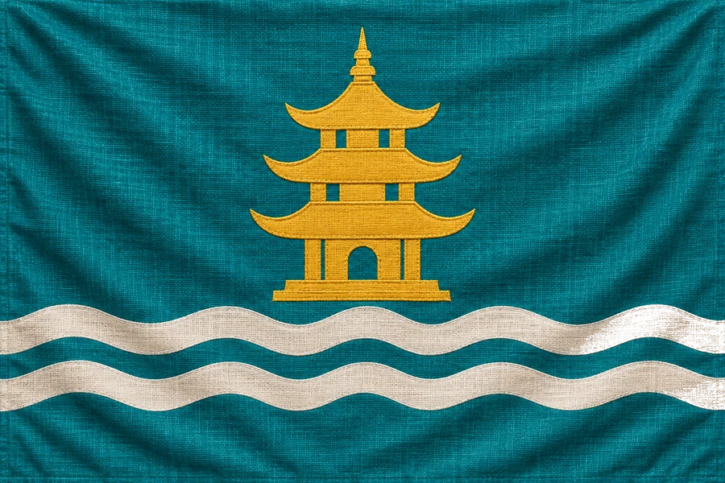

# Svobodné Jižní Ostrovy

## Základní Přehled
- **Poloha (DM):** ostrovy jižně od Laertmundu ([mapa](../11_Mapy/Geografie.md))
- **Hlavní město:** Menkant
- **Hlava státu:** Královna Yuthika (Tiefling)
- **Podřízenost:** Pod skrytým vlivem Ordenu

## Souostroví
Exotické souostroví námořníků a obchodníků. Královna Yuthika udržuje zdání svobody, avšak v přístavech již působí tajní ordenští agenti.

## Heraldika

> **Stav:** návrh

{.heraldika-img .heraldika-znak} {.heraldika-img .heraldika-vlajka}

**Znak:** V modrém štítu zlatá pagoda na ostrově nad stříbrnými vlnami.

**Vlajka:** Tyrkysová vlajka se třemi bílými vlnami dole a zlatou pagodou.

**Proč:** Souostroví námořníků a obchodníků, Pagodový ostrov u Menkantu.

## Související
- Hlavní město: [Město Menkant](../03_Mesta/Mesto_Menkant.md)
- Hlava státu: [Královna Yuthika](../04_Postavy/Vladci/Postava_Yuthika.md)
- Frakce: [Ordenský řád](../05_Frakce/Ordensky_Rad.md)
- Frakce: [Piráti z Opilé fretky](../05_Frakce/Pirati_z_Opile_fretky.md)
