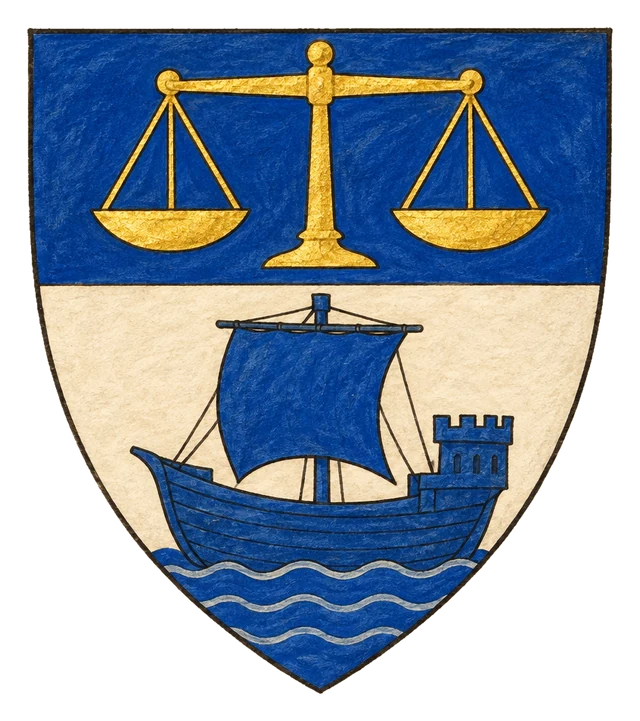
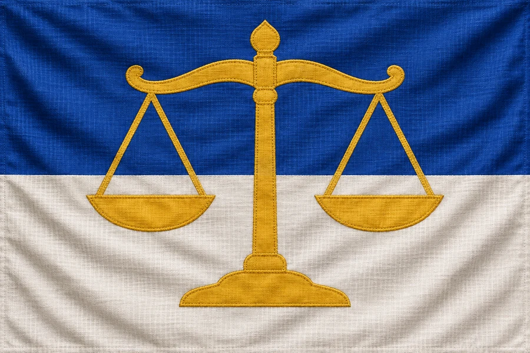

# Svobodné Město Miria

## Základní Přehled
- **Hlavní město:** Miria
- **Hlava státu:** Konzul Timopeus
- **Podřízenost:** Nezávislé

## Obchodní Metropole
Miria je křižovatkou obchodu a intrik. Konzul Timopeus obratně balancuje mezi nezávislostí a úplatky ordenským vyslancům.

## Heraldika

> **Stav:** návrh

{.heraldika-img .heraldika-znak} {.heraldika-img .heraldika-vlajka}

**Znak:** Štít dělený modro-stříbrně, nahoře zlaté váhy, dole modrá loď.

**Vlajka:** Vodorovně modrá a bílá, zlaté váhy uprostřed.

**Proč:** Obchodní metropole a velký přístav. Váhy jsou spravedlnost obchodu, ale i úplatky.

## Související
- Hlavní město: [Město Miria](../03_Mesta/Mesto_Miria.md)
- Hlava státu: [Konzul Timopeus](../04_Postavy/Vladci/Postava_Timopeus.md)
