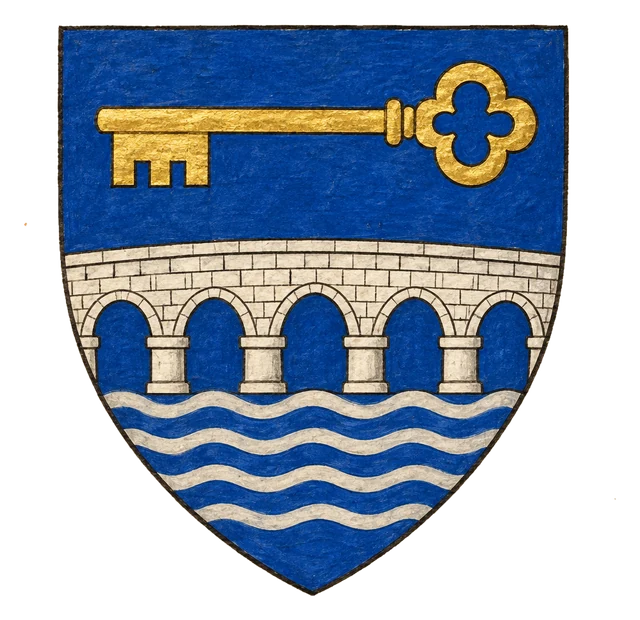
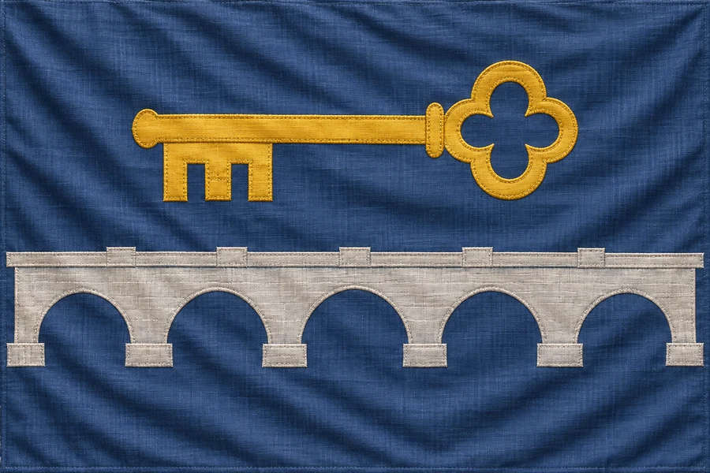

# Svobodné Město Werenor

## Základní Přehled
- **Hlavní město:** Werenor
- **Hlava státu:** Primas Pertham
- **Podřízenost:** Nezávislé
- **Poloha (DM):** v Bririi na západním břehu jezera Amir, u mostu do [Kop Aramu](../03_Mesta/Mesto_Kop_Aram.md)

## Popis
Město postavené v blízkosti staré zkázy a ruin. Primas Pertham stráží stará tajemství a dohlíží na zákaz vstupu do prokletého Dräaru. Samotnému Werenoru kletba z Dräaru nehrozí (upřesnění DM).

## Heraldika

> **Stav:** kánon

{.heraldika-img .heraldika-znak} {.heraldika-img .heraldika-vlajka}

**Znak:** V modrém štítu dlouhý stříbrný most o mnoha obloucích, nad ním zlatý klíč.

**Vlajka:** Šedomodrá vlajka se stříbrným mostem a zlatým klíčem.

**Proč:** Super dlouhý most do Kop Aramu. Klíč je primasovo povolení ke vstupu do Dräaru, které většinou odmítne.

## Související
- Hlavní město: [Město Werenor](../03_Mesta/Mesto_Werenor.md)
- Hlava státu: [Primas Pertham](../04_Postavy/Vladci/Postava_Pertham.md)
