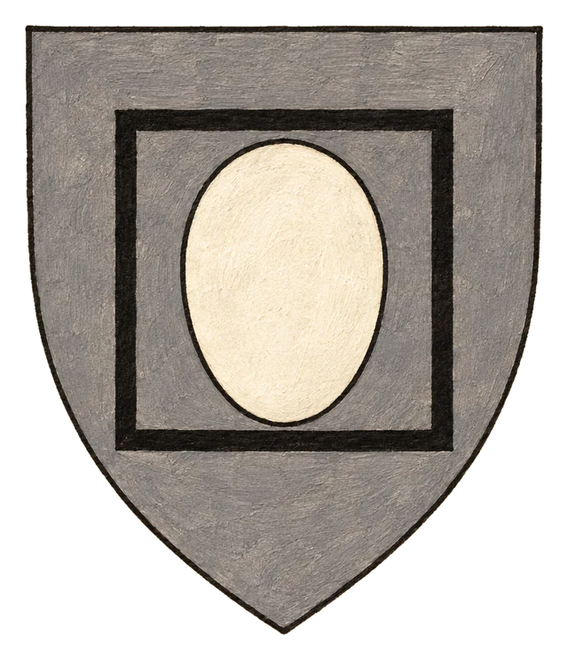
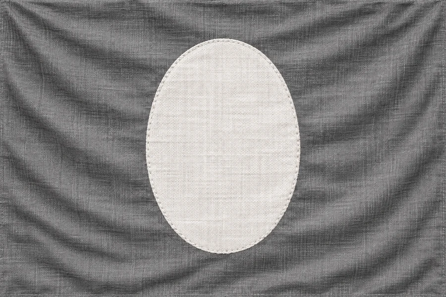

# Teokracie Orden

## Základní Přehled
- **Hlavní město:** Pevnost Orden
- **Hlava státu:** Otec Samuel (Hexblood)
- **Podřízenost:** Nezávislá teokracie vládne všem podrobeným státům

## Popis
Centrum Ordenského řádu. Nedobytná pevnost, odkud Otec Samuel a jeho inkvizitoři spravují celý známý svět a vymáhají "Ordenský řád věcí".

## Heraldika

> **Stav:** kánon

{.heraldika-img .heraldika-znak} {.heraldika-img .heraldika-vlajka}

**Znak:** Šedý štít, uprostřed bílá bezvýrazná tvář (ovál bez rysů) vepsaná do černého čtverce.

**Vlajka:** Jednolitě šedá vlajka s bílým prázdným oválem uprostřed.

**Proč:** Šedé kutny a bezvýrazné tváře Řádu. Čtverec znamená Ordenský řád věcí a Kodex. Záměrně strohé a mrazivé.

## Související
- Na mapě: pevnost na východním břehu **Ordenské zátoky** ([Geografie](../11_Mapy/Geografie.md))
- Hlavní město: [Město Orden (Pevnost)](../03_Mesta/Pevnost_Orden.md)
- Hlava státu: [Otec Samuel (Hlava Ordenu)](../04_Postavy/Vladci/Postava_Otec_Samuel.md)
- Frakce: [Ordenský řád](../05_Frakce/Ordensky_Rad.md)
