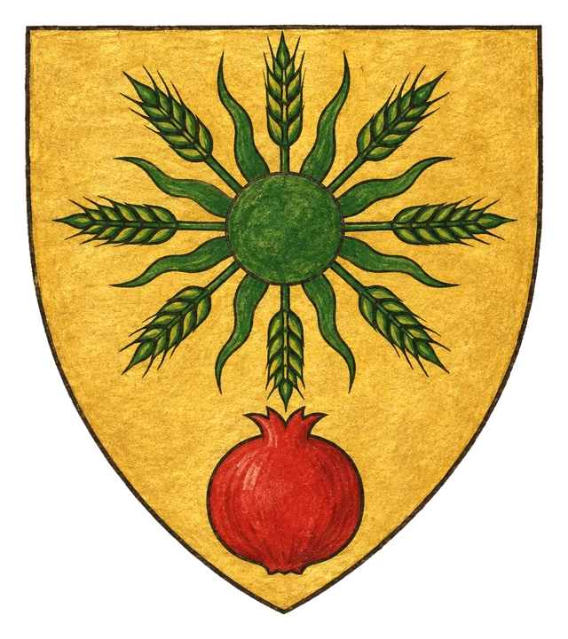
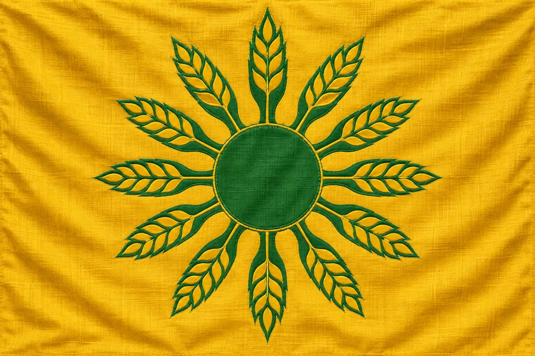

# Země Zairam

## Základní Přehled
- **Hlavní město:** Pertam
- **Hlava státu:** Kněžka Mi-Komde (Satyr)
- **Podřízenost:** Briria (formálně, bez přímého vlivu Ordenu)

## Příroda a Víra
Zairam je požehnaný kraj plný bujné vegetace a bohaté úrody. Je považován za dědictví patronky Zairy. Satyrská kněžka Mi-Komde uplatňuje vládu harmonie s přírodou a Ordenský řád se sem zatím neodvažuje plně vstoupit.

## Heraldika

> **Stav:** návrh

{.heraldika-img .heraldika-znak} {.heraldika-img .heraldika-vlajka}

**Znak:** Ve zlatém štítu zelené slunce, jehož paprsky tvoří obilné klasy; v patě červené granátové jablko.

**Vlajka:** Zlatá vlajka se zeleným sluncem z klasů.

**Proč:** Zaiřin sluneční klas, bujná úroda a Zahrady Zairy.

## Související
- Sousedé (mapa): [Tali](../01_Svet/Mista/Tali.md) za roklí na západě
- Hlavní město: [Město Pertam](../03_Mesta/Mesto_Pertam.md)
- Hlava státu: [Kněžka Mi-Komde](../04_Postavy/Vladci/Postava_Mi_Komde.md)
- Frakce: [Ordenský řád](../05_Frakce/Ordensky_Rad.md)
- Frakce: [Piráti ze Zairamu](../05_Frakce/Pirati_ze_Zairamu.md)
