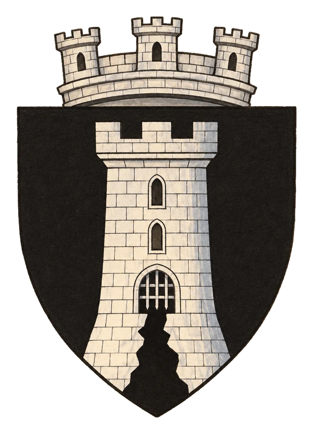

# Město Dar Kemmar

> **Stav:** původní věta = kánon, ostatní návrh

## Detailní Popis
Uzavřené horské pevnostní město v Knärghae Zia.

- **Velikost:** Uzavřené horské pevnostní město v Knärghae Zia, počet obyvatel neznámý

## Čtvrti a významná místa
- **Zavřené brány** – cizincům je vstup přísně zakázán.
- **Propast** (na mapě) – obří trhlina na hranici mrtvé Knärghae.
- **Vysoká věž** (na mapě) – viditelná na desítky kilometrů.

## Služby
- Žádné služby pro cizince.

## Pověsti a háčky
- Za hradbami nikdo nesvítí – a přece se tam pohybují stíny.
- Ti, kdo se pokusili přelézt hradby, se vrátili o měsíc později, mrtví a chodící.

## Významné NPC (návrh)
- Neznámí vládci – nemrtví a démoni (kánon)
- Poslední živý strážce brány (návrh)

## Setkání a scény (návrh)
- Pokus přelézt hradby – [Wight](#srd-bestiar-Wight), [Shadow](#srd-bestiar-Shadow), [Vrock](#srd-bestiar-Vrock).
- Hlas z druhé strany brány prosí o pomoc.

## Pro DM (tajné)
- Viz [Dvě sestry Zhie](../06_Knihy_a_Dokumenty/Kniha_09_Dve_sestry_Zhie.md). **Kánon:** Knärghae Zia ovládají chodící mrtví a démoni – „neznámí vládci“ za zavřenými branami jsou právě oni. (Návrh: propast je místo, odkud vyšli.)

## Heraldika

> **Stav:** návrh

{.heraldika-img .heraldika-znak}

**Znak:** Vysoká stříbrná věž se zavřenou branou nad rozsedlinou.

## Související
- Země: [Nezávislá Država Knärghae Zia](../02_Zeme/Drzava_Knarghae_Zia.md)
