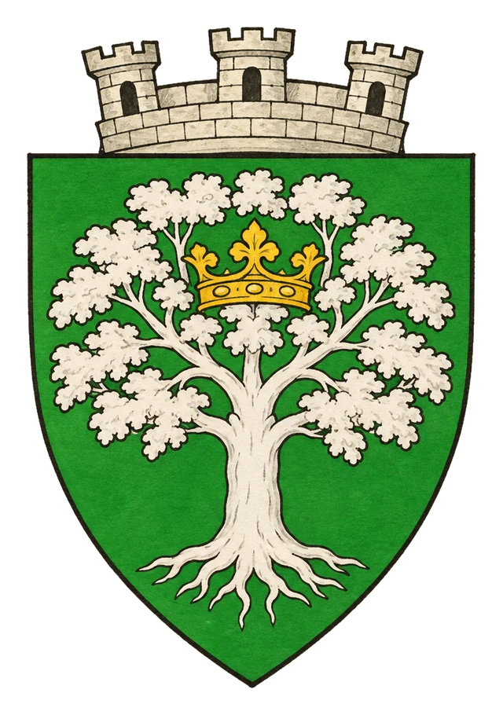

# Město Imonir

> **Stav:** původní věta = kánon, ostatní návrh

## Detailní Popis
Lesní město v království Imonir, sídlo krále Istuviona.

- **Velikost:** Lesní město firbolgů a přírodních bytostí, ~6 000 obyvatel

## Čtvrti a významná místa
- **Královský strom** – sídlo krále Istuviona.
- **Kruhy druidů**.
- **Pastviny divokých tvorů**.

## Služby
- Výměnný obchod, žádné peníze.

## Pověsti a háčky
- Kdo v Imoniru zabije zvíře bez prosby, zmizí.

## Významné NPC (návrh)
- Král Istuvion
- Druidka Neva
- Otrávený jelen – strážce pramene

## Setkání a scény (návrh)
- Šílená zvířata na stezkách.
- Hledání otrávce pramenů.

## Pro DM (tajné)
- Návrh: Imonir je jediné místo, kam Orden nemá přístup, protože o něm neví.

## Heraldika

> **Stav:** návrh

{.heraldika-img .heraldika-znak}

**Znak:** Velký stříbrný strom se zlatou korunou ve větvích.

## Související
- Země: [Království Imonir](../02_Zeme/Kralovstvi_Imonir.md)
- Vládce: [Král Istuvion](../04_Postavy/Vladci/Postava_Istuvion.md)
