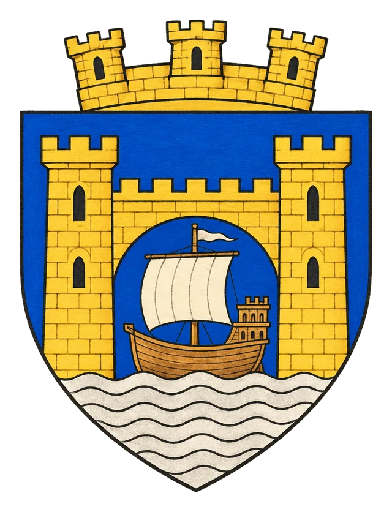

# Město Menkant

> **Stav:** původní věta = kánon, ostatní návrh

## Detailní Popis
Hlavní přístavní město Svobodných jižních ostrovů pod vládou královny Yuthiky.

- **Velikost:** Hlavní přístav Svobodných jižních ostrovů, ~25 000 obyvatel

## Čtvrti a významná místa
- **Královský přístav** – sídlo královny Yuthiky.
- **Pagodový ostrov** (na mapě) – chrám a pevnost.
- **Pašerácké zátoky**.

## Služby
- Krčma *Zlatá kotva*.

## Pověsti a háčky
- V přístavech působí tajní ordenští agenti.

## Významné NPC (návrh)
- Královna Yuthika
- První důstojník Rael (ordenský agent)
- Pašerák Jo Tři-prsty

## Setkání a scény (návrh)
- Ordenská loď v přístavu – kdo ji pozval?
- Souboj na palubě s piráty.

## Pro DM (tajné)
- Viz [Lodní deník z Menkantu](../06_Knihy_a_Dokumenty/Kniha_17_Lodni_denik_z_Menkantu.md).

## Heraldika

> **Stav:** návrh

{.heraldika-img .heraldika-znak}

**Znak:** Zlatá přístavní brána, jí proplouvá stříbrná loď.

## Související
- Země: [Svobodné Jižní Ostrovy](../02_Zeme/Svobodne_Jizni_Ostrovy.md)
- Vládce: [Královna Yuthika](../04_Postavy/Vladci/Postava_Yuthika.md)
- Frakce: [Piráti z Opilé fretky](../05_Frakce/Pirati_z_Opile_fretky.md)
