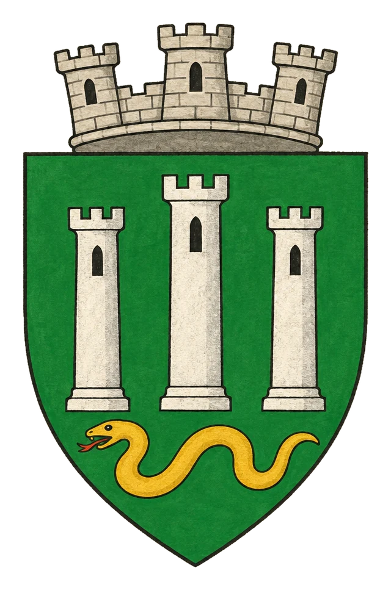

# Město Mictima

> **Stav:** původní věta = kánon, ostatní návrh

## Detailní Popis
Hlavní město Nöetu, sídlo arcimága Breffana plné magických věží a knihoven.

- **Velikost:** Město magických věží a knihoven v džunglích Nöetu, ~25 000 obyvatel

## Čtvrti a významná místa
- **Breffanova věž** – nejvyšší věž, laboratoře transmutace.
- **Hadí knihovny** – soukromé knihovny yuan-ti, kde kolují zakázané svazky.
- **Ordenská posádka** – kasárna u brány, mniši s rozkazem nevidět.
- **Džunglový trh** – exotické byliny a komponenty kouzel.

## Služby
- Obchod *Šupina a svitek* – komponenty kouzel i pašované knihy.

## Pověsti a háčky
- V Breffanových sklepích mizí otroci a vracejí se jako zvířata.
- Zakázané svazky tu kolují z ruky do ruky – černý trh s knihami kvete.

## Významné NPC (návrh)
- Arcimág Breffan
- Lékařka Vesna – pašuje zakázané svazky pro hadí knihovny
- Hadí stráž Breffanovy věže

## Setkání a scény (návrh)
- Noční ulice, kde chodí mrtví ([Zombie](#srd-bestiar-Zombie), [Ghoul](#srd-bestiar-Ghoul)).
- Aukce zakázaných svazků v podzemí.

## Pro DM (tajné)
- Návrh: Breffan tajně studuje ferienské runy, aby se vymanil z dohody s Ordenem.

## Heraldika

> **Stav:** kánon

{.heraldika-img .heraldika-znak}

**Znak:** Tři stříbrné věže (prostřední nejvyšší), dole zlatý had.

## Související
- Země: [Provincie Nöet](../02_Zeme/Provincie_Noet.md)
- Vládce: [Arcimág Breffan](../04_Postavy/Vladci/Postava_Breffan.md)
