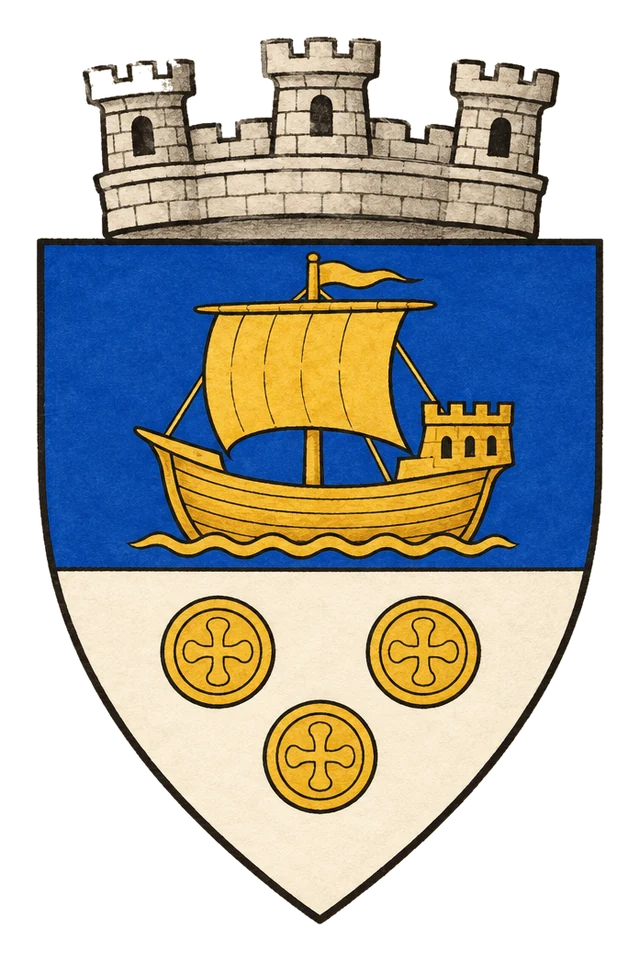

# Město Miria

> **Stav:** původní věta = kánon, ostatní návrh

## Detailní Popis
Svobodná obchodní metropole pod vládou konzula Timopea.

- **Velikost:** Svobodná obchodní metropole, ~50 000 obyvatel

## Čtvrti a významná místa
- **Velký přístav** – brána obchodu mezi pevninou a Jižními ostrovy.
- **Konzulský palác** – sídlo konzula Timopea.
- **Ulice úplatků** – tam, kde bydlí ordenští vyslanci.

## Služby
- Burza, banky, směnárny, cechovní domy.

## Pověsti a háčky
- V Mirii se dá koupit cokoliv – i propustka do Dräaru.

## Významné NPC (návrh)
- Konzul Timopeus
- Kapitánka Dera – přístavní stráž
- Zloděj lodí „Mlha“

## Setkání a scény (návrh)
- Noční vyšetřování v přístavu.
- Obchodní jednání, kde každý lže.

## Pro DM (tajné)
- Návrh: Timopeus hraje na obě strany a vede tajný seznam ordenských agentů.

## Heraldika

> **Stav:** návrh

{.heraldika-img .heraldika-znak}

**Znak:** Zlatá loď a tři mince.

## Související
- Země: [Svobodné Město Miria](../02_Zeme/Svobodne_Mesto_Miria.md)
- Vládce: [Konzul Timopeus](../04_Postavy/Vladci/Postava_Timopeus.md)
