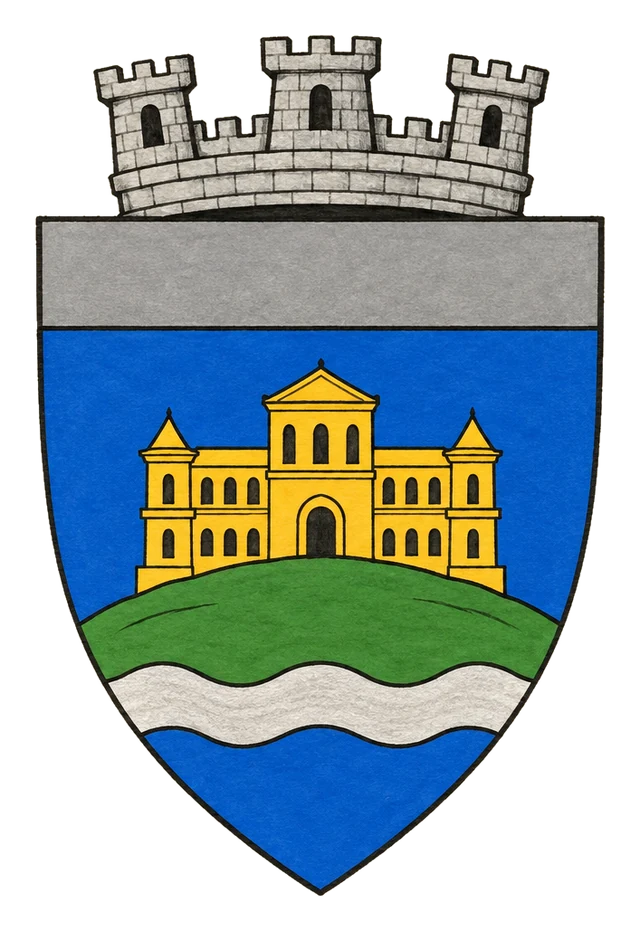

# Město Octowerin

> **Stav:** původní věta = kánon, ostatní návrh

## Detailní Popis
Královské město Bririe, sídlo krále Forpy VII. a centrum ordenské inkvizice.

- **Velikost:** Velké královské město na řece, ~60 000 obyvatel

## Čtvrti a významná místa
- **Královský vrch** – palác krále Forpy VII., dnes střežený šedými mnichy místo královské stráže.
- **Ordenská inkvizice** – bývalá Eligonova katedrála přestavěná na sídlo inkvizitora [Vaelena](../04_Postavy/NPC/Postava_Vaelen.md).
- **Říční přístav a sklady** – srdce obchodu Bririe.
- **Octowerinské podzemí** – staré stoky a katakomby, hnízdo [Odboje Svobodných](../05_Frakce/Odboj_Svobodnych.md) (symbol přeškrtnutého oka).

## Služby
- Krčma *U Slepé lucerny* – místo, kde se dá najít Corvinova spojka.
- Písařská ulice – opisovači pod dohledem cenzorů Ordenu.

## Pověsti a háčky
- V noci mizí lidé, kteří se ptali na Stavitele.
- Pod katedrálou je prý zazděná Eligonova socha, která pláče.

## Významné NPC (návrh)
- Corvin – vůdce odboje (U Slepé lucerny)
- Inkvizitor Vaelen – katedrála
- Bratr Osmund – cenzor Písařské ulice, úplatný
- Mara Rybářka – pašerák v říčním přístavu

## Setkání a scény (návrh)
- Ordenská hlídka kontroluje knihy u brány (DC 14 Deception/Sleight of Hand).
- Pálení knih na náměstí – dav, který stačí jiskra.
- Honička stokami s odbojem v patách.

## Pro DM (tajné)
- Návrh: Vaelen má v odboji informátora; Corvin o tom ví a nechává ho žít, aby mu podstrkoval lži.

## Heraldika

> **Stav:** návrh

{.heraldika-img .heraldika-znak}

**Znak:** Zlatý palác na zeleném vrchu nad stříbrnou řekou, šedá hlava štítu.

## Související
- Země: [Království Briria](../02_Zeme/Kralovstvi_Briria.md)
- Vládce: [Král Forpa VII.](../04_Postavy/Vladci/Postava_Forpa_VII.md)
- Frakce: [Ordenský řád](../05_Frakce/Ordensky_Rad.md), [Odboj Svobodných](../05_Frakce/Odboj_Svobodnych.md)
- NPC: ["Slepý" Corvin](../04_Postavy/NPC/Postava_Corvin.md), [Inkvizitor Vaelen](../04_Postavy/NPC/Postava_Vaelen.md)
