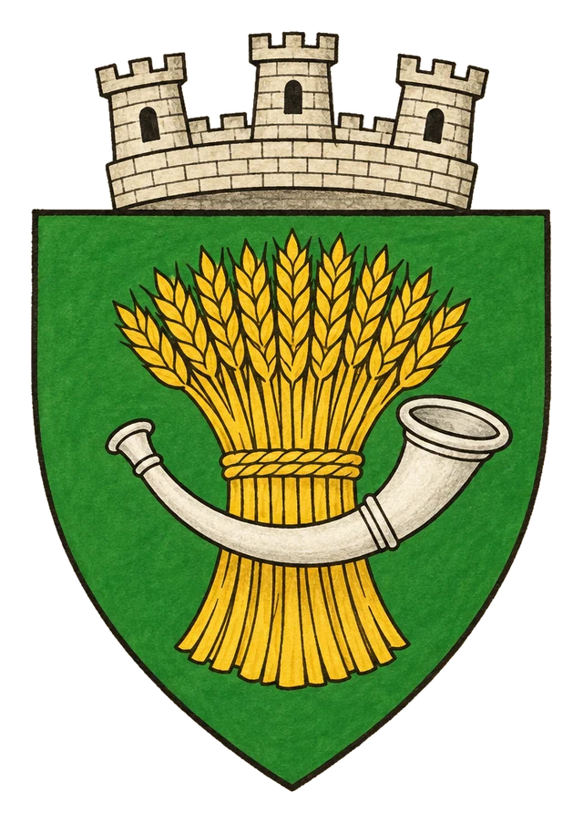

# Město Owappa

> **Stav:** původní věta = kánon, ostatní návrh

## Detailní Popis
Zemědělské a obchodní centrum Laertmundu pod dohledem krále Iridina III.

- **Velikost:** Zemědělské a obchodní centrum Laertmundu, ~20 000 obyvatel

## Čtvrti a významná místa
- **Trh obilí** – největší v zemi.
- **Hraničářská síň** – sídlo stoických hraničářů krále Iridina III.
- **Dvůr krále Iridina** – skromný, bez pompy.

## Služby
- Hostinec *Zlatý snop*.

## Pověsti a háčky
- Král prý v noci sám jezdí po vesnicích a varuje lidi před čistkami.

## Významné NPC (návrh)
- Král Iridin III.
- Výběrčí Malek (Orden)
- Stařešina Hedda – mluví za vesnice

## Setkání a scény (návrh)
- Spor sedláků s výběrčím přerůstá v potyčku.
- Uprchlíci v lese potřebují doprovod.

## Pro DM (tajné)
- Návrh: Iridin III. tajně posílá jídlo odboji.

## Heraldika

> **Stav:** kánon

{.heraldika-img .heraldika-znak}

**Znak:** Zlatý snop obilí a stříbrný lovecký roh.

## Související
- Země: [Království Laertmund](../02_Zeme/Kralovstvi_Laertmund.md)
- Vládce: [Král Iridin III.](../04_Postavy/Vladci/Postava_Iridin_III.md)
