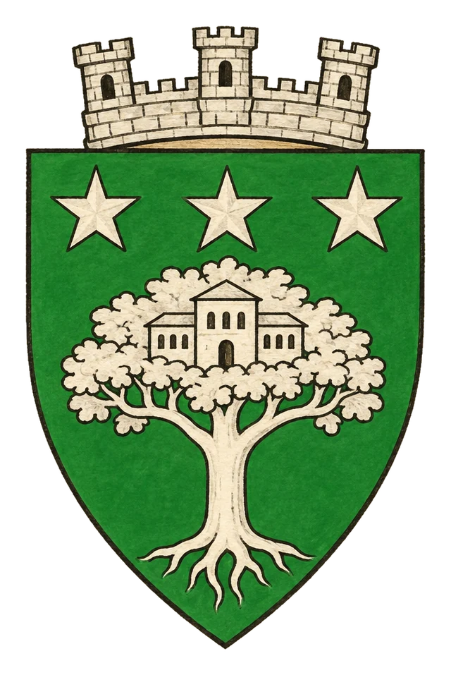

# Město Tel Palentin

> **Stav:** původní věta = kánon, ostatní návrh

## Detailní Popis
Vznešené elfské město v Nölienu, sídlo krále Veanora I.

- **Velikost:** Vznešené elfské město v Nölienu, ~30 000 obyvatel

## Čtvrti a významná místa
- **Královský háj** – palác krále Veanora I. ve stromech.
- **Hranice hvozdu** – chráněné prastarou magií z doby Tirenta.
- **Knihovna listů** – elfské letopisy, viz [Elfské letopisy](../06_Knihy_a_Dokumenty/Kniha_14_Elfske_letopisy.md).

## Služby
- Ordenští vyslanci jsou vráceni na hranici.

## Pověsti a háčky
- Elfové prý pamatují Temný den na vlastní oči.

## Významné NPC (návrh)
- Král Veanor I.
- Strážkyně hranic Ithiel
- Starý písař Tirentovy knihovny

## Setkání a scény (návrh)
- Elfové nevpustí cizince bez důkazu dobrých úmyslů.
- Magie hranic na chvíli selže – do lesa vnikne netvor.

## Pro DM (tajné)
- Návrh: nejstarší elfové opravdu Temný den zažili a znají pravdu o Tirentově zmizení.

## Heraldika

> **Stav:** návrh

{.heraldika-img .heraldika-znak}

**Znak:** Stříbrný strom s palácem v koruně, nahoře tři hvězdy.

## Související
- Země: [Elfský Stát Nölien](../02_Zeme/Elfsky_Stat_Nolien.md)
- Vládce: [Král Veanor I.](../04_Postavy/Vladci/Postava_Veanor_I.md)
