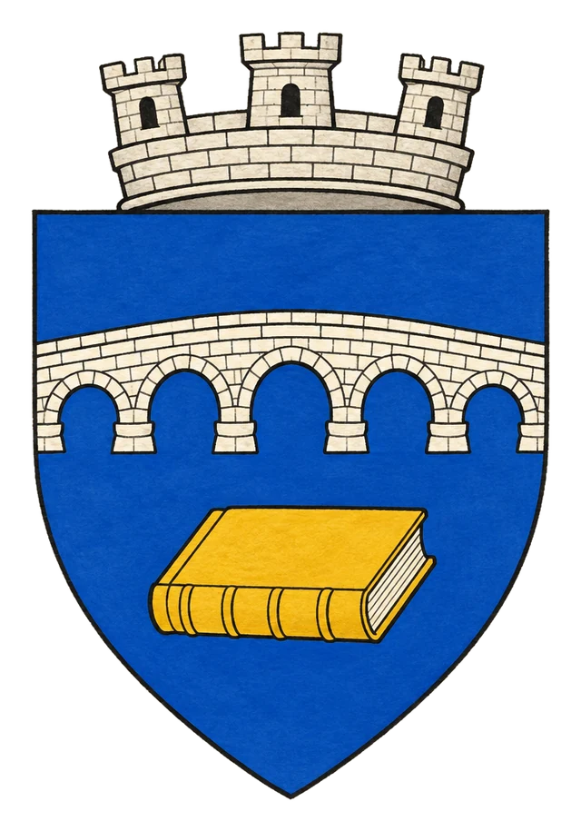

# Město Werenor

> **Stav:** původní věta = kánon, ostatní návrh

## Detailní Popis
Svobodné město ležící u hranic staré zkázy pod správou primase Perthama.

- **Poloha (DM):** v [Bririi](../02_Zeme/Kralovstvi_Briria.md) na západním břehu [jezera Amir](../01_Svet/Mista/Jezero_Amir_a_Kop_Aram.md); odtud vede super dlouhý most do [Kop Aramu](Mesto_Kop_Aram.md)
- **Velikost:** Svobodné město u hranic staré zkázy, ~18 000 obyvatel

## Čtvrti a významná místa
- **Brána k Dräaru** – úřad primase vydává (a hlavně odmítá) povolení ke vstupu do Dräaru.
- **Primasovy archivy** – sbírka svědectví o Temném dni, viz [Kronika Temného dne](../06_Knihy_a_Dokumenty/Kniha_06_Kronika_Temneho_dne.md).
- **Staré ruiny** – zbytky předpádového Werenoru.

## Služby
- Hostinec *Poslední břeh*.

## Pověsti a háčky
- Temný den se dodnes nazývá také „Zkáza Werenoru“.

## Významné NPC (návrh)
- Primas Pertham
- Archivář Lenn
- Šílený námořník z Dräaru

## Setkání a scény (návrh)
- Krádež v archivu – stopy vedou k Ordenu.
- Žádost o povolení vstupu do Dräaru.

## Pro DM (tajné)
- Kletba z Dräaru Werenoru nehrozí (DM). Návrh: Pertham ví proč – a mlčí o tom.

## Heraldika

> **Stav:** návrh

{.heraldika-img .heraldika-znak}

**Znak:** Stříbrný most a pod ním zavřená kniha archivů.

## Související
- Země: [Svobodné Město Werenor](../02_Zeme/Svobodne_Mesto_Werenor.md)
- Vládce: [Primas Pertham](../04_Postavy/Vladci/Postava_Pertham.md)
