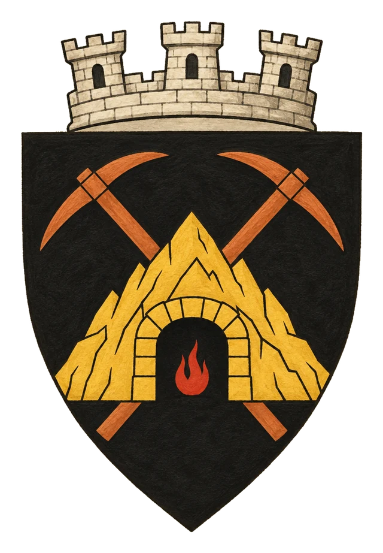

# Město Wortmir

> **Stav:** původní věta = kánon, ostatní návrh

## Detailní Popis
Trpasličí podzemní i povrchové město v Khärghae Zia v čele s vévodou Wortem XXIV.

- **Velikost:** Trpasličí podzemní i povrchové město v Khärghae Zia, ~35 000 obyvatel

## Čtvrti a významná místa
- **Horní město** – kovárny, sklady rudy a ordenská celnice.
- **Hlubiny** – podzemní cechy, doly a tajné svatyně Irtis „Ohnivé“.
- **Vévodský sál** – sídlo vévody Worta XXIV.

## Služby
- Pivnice *Kladivo a výheň*.

## Pověsti a háčky
- Cechy chystají vzpouru, až „Matka vystoupí z Dräaru“.

## Významné NPC (návrh)
- Vévoda Wort XXIV.
- Mistr kovář [Brannok](../04_Postavy/NPC/Wortmir/Postava_Brannok_Thuragh.md) – kuje zbraně pro povstání
- Kněžka Irtis [Sola](../04_Postavy/NPC/Wortmir/Postava_Sola_Eredin.md) (tajná svatyně)
- [Gorrum Orrmak](../04_Postavy/NPC/Wortmir/Postava_Gorrum_Orrmak.md), zbrojíř
- [Torva Kier](../04_Postavy/NPC/Wortmir/Postava_Torva_Kier.md), hostinská
- [Lisvar Mjörgen](../04_Postavy/NPC/Wortmir/Postava_Lisvar_Mjorgen.md), zpěvák
- [Meruth Al Benar](../04_Postavy/NPC/Wortmir/Postava_Meruth_Al_Benar.md), arkanista
- [Jorvak Kettrun](../04_Postavy/NPC/Wortmir/Postava_Jorvak_Kettrun.md), runopisec
- [Eskarn Bharrin](../04_Postavy/NPC/Wortmir/Postava_Eskarn_Bharrin.md), kupec
- [Myrrin Tobel](../04_Postavy/NPC/Wortmir/Postava_Myrrin_Tobel.md), alchymistka
- [Haldrak Wennk](../04_Postavy/NPC/Wortmir/Postava_Haldrak_Wennk.md), průvodce Hlubinami
- [Urvik Stalgar](../04_Postavy/NPC/Wortmir/Postava_Urvik_Stalgar.md), žoldnéř
- [Agnar Wogot](../04_Postavy/NPC/Wortmir/Postava_Agnar_Wogot.md), písař
- Stráž Wortmiru: [Vorek Hald](../04_Postavy/NPC/Straz_Wortmiru/Postava_Vorek_Hald.md), [Ederhan Vossk](../04_Postavy/NPC/Straz_Wortmiru/Postava_Ederhan_Vossk.md) a [Morn](../04_Postavy/NPC/Straz_Wortmiru/Postava_Morn.md)

## Obchody
- [Prohlédnout katalog obchodů ve Wortmiru](../obchody/?mesto=M%C4%9Bsto%20Wortmir)
- [Brannokova výheň](../12_Obchody/Obchod_Brannokova_vyhen.md)
- [Orrmakova zbrojnice](../12_Obchody/Obchod_Orrmakova_zbrojnice.md)
- [Kladivo a výheň](../12_Obchody/Obchod_Kladivo_a_vyhen.md)
- [Arkánum Al Benar](../12_Obchody/Obchod_Arkanum_Al_Benar.md)
- [Runová dílna](../12_Obchody/Obchod_Runova_dilna.md)
- [Bharrinův sklad](../12_Obchody/Obchod_Bharrinuv_sklad.md)
- [Léčivna a alchymie v Hlubinách](../12_Obchody/Obchod_Lecivna_Hlubiny.md)

## Setkání a scény (návrh)
- Sestup do hlubin k tajné svatyni Irtis.
- Ordenský inspektor ve slévárně.

## Pro DM (tajné)
- Návrh: vévoda kuje zbraně pro nějakou armádu – Orden si myslí, že pro něj.

## Heraldika

> **Stav:** kánon

{.heraldika-img .heraldika-znak}

**Znak:** Zlatá horská brána, dva zkřížené krumpáče, v bráně malý plamen.

## Související
- Země: [Knížectví Khärghae Zia](../02_Zeme/Kralovstvi_Kharghae_Zia.md)
- Vládce: [Vévoda Wort XXIV.](../04_Postavy/Vladci/Postava_Wort_XXIV.md)
- Frakce: [Stráž Wortmiru](../05_Frakce/Straz_Wortmiru.md)

## Skupiny obyvatel (návrh)

- [Klan Ghorrund — kovářský klan](../05_Frakce/Klan_Ghorrund.md): [Baldrok Ghorrund](../04_Postavy/NPC/Wortmir/Postava_Baldrok_Ghorrund.md), [Durvek Ghorrund](../04_Postavy/NPC/Wortmir/Postava_Durvek_Ghorrund.md), [Hraska Ghorrund](../04_Postavy/NPC/Wortmir/Postava_Hraska_Ghorrund.md), [Grenn Ghorrund](../04_Postavy/NPC/Wortmir/Postava_Grenn_Ghorrund.md), [Ostrik Ghorrund](../04_Postavy/NPC/Wortmir/Postava_Ostrik_Ghorrund.md).
- [Důlní parta Hlubin](../05_Frakce/Dulni_Parta_Hlubin.md): [Morgath Kelvarr](../04_Postavy/NPC/Wortmir/Postava_Morgath_Kelvarr.md), [Ruskar Brannuth](../04_Postavy/NPC/Wortmir/Postava_Ruskar_Brannuth.md), [Nibbek Quorrin](../04_Postavy/NPC/Wortmir/Postava_Nibbek_Quorrin.md), [Ghrent](../04_Postavy/NPC/Wortmir/Postava_Ghrent.md), [Kavak Thunnari](../04_Postavy/NPC/Wortmir/Postava_Kavak_Thunnari.md), [Wenno Kelvarr](../04_Postavy/NPC/Wortmir/Postava_Wenno_Kelvarr.md).
- [Ordenská správa Wortmiru](../05_Frakce/Ordenska_Sprava_Wortmiru.md): [Severan Malth](../04_Postavy/NPC/Wortmir/Postava_Severan_Malth.md), [Ditrian Vael](../04_Postavy/NPC/Wortmir/Postava_Ditrian_Vael.md), [Auvel](../04_Postavy/NPC/Wortmir/Postava_Auvel.md), [Tharashtai](../04_Postavy/NPC/Wortmir/Postava_Tharashtai.md), [Orvane Tesk](../04_Postavy/NPC/Wortmir/Postava_Orvane_Tesk.md).
- [Tajná obec Irtis](../05_Frakce/Tajna_Obec_Irtis.md): [Ysheth](../04_Postavy/NPC/Wortmir/Postava_Ysheth.md), [Kaellith Vorr](../04_Postavy/NPC/Wortmir/Postava_Kaellith_Vorr.md), [Ennora Thask](../04_Postavy/NPC/Wortmir/Postava_Ennora_Thask.md), [Bryk Stalgar](../04_Postavy/NPC/Wortmir/Postava_Bryk_Stalgar.md).
- [Trh u Horní brány](../05_Frakce/Trh_Horni_Brany.md): [Ve-Shakir Ommet](../04_Postavy/NPC/Wortmir/Postava_Ve_Shakir_Ommet.md), [Ollo Pembrick](../04_Postavy/NPC/Wortmir/Postava_Ollo_Pembrick.md), [Fiach Ballan](../04_Postavy/NPC/Wortmir/Postava_Fiach_Ballan.md), [Hrogan Ysgarth](../04_Postavy/NPC/Wortmir/Postava_Hrogan_Ysgarth.md), [Lenvar Ilmarin](../04_Postavy/NPC/Wortmir/Postava_Lenvar_Ilmarin.md), [Thaelin Avaressë](../04_Postavy/NPC/Wortmir/Postava_Thaelin_Avaresse.md), [Kordrash Vehkar](../04_Postavy/NPC/Wortmir/Postava_Kordrash_Vehkar.md).
- [Štamgasti Kladiva a výhně](../05_Frakce/Stamgasti_Kladiva_a_Vyhne.md): [Gurdak Vollund](../04_Postavy/NPC/Wortmir/Postava_Gurdak_Vollund.md), [Ughrak Senn](../04_Postavy/NPC/Wortmir/Postava_Ughrak_Senn.md), [Tamsel Kier](../04_Postavy/NPC/Wortmir/Postava_Tamsel_Kier.md), [Wulvar Dhenn](../04_Postavy/NPC/Wortmir/Postava_Wulvar_Dhenn.md), [Sarvenne Ulgard](../04_Postavy/NPC/Wortmir/Postava_Sarvenne_Ulgard.md).
- [Popelná ulička](../05_Frakce/Popelna_Ulicka.md): [Rikko Vashel](../04_Postavy/NPC/Wortmir/Postava_Rikko_Vashel.md), [Tizzi Nobbelwyn](../04_Postavy/NPC/Wortmir/Postava_Tizzi_Nobbelwyn.md), [Grubnik](../04_Postavy/NPC/Wortmir/Postava_Grubnik.md), [Aumric Dhole](../04_Postavy/NPC/Wortmir/Postava_Aumric_Dhole.md), [Vessarine Kroll](../04_Postavy/NPC/Wortmir/Postava_Vessarine_Kroll.md).
- [Karavany a průsmyky](../05_Frakce/Karavany_a_Prusmyky.md): [Brakka Ruun](../04_Postavy/NPC/Wortmir/Postava_Brakka_Ruun.md), [Odvar Tennick](../04_Postavy/NPC/Wortmir/Postava_Odvar_Tennick.md), [Sev](../04_Postavy/NPC/Wortmir/Postava_Sev.md), [Ketta Brunnvar](../04_Postavy/NPC/Wortmir/Postava_Ketta_Brunnvar.md).
- [Runová dílna a učenci](../05_Frakce/Runova_Dilna_a_Ucenci.md): [Orrilin Tock](../04_Postavy/NPC/Wortmir/Postava_Orrilin_Tock.md), [Nyavel](../04_Postavy/NPC/Wortmir/Postava_Nyavel.md), [Lirra Benn](../04_Postavy/NPC/Wortmir/Postava_Lirra_Benn.md), [Corvas Melleth](../04_Postavy/NPC/Wortmir/Postava_Corvas_Melleth.md).
- [Pašeráci z Hlubin](../05_Frakce/Paseraci_z_Hlubin.md): [Iobhar](../04_Postavy/NPC/Wortmir/Postava_Iobhar.md), [Ulh-Varra](../04_Postavy/NPC/Wortmir/Postava_Ulh_Varra.md), [Saelwen Iriscael](../04_Postavy/NPC/Wortmir/Postava_Saelwen_Iriscael.md), [Hegrim Oszt](../04_Postavy/NPC/Wortmir/Postava_Hegrim_Oszt.md), [Zemra Ashketh](../04_Postavy/NPC/Wortmir/Postava_Zemra_Ashketh.md).
