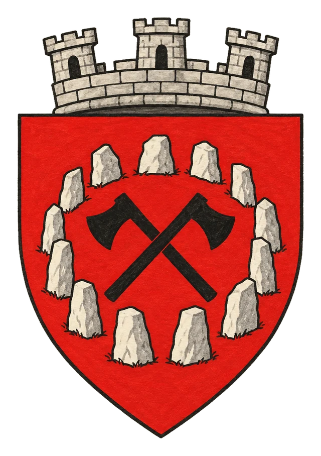

# Město Yotter

> **Stav:** původní věta = kánon, ostatní návrh

## Detailní Popis
Bojové město klanů Mönohenu pod vládou Aettara Szkunziho.

- **Velikost:** Bojové město klanů Mönohenu, ~12 000 obyvatel

## Čtvrti a významná místa
- **Kruh náčelníků** – kamenná aréna, kde se rozhoduje silou.
- **Síň Aettara Szkunziho**.
- **Brána výběrčích** – ordenské výběrčí tu vítají „s otevřenou sekyrou“.

## Služby
- Medovina v *Rozpolceném štítu*.

## Pověsti a háčky
- Szkunzi prý přijme každého, kdo ho porazí v souboji, za bratra.

## Významné NPC (návrh)
- Aettar Szkunzi
- Jeho syn Brakk (tajný konvertita Ordenu)
- Šamanka Uula

## Setkání a scény (návrh)
- Turnaj klanů o Szkunziho ochranu.
- Spiknutí v noci před turnajem.

## Pro DM (tajné)
- Návrh: Orden chystá na Szkunziho atentát.

## Heraldika

> **Stav:** kánon

{.heraldika-img .heraldika-znak}

**Znak:** Kamenný kruh a v něm dvě zkřížené sekery.

## Související
- Země: [Klanové Země Mönohen](../02_Zeme/Klanove_Zeme_Monohen.md)
- Vládce: [Aettar Szkunzi](../04_Postavy/Vladci/Postava_Szkunzi.md)
