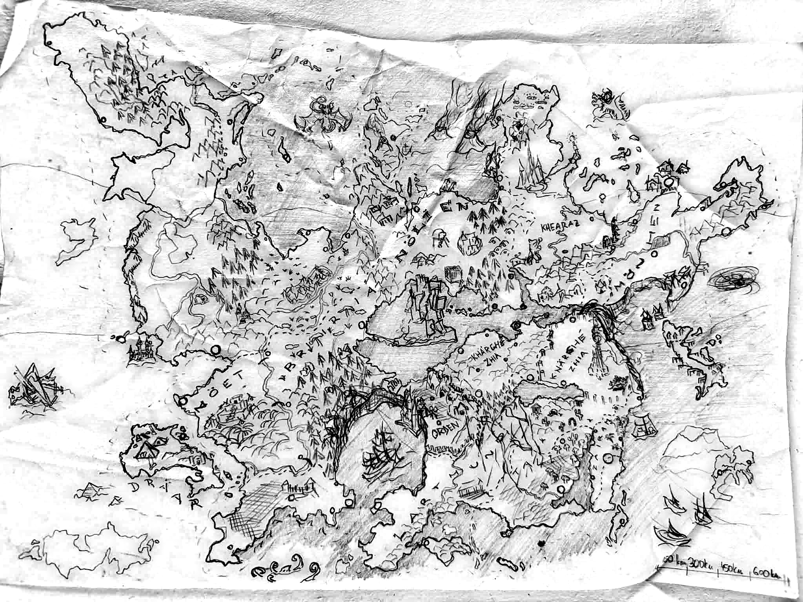

# Geografie Montelienu (podle mapy DM)

> **Stav:** návrh – sekce *Jisté* odpovídá popiskům na mapě, sekce *Odhad* je můj výklad nepopsaných kreseb a je potřeba ji potvrdit.

## Měřítko a rozměry
- Měřítko na mapě: dílky **150 / 300 / 450 / 600 km**.
- Pevnina měří zhruba **3 500 km od západu na východ** a **2 500 km od severu na jih** (velikost podobná Evropě).
- **Cestování (pravidla 2024, PHB kap. 1 – Travel Pace):** pomalé tempo 18 mil (~29 km) za den, normální 24 mil (~39 km), rychlé 30 mil (~48 km). Přejít celý kontinent pěšky normálním tempem trvá zhruba **3 měsíce**, z Octowerinu do Pevnosti Orden cca **2–3 týdny**. Jezdecký kůň tempo nezvýší (zvýší jen sprint na kratší vzdálenost), loď po řece/moři cca 2–4× rychleji.

## Jisté (popsáno na mapě)
| Popisek na mapě | Poloha | Soubor |
|---|---|---|
| **BRIRIA** | střed kontinentu, diagonálně od jihozápadu k severovýchodu | [Království Briria](../02_Zeme/Kralovstvi_Briria.md) |
| **NÖELIEN** | sever středu, nad Bririí, zalesněný pás | [Elfský Stát Nöelien](../02_Zeme/Elfsky_Stat_Noelien.md) |
| **NÖET** | jihozápad, pobřeží s pralesem (palmy) | [Provincie Nöet](../02_Zeme/Provincie_Noet.md) |
| **DRÄAR** | ostrov u jihozápadního pobřeží, pyramidy a trosky | [Trosky Dräaru](../01_Svet/Mista/Trosky_Draaru.md) |
| **ORDEN** | jih středu, opevnění s hradbou | [Teokracie Orden](../02_Zeme/Teokracie_Orden.md) |
| **KHEARAZ** | severovýchod | [Khaeraz](../02_Zeme/Khaeraz.md) |
| **KHÄRGHE ZHIA** | jihovýchod středu, jižně od velkého průlivu | [Knížectví Khärghae Zia](../02_Zeme/Kralovstvi_Kharghae_Zia.md) |
| **KNÄRGHE ZHIA** | východně od Khärghe, podél obří propasti s vysokou věží | [Država Knärghae Zia](../02_Zeme/Drzava_Knarghae_Zia.md) |
| **MÖNOHEN** (částečně čitelné) | východ, jižně od Khearazu | [Klanové Země Mönohen](../02_Zeme/Klanove_Zeme_Monohen.md), v nich [Východní hvozd](../01_Svet/Mista/Vychodni_hvozd.md) (kánon) |
| další popisek na jihu (Z… A… M) | jih mezi Ordenem a Knärghe | pravděpodobně [Zairam](../02_Zeme/Zeme_Zairam.md) – potvrď |

> Pozn.: na mapě je psáno **Khärghe / Knärghe Zhia**, v textech **Khärghae / Knärghae Zia** – obě podoby jsou správné (kánon). Temné síly ovládají **Knärghe Zhia**.

## Odhad (nepopsané kresby) – potvrď
| Kresba | Poloha | Můj výklad |
|---|---|---|
| Hornatý poloostrov se smrky | daleký severozápad | [Divoký Sever](../01_Svet/Mista/Divoky_Sever.md) |
| Ledové krystalické věže | sever (nad Nöelienem/Khearazem) | [Fornheim](../01_Svet/Mista/Fornheim.md) – tvrz Antemia |
| Obrovská zřícenina trčící z vnitrozemského jezera | střed, mezi Bririí a Nöelienem | [Jezero Amir a Kop Aram](../01_Svet/Mista/Jezero_Amir_a_Kop_Aram.md) |
| Rozsáhlé lesy s řekami a jezery | západní část pevniny | [Západní hvozd a Ertinova hora](../01_Svet/Mista/Zapadni_hvozd_a_Ertinova_hora.md) |
| Hrad na západním pobřeží | západ | [Tel Palentin](../03_Mesta/Mesto_Tel_Palentin.md)? (elfové jsou podle textu „na západě“) |
| Husté lesy se stromovými domy | sever středu, u Nöelienu | lesy [Nöelienu](../02_Zeme/Elfsky_Stat_Noelien.md) (Tirentova magie); [Imonir](../02_Zeme/Kralovstvi_Imonir.md)? |
| Tmavý šrafovaný prales kolem zátoky s lodí | jih středu, mezi Bririí a Ordenem | [Hinai Mihi](../01_Svet/Mista/Hinai_Mihi.md) |
| Dlouhý průliv z jezera na východ do moře | střed → východ | hlavní obchodní tepna; hranice Bririe a Zhie |
| Obří propast (sever–jih) s vysokou věží | Knärghe Zhia | hranice mrtvé Knärghe Zhie (ovládají ji mrtví a démoni – kánon); propast jako jejich zdroj = návrh |
| Poušť s kaktusy a chrámy | jihovýchod | Irtisina poušť / jižní pole Eligona? |
| Přístav s domy u ústí průlivu | východní pobřeží | [Miria](../03_Mesta/Mesto_Miria.md)? |
| Ostrov s pagodou, souostroví s loděmi | jihovýchod | [Svobodné Jižní ostrovy](../02_Zeme/Svobodne_Jizni_Ostrovy.md), [Menkant](../03_Mesta/Mesto_Menkant.md) |
| Pobřeží proti Dräaru | jihozápad u Nöetu | [Werenor](../03_Mesta/Mesto_Werenor.md) („strážce Dräaru“) |
| Velká nepopsaná pevnina | daleký jihozápad (okraj mapy) | neprozkoumaná země? |
| Vír v moři | východní oceán | [Moře a ostrovy](../01_Svet/Mista/More_a_ostrovy.md) – Velký vír |
| Mořský had / drak | severovýchodní moře | [Moře a ostrovy](../01_Svet/Mista/More_a_ostrovy.md) |
| Okřídlený démon nad mořem | severní moře | [Moře a ostrovy](../01_Svet/Mista/More_a_ostrovy.md) |
| Vrak lodi | západní oceán | [Moře a ostrovy](../01_Svet/Mista/More_a_ostrovy.md) |
| Hlavní cesty (čárkované) | celý kontinent | obchodní stezky |

## Použitelnost mapy
- **Jako podklad pro DM: ano.** Poloha zemí, pobřeží, řeky, pohoří, průliv i hlavní dominanty jsou čitelné.
- **Jako hráčská mapa: zatím ne.** Fotka zmačkaného papíru se stíny, většina měst je jen kroužek bez jména a jen asi 10 popisků. Doporučuji ji naskenovat naplocho, doplnit jména měst a hranice a pak udělat čistou verzi.
