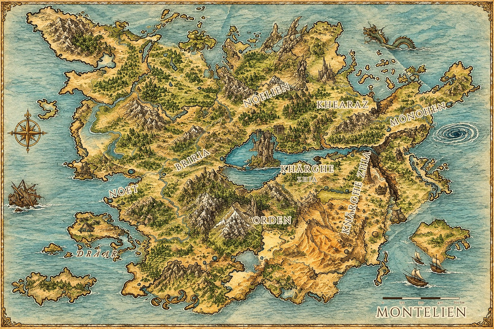

# Mapy

> **Stav:** fantasy mapa = návrh. Je překreslená podle DM kresby (generováno AI a popsáno skriptem). Pobřeží, ostrovy, jezera, průliv a propast odpovídají kresbě; drobné detaily (tvary hor, lesů) jsou umělecká licence. Rozhoduje původní kresba.

| Soubor | Popis |
|---|---|
| [Montelien_mapa_fantasy.jpg](Montelien_mapa_fantasy.jpg) | Fantasy mapa s popisky, měřítkem a názvem (3072×2048). |
| [Montelien_mapa_fantasy_podklad.jpg](Montelien_mapa_fantasy_podklad.jpg) | Stejná mapa bez popisků – podklad pro úpravy. |
| [Montelien_mapa_foto.jpg](Montelien_mapa_foto.jpg) | Původní fotka ručně kreslené mapy (DM). |
| [Montelien_mapa_vycistena.jpg](Montelien_mapa_vycistena.jpg) | Digitálně vyčištěná verze kresby (bez stínů, vyšší kontrast). |
| [mista.json](mista.json) | Souřadnice míst na mapě (pro popisky i interaktivní mapu na webu). |
| [Geografie.md](Geografie.md) | Popis mapy: co je jisté, co je odhad, měřítko a cestování. |

## Úpravy
- Přidat/posunout místo: uprav `mista.json` (souřadnice v px podkladu 1536×1024), pak `python3 tools/mapa.py` (popisky) – web převezme body automaticky. `python3 tools/mapa.py --debug` vykreslí kontrolní body.
- Jména měst zatím na mapě nejsou (na DM kresbě jsou jen kroužky). Až určíš, který kroužek je které město, doplním je.
