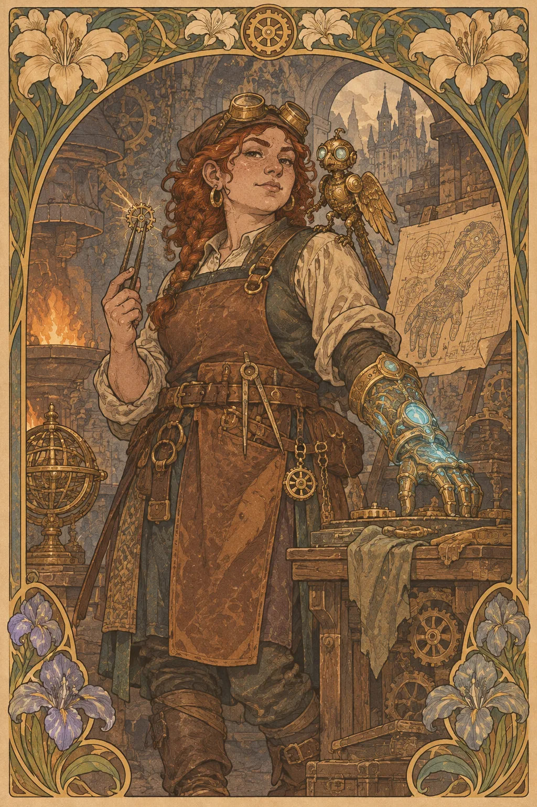

---
povolani:
  nazev: Artificer
  zdroj: Forge of the Artificer (2026)
  overeno:
    - https://dnd2024.wikidot.com/artificer:main
---

# Artificer

## Přehled

Artificer zachází s magií jako s dovedností, kterou lze pozorovat, rozebrat a znovu sestavit. Jeho vynalézavost se neomezuje na kovárnu: jeden den může vylepšovat výstroj družiny, druhý hledat slabé místo v obraně a třetí dokazovat, že zdánlivě obyčejný předmět skrývá užitečnou funkci. Třída odměňuje hráče, který rád připravuje řešení předem, ale umí improvizovat, když se plán rozpadne.

## Fantazie a role ve skupině

Artificer přináší do skupiny nástrojovou zdatnost, kouzla a promyšlenou práci s předměty. Nemusí být „technikem“ v moderním smyslu: jeho řemeslo může vycházet z alchymie, run, mechanických součástek, sklářství nebo z tradice, kterou žádný učenec neumí popsat. V boji může stát v první řadě v odolné zbroji, krýt spojence, nebo podporovat skupinu z bezpečnější vzdálenosti.

Jeho největší týmový přínos často vzniká mezi střety. Ptejte se, zda skupina potřebuje průzkumný nástroj, spolehlivou obranu, léčení či pomoc s magickou překážkou. Artificer není náhradou za každou jinou třídu; je to postava, která proměňuje vybavení a přípravu ve společnou výhodu.

## Jak se hraje

Na začátku střetu si určete, kde má vaše postava nejlepší přístup k cílům a kam se může stáhnout, když se situace obrátí. V prvním tahu se často rozhoduje mezi kouzlem, které ovlivní celé bojiště, a přímým zapojením do boje. Potom si hlídejte koncentraci a bonusovou akci: silná možnost, kterou nelze využít současně s jinou, potřebuje jasnou prioritu.

Mimo boj fungují plánování a konkrétní otázky lépe než neurčitý slib „něco vyrobím“. Zjistěte, jaký materiál, čas a nástroje máte; mějte po ruce běžné předměty a zapisujte si, komu jste půjčili důležitou výbavu. Short Rest využijte k domluvě o dalším postupu a kontrole spotřebovaných zdrojů; při Long Restu připravte kouzla podle toho, co družinu čeká, ne podle hypotetické příští kampaně.

## Základní údaje

<!-- udaje:povolani -->

## Postup po úrovních

<!-- mechaniky:povolani -->

## Podtřídy

<!-- podtridy:povolani -->

## Doporučené volby 2024

Pozadí Artisan nebo Sage snadno vysvětlí dovednosti postavy, ale stejně dobře funguje bývalý voják, lodní opravář či pouliční hodinář. V katalogu [pozadí](/pozadi/) hledejte schopnosti, které doplňují Intelligence a dávají důvod znát řemeslníky mimo dobrodružnou družinu; mezi [Origin featy](/featy/) stojí za zvážení Crafter. Rock Gnome je tematická, nikoli povinná volba: zvažte libovolný druh, jehož příběh odpovídá vašemu řemeslu. Kouzla vybírejte podle role: Shield a Cure Wounds chrání skupinu, Faerie Fire pomáhá její přesnosti a utility kouzla mají cenu i bez jediného zásahu.

## Multiclass

Předpokladem Artificera je Intelligence 13. Začátek v této třídě nabízí nástroje, zbroj a rané sesílání; další úrovně přidávají vlastní řemeslné možnosti, ale jejich odložení znamená pozdější přístup k třídním plánům i k vyšším kouzlům. Při kombinaci s jiným sesilatelem počítejte s tím, že Artificer přispívá do společného postupu slotů polovinou úrovní zaokrouhlenou nahoru; jeho připravená kouzla a jiné třídní zdroje se tím neslučují. Rozhodnutí proto založte na konkrétní schopnosti, ne pouze na větším počtu slotů.

## Tipy pro hráče a DM

Hráči by měli nahlas sdílet, co jejich vybavení umí, a nečekat, až DM vymyslí správnou otázku. Zapište si, které schopnosti vyžadují akci, bonusovou akci nebo koncentraci. DM může odměnit vynalézavost prostorem k přípravě, dostupnými surovinami a problémy, které připustí několik řešení; neměl by však vyžadovat skutečný technický výkres, aby postava směla použít pravidlovou schopnost. Při improvizovaných výrobcích se předem dohodněte na čase a následcích.

## 3 háčky

1. Někdo vrací zařízení, které jste nikdy nevyrobili, ale nese vaši přesnou značku a drobnou chybu, kterou znáte jen vy.
2. Výprava získá přístup do dílny po zesnulém mistru; každý nástroj je očíslovaný a jeden chybí.
3. Zákazník zaplatí za opravu relikvie, která začne fungovat až ve chvíli, kdy ji odnesete z dílny.

## V Montelienu

> **Stav:** návrh

Navrhuji, aby se Artificerovy dílny vyskytovaly tam, kde se střetává řemeslo s mocí: u městských bran, při opravách mostů, v karavanách nebo v institucích, které chtějí kontrolovat neobvyklé předměty. To není potvrzení žádné existující gildy ani nové technické tradice. DM může rozhodnout, zda postava získala své postupy od kováře, od učence, nebo od člověka, který se obává, co její vynálezy odhalí. Následující odkazy ukazují na osoby a místa skutečně vedená v rejstříku postav.

<!-- vazby:povolani -->

## Postavy tohoto povolání

<!-- postavy:povolani -->

## Zdroje

- *Forge of the Artificer* (2026).
- https://dnd2024.wikidot.com/artificer:main
