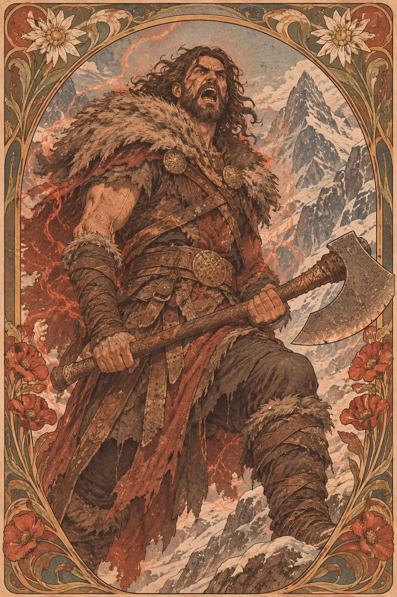

---
povolani:
  nazev: Barbarian
  zdroj: Player's Handbook (2024)
  overeno:
    - https://dnd2024.wikidot.com/barbarian:main
---

# Barbarian

## Přehled

Barbarian je bojovník, jehož odhodlání se v boji mění v mimořádnou houževnatost a sílu. Rage není nutně slepý hněv: může jít o soustředěnou obranu, rytmus bubnů, vzpomínku na porážku nebo přísahu, kterou si postava opakuje při každém úderu. Hráč si vybírá, zda jeho Barbarian působí jako neústupná zeď, ničivý útočník, nebo člověk, který se snaží zkrotit energii, jež je nebezpečná i pro něj.

## Fantazie a role ve skupině

V boji Barbarian přitahuje pozornost a tlačí se k protivníkům, kteří ohrožují ostatní. Vysoká odolnost pomáhá udržet linii, ale neznamená, že postava musí každé kolo útočit na nejbližší cíl. Pohyb, načasování a výběr cíle jsou stejně důležité jako samotný zásah. Mimo boj mohou smysly, atletika a přímý přístup přinést nové možnosti, pokud družina řeší stopu, překážku nebo spor, který se nedá umlčet dalším kouzlem.

Barbarian může být zkušený lovec, člen královské stráže, vyhnanec, přeživší katastrofy nebo někdo, kdo se nikdy nevzdálil od domova. Třída neurčuje, že postava musí být nevzdělaná či neovladatelná. Zvolte si vlastní důvod, proč se její bojová síla projevuje právě tímto způsobem.

## Jak se hraje

Před vstupem do střetu si všimněte, zda potřebujete chránit konkrétního spojence, zablokovat úzké místo, nebo proniknout k nebezpečnému sesilateli. Rage zapněte ve chvíli, kdy očekáváte, že bude mít význam po většinu boje, nikoli jen proto, že se někdo postavil do cesty. V dalších kolech vyvažujte útok s obranou a pohybem; nespoléhejte, že vysoké životy napraví každou špatnou pozici.

Využívejte prostředí: rozbité schodiště, vůz nebo úzký most mohou změnit podobu boje, aniž byste museli každé kolo řešit stejné útoky. Po krátkém odpočinku zkontrolujte, které zdroje se vrátily a kdo potřebuje pomoc. Při Long Restu si s družinou řekněte, zda se vracíte do bezpečí, nebo jen získáváte čas před dalším pronásledováním.

## Základní údaje

<!-- udaje:povolani -->

## Postup po úrovních

<!-- mechaniky:povolani -->

## Podtřídy

<!-- podtridy:povolani -->

## Doporučené volby 2024

Background Guide nebo Soldier může přirozeně podpořit průzkum či vojenskou zkušenost, ale vhodný je i Sailor, Farmer nebo pozadí, které vysvětluje, proč se postava v neznámém prostředí vyzná. Prohlédněte [pozadí](/pozadi/) a vybírejte taková, která rozvíjejí Strength nebo Constitution podle vaší role. Origin feat Tavern Brawler podtrhne boj zblízka, zatímco Alert pomůže reagovat dřív, než protivníci rozbijí formaci. V [katalogu featů](/featy/) porovnejte přínos s výbavou celé skupiny. Weapon Mastery vybírejte podle toho, zda chcete držet protivníka na místě, tlačit jej z pozice, nebo zvýšit tlak po zásahu.

## Multiclass

Barbarian vyžaduje Strength 13. Víceúrovňový vstup získá odolnost a přímou bojovou přítomnost, ale sesílání kouzel při Rage bývá omezené; plánujte proto, co má postava dělat v kolech, kdy její kouzla nejsou dostupná. Přidání úrovní jiné bojové třídy může otevřít nové možnosti boje či obrany, avšak odloží další růst schopností Barbariana. Ujistěte se, že zvolená kombinace opravdu dává nové rozhodnutí, nikoli jen další číselný bonus.

## Tipy pro hráče a DM

Hráč může Barbarianovu intenzitu ukazovat bez křiku nebo konfliktu s ostatními postavami. Dejte mu hodnotu, kterou chrání, a chvíle, kdy síla sama nestačí. DM by měl rozlišovat mezi „odolným“ a „nesmrtelným“: nebezpečí může ohrozit cíl, prostředí nebo skupinu, ale nemělo by trestat hráče jen za to, že se ujímá přední linie. Mimo boj nabídněte příležitost využít tělesnou zdatnost i úsudek.

## 3 háčky

1. Starý přívěsek vaší rodiny se objeví na trofeji protivníka, který tvrdí, že jej získal při záchraně vašeho předka.
2. Kmen, jednotka nebo sousedská hlídka vás žádá o návrat, ale nikdo nedokáže říct, před čím potřebuje ochranu.
3. Při Rage slyšíte útržek hlasu, který zná jen člověk, jenž vás kdysi učil bojovat.

## V Montelienu

> **Stav:** návrh

Barbarian může do Montelienu přijít z jakéhokoli kulturního prostředí; jeho síla sama o sobě nedokazuje původ ani příslušnost ke konkrétnímu národu. Jako návrh pro DM se nabízí postava, která pracovala v průsmyku, bránila karavanu nebo odmítla poslušnost mocnějšímu velitelství. O její vztah k Ordenu, staré víře či městským strážím rozhodne hráč spolu s DM, nikoli název třídy. Rejstřík níže uvádí skutečné vazby existujících postav Barbarianů.

<!-- vazby:povolani -->

## Postavy tohoto povolání

<!-- postavy:povolani -->

## Zdroje

- *Player's Handbook* (2024).
- https://dnd2024.wikidot.com/barbarian:main
