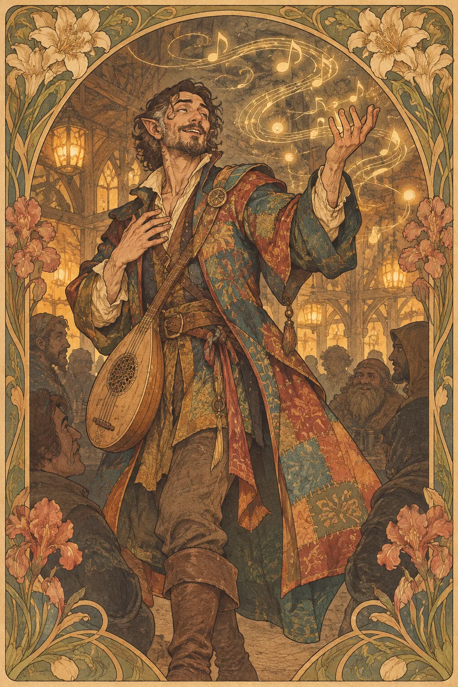

---
povolani:
  nazev: Bard
  zdroj: Player's Handbook (2024)
  overeno:
    - https://dnd2024.wikidot.com/bard:main
---

# Bard

## Přehled

Bard pracuje s inspirací, příběhem a magií, která se přenáší hlasem, pohybem nebo jinou formou umění. Hudební nástroj je výrazný symbol, ne povinnost: bard může recitovat, vyprávět, tančit, kreslit nebo používat způsob vystupování, který si sám určí. Ve skupině přináší pružná kouzla, dovednosti a podporu, díky nimž se ostatní mohou prosadit ve chvílích, kdy jim chybí správná výhoda.

## Fantazie a role ve skupině

Bard si často všímá vztahů a nálady v místnosti. To z něj nedělá povinného mluvčího ani člověka, který musí být hlučný: jeho umění může být tiché, soukromé a určené pro jediného posluchače. V boji poskytuje pomoc prostřednictvím kouzel a Bardic Inspiration, mimo něj se může stát vyjednavačem, vypravěčem, odborníkem na jednu oblast nebo spojnicí mezi různými kulturami.

Třída nejlépe funguje, když hráč ví, komu chce dát prostor. Inspirace může podpořit zlodějův rozhodující manévr, knězovo kouzlo nebo bojovníkův útok; její hodnota roste, když hráči komunikují. Bard nemusí všechno umět sám. Jeho úkolem je pomoci družině sdílet její nejsilnější okamžiky.

## Jak se hraje

Na začátku dne si projděte připravená kouzla a určete, která řeší boj, průzkum a společenské situace. V prvním kole se rozhodněte, zda potřebujete změnit průběh střetu kouzlem, posílit spojence inspirací, nebo se přesunout na místo s lepším přehledem. Neutrácejte všechny prostředky hned; sledujte, jak často družina odpočívá a na jaké typy překážek naráží.

V rozhovorech dejte prostor i ostatním. Bardova dovednost může otevřít dveře, ale nemusí za družinu odpovídat. Po Short Restu zkontrolujte dostupnost inspirace a domluvte se, kdo bude mluvit s dalším svědkem. Long Rest využijte k úpravě kouzel podle skutečných informací, které družina získala.

## Základní údaje

<!-- udaje:povolani -->

## Postup po úrovních

<!-- mechaniky:povolani -->

## Podtřídy

<!-- podtridy:povolani -->

## Doporučené volby 2024

Entertainer nebo Charlatan dobře poslouží postavě, která zná publikum a masky, zatímco Sage či Noble vysvětlí přístup k archivům a dvorským kruhům. V [katalogu pozadí](/pozadi/) vybírejte podle vztahů, které chcete rozehrávat, ne podle stereotypu umělce. Musician je tematický Origin feat, ale Alert či Skilled mohou lépe vystihnout konkrétní pojetí. Mezi kouzly zvažte Vicious Mockery pro rušivou drobnou magii, Healing Word pro rychlou pomoc a Dissonant Whispers pro tlak na postavení protivníka; aktuální možnosti lze procházet přes [katalog kouzel](/kouzla/?trida=Bard).

## Multiclass

Bard vyžaduje Charisma 13. Úrovně jiné třídy mohou dát odolnější zbroj, bojovou specializaci nebo odlišný zdroj magie, ale každá odložená bardovská úroveň zpomaluje přístup ke kouzlům a třídním rysům. Před kombinací rozhodněte, zda má Bard zůstat podporou, stát se bojovým umělcem, nebo získat jasnou fikční dovednost. Propojte mechanickou volbu s tím, kdo postavu učil a co očekává na oplátku.

## Tipy pro hráče a DM

Hráč může před sezením nabídnout DM několik motivů, které chce zkoumat: pověst, rivalitu, dluh vůči publiku nebo účinek dávné písně. DM může do příběhu vkládat publikum a svědky, ale neměl by vyžadovat improvizovaný přednes pro každé použití schopnosti. Bardova podpora se nejsnáze hraje, když je zřejmé, kdo má nyní rozhodující tah; krátká věta nebo gesto stačí k tomu, aby se na stole neztratil rytmus.

## 3 háčky

1. Publikum zná refrén vaší nové písně ještě před prvním veřejným vystoupením a každé město tvrdí, že vznikl právě tam.
2. Někdo žádá, abyste uchovali píseň, která se nesmí zpívat nahlas, ale její text chybí.
3. Váš někdejší rival nabízí společné vystoupení; podmínkou je, že zazní pravdivá verze události, na kterou máte odlišnou vzpomínku.

## V Montelienu

> **Stav:** návrh

Bardovská pověst může v Montelienu cestovat rychleji než oficiální zprávy, ale žádná třída automaticky nepatří k určitému dvoru, řádu ani městu. Navrhuji, aby si hráč s DM určil, kdo zná postavu podle její práce: obchodníci, stráž, poutníci nebo lidé, kteří slyšeli její příběh z druhé ruky. To otevírá prostor pro spor o pravdivost vyprávění, ne pro přepis existujícího kánonu. Rejstřík níže doplňuje konkrétní postavy Bardů a jejich vazby.

<!-- vazby:povolani -->

## Postavy tohoto povolání

<!-- postavy:povolani -->

## Zdroje

- *Player's Handbook* (2024).
- https://dnd2024.wikidot.com/bard:main
