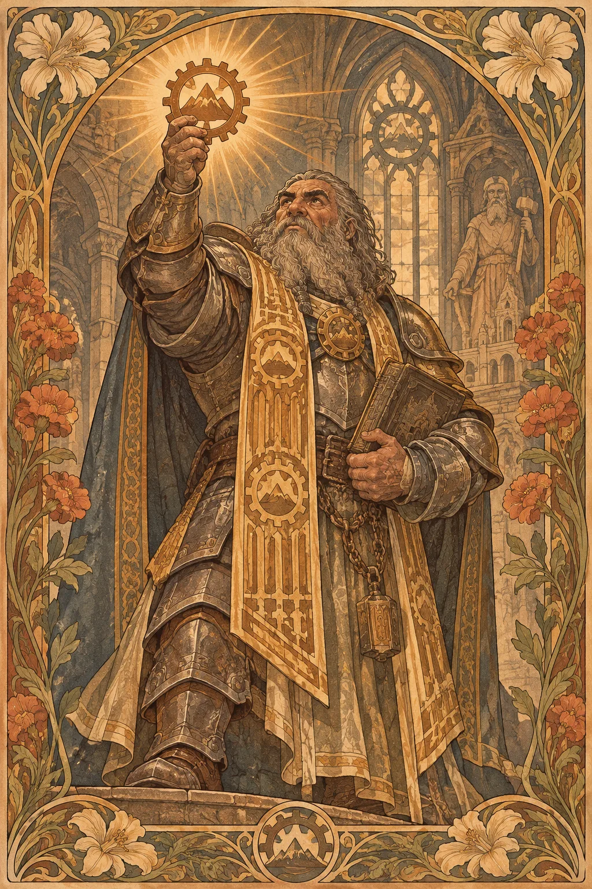

---
povolani:
  nazev: Cleric
  zdroj: Player's Handbook (2024)
  overeno:
    - https://dnd2024.wikidot.com/cleric:main
---

# Cleric

## Přehled

Cleric spojuje víru, službu a božskou magii, ale jeho přesvědčení nemusí být jednoduché ani bez pochyb. Může sloužit božstvu, ideálu, komunitě nebo posvátnému závazku, který teprve začíná chápat. V družině umí chránit, léčit, posilovat i ohrožovat nepřátele; jeho skutečnou volbou je, jakou část své moci považuje za odpovědnost a co odmítne udělat, i když by to bylo snadné.

## Fantazie a role ve skupině

Cleric není jen léčitel, který čeká, až někdo ztratí životy. Jeho kouzla mohou ovlivnit prostor, zadržet protivníky, vyjasnit záhadu nebo podpořit spojence dřív, než je nutné napravovat škody. V rozhovorech jeho víra poskytuje jazyk pro sliby, vinu a naději, nikoli automatický návod na správné rozhodnutí. Při tvorbě postavy si ujasněte, co její služba stojí a jaké otázky zůstávají bez odpovědi.

Skupina získá nejvíc, když Cleric nesupluje všechny role. Otevřete diskusi o tom, jaká míra náboženské praxe je pro ostatní postavy pohodlná, a nabídněte spojencům volbu, zda duchovní vedení přijmou. Hráč si tak zachová jasnou identitu bez toho, aby každé setkání měnilo v kázání.

## Jak se hraje

Před výpravou si připravte kouzla podle informací, které družina skutečně má. V prvním kole střetu bývá důležité rozhodnout, zda posílit obranu, zaujmout výhodné místo, nebo zasáhnout největší hrozbu. Sledujte koncentraci a akce: léčivé kouzlo nemusí být nejlepší volbou, pokud lze spojence bezpečně stabilizovat jinak a zabránit dalšímu nebezpečí.

Po boji promluvte se skupinou o tom, co stálo za použitý zdroj a co lze odložit do dalšího odpočinku. Short Rest je vhodný pro sdílení obav a doplnění plánu. Při Long Restu změňte připravená kouzla, pokud se změnily cíle nebo pokud vám průzkum odhalil novou hrozbu.

## Základní údaje

<!-- udaje:povolani -->

## Postup po úrovních

<!-- mechaniky:povolani -->

## Podtřídy

<!-- podtridy:povolani -->

## Doporučené volby 2024

Acolyte je přirozená volba pro postavu s chrámovým zázemím, ale Soldier, Hermit nebo Sage mohou lépe vyjádřit, jak se k víře dostala. Projděte [pozadí](/pozadi/) a zvažte, zda chcete zvýraznit Wisdom nebo společenskou stránku Charisma. Origin feat Healer posiluje praktickou službu, zatímco Magic Initiate může ukázat vliv jiné tradice. Mezi kouzly záleží na tom, zda družina potřebuje ochranu, obnovu nebo kontrolu bojiště; přehled najdete v [katalogu kouzel pro Clerica](/kouzla/?trida=Cleric). Vybraný symbol víry může být viditelný, ale není náhradou za vlastní přesvědčení postavy.

## Multiclass

Pro vstup do Clerica je potřeba Wisdom 13. Jedna či několik úrovní přidá léčivá a podpůrná kouzla a vybranou duchovní specializaci, ale pozdější přístup k vyšším kouzlům se odloží. Před kombinací s bojovou třídou se podívejte, zda potřebujete její zbroj a zbraně, nebo zda už je nabízí základní volba Clerica. Příběhově je důležité, proč se postava zavázala dalšímu výcviku a zda se její víra mění, nebo jen získává nový způsob služby.

## Tipy pro hráče a DM

Hráči mohou předem říct, zda chtějí řešit víru osobně, politicky, nebo jen jako jednu z mnoha částí postavy. DM by měl oddělit morální dilemata od trestu za to, že postava neuposlechne cizí náboženskou autoritu. Nabídněte Clericovi chvíle, kdy může jednat bez boje, ale ponechte ostatním prostor odpovědět. Jasně popsaný cíl a vztah k božské moci jsou lepším základem než představa, že Cleric musí mít na všechno hotový názor.

## 3 háčky

1. Dva věřící tvrdí, že dostali opačné příkazy z téhož chrámu, a oba ukazují důkaz, kterému důvěřují.
2. Obyčejná prosba o požehnání odhalí, že někdo dlouho používá váš symbol bez dovolení.
3. Svědek žádá, abyste před soudem potvrdili zázrak, který jste sami neviděli.

## V Montelienu

> **Stav:** návrh

Clericova tradice může do Montelienu vstoupit přes rodinu, službu komunitě, osobní slib nebo zkušenost, kterou postava dosud neumí vysvětlit. Neurčuji tím, které božstvo je skutečné ani jakou autoritu má Orden; to zůstává v rukou DM. Pro konkrétní začlenění lze zvolit místo, kde se péče o nemocné nebo pohřbívání střetává s mocí, a společně rozhodnout, komu tam postava důvěřuje. Automatické odkazy níže pocházejí z již existujícího rejstříku.

<!-- vazby:povolani -->

## Postavy tohoto povolání

<!-- postavy:povolani -->

## Zdroje

- *Player's Handbook* (2024).
- https://dnd2024.wikidot.com/cleric:main
