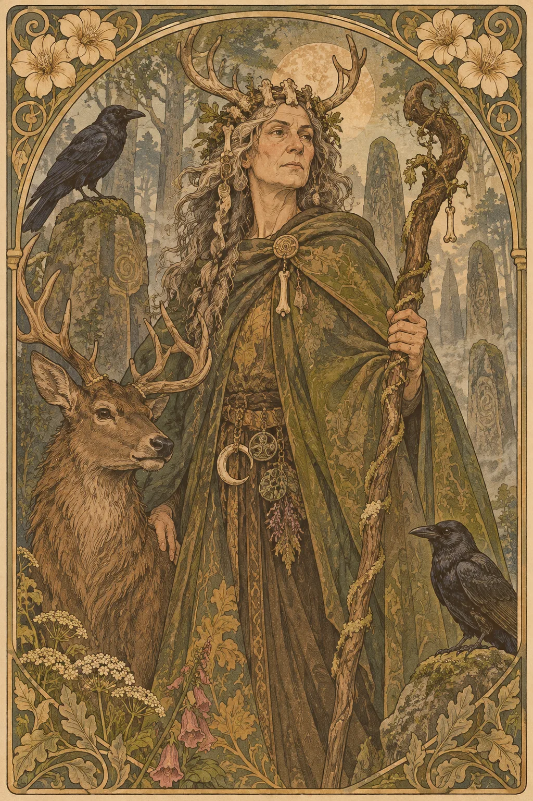

---
povolani:
  nazev: Druid
  zdroj: Player's Handbook (2024)
  overeno:
    - https://dnd2024.wikidot.com/druid:main
---

# Druid

## Přehled

Druid vnímá přírodní síly jako součást živého vztahu, ne jen jako soubor kouzel. Může být ochráncem mokřadu, zvědavým přírodovědcem, léčitelem z odlehlé osady nebo člověkem, který se naučil přežít v prostředí, kde se mění počasí i pravidla. Jeho magie umí měnit situaci na bojišti, podpořit průzkum a nabídnout nečekanou podobu, ale její smysl vychází z toho, jak postava přemýšlí o růstu, rozkladu a rovnováze.

## Fantazie a role ve skupině

Druid dobře zapadá do družiny, která se často pohybuje mimo civilizaci, ale třída není omezena na les. Řeka, poušť, pobřeží, zahrada nebo městská zeleň mohou být stejně důležité prostředí. V boji si vybírá mezi přímým zásahem, kontrolou prostoru, podporou a schopnostmi spojenými s proměnou. Mimo boj může sledovat stopy, vyjednávat s místními obyvateli nebo vysvětlovat, proč se určitá změna krajiny stala.

Vyhněte se představě, že Druid musí být odpůrcem každé stavby. Postava může chránit přírodu a zároveň hledat dohodu s lidmi, kteří potřebují dřevo, pole nebo bezpečnou cestu. Konflikt je zajímavější, když má každá strana důvod, ne když jednu z nich označíme za bezcitnou.

## Jak se hraje

Na začátku dne si připravte kouzla pro pravděpodobné úkoly, ale ponechte prostor pro změnu po průzkumu. V prvním kole si všimněte, zda má smysl rozdělit nepřátele, posílit spojence, nebo změnit vlastní podobu. Před proměnou si ujasněte, jak bude vaše postava komunikovat a jaké úkoly chce vykonávat; forma má být herní volbou, ne překvapením pro zbytek stolu.

Mimo boj využívejte přírodní znalosti k získávání informací, ne pouze jako důvod, proč se scéně vyhnout. Short Rest může být chvílí k pozorování změn v okolí; Long Rest zase možností přehodnotit připravená kouzla podle nové výpravy. Popište, jak Druid vnímá počasí, zvuky a stopy, ale nechávejte i ostatním postavám vlastní cestu k řešení.

## Základní údaje

<!-- udaje:povolani -->

## Postup po úrovních

<!-- mechaniky:povolani -->

## Podtřídy

<!-- podtridy:povolani -->

## Doporučené volby 2024

Guide, Hermit nebo Farmer mohou vysvětlit vztah k prostředí, ale žádné pozadí není povinně „druidské“. V [katalogu pozadí](/pozadi/) hledejte praktické dovednosti pro konkrétní krajinu. Origin feat Magic Initiate může naznačit dřívější výcvik mimo druidickou tradici; Healer se hodí postavě, která pečuje o lidi stejně ochotně jako o divočinu. Kouzla jako Entangle, Faerie Fire či Healing Word pokrývají různé úkoly, proto je vybírejte podle stylu družiny přes [katalog kouzel](/kouzla/?trida=Druid). Pro postavu z města může být přirozenou inspirací městská zeleň, studny a opuštěné zahrady.

## Multiclass

Druid vyžaduje Wisdom 13. Vstup do jiné třídy může přinést odolnost, zbroj nebo dovednost, kterou si příběh vyžaduje, ale zpomalí přístup k dalším druidickým kouzlům a proměnám. Pokud kombinujete Druidovu magii s bojovou rolí, rozhodněte, zda má postava během střetu častěji sesílat, měnit formu, nebo stát v první řadě. Multiclass funguje nejlépe, když obě části mají společný příběhový důvod, například jiný způsob péče o stejnou komunitu.

## Tipy pro hráče a DM

Hráč by měl s DM probrat, jaké přírodní prostředí se v kampani skutečně objeví a jak často lze využít schopnosti navázané na zvířata či rostliny. DM může nabídnout proměnlivé krajiny, jejichž stav souvisí s dějem, aniž by Druid musel přebírat roli jediného mluvčího za přírodu. Zajímavé jsou i drobné pozorovací scény: změna ptačího zpěvu, neobvyklá plíseň nebo stopy, které končí na kamenné cestě.

## 3 háčky

1. Zvířata z různých koutů kraje opakují stejnou trasu, přestože na ní není potrava ani voda.
2. Starý háj žádá o pomoc, ale jeho obyvatelé se neshodnou, zda má být chráněn před lidmi, nebo před vlastním růstem.
3. Voda uprostřed města chutná jako po dešti, který v okolí nepršel celé měsíce.

## V Montelienu

> **Stav:** návrh

Druidovský vztah ke světu může nabídnout nový pohled na řeku, lesní hranici, zahradu nebo místo poznamenané válkou, ale tento návrh nepřidává žádný nový posvátný háj ani frakci. DM může rozhodnout, zda Druid považuje změnu krajiny za přirozený cyklus, zásah Stavitelů, nebo důsledek lidského rozhodnutí. Při tvorbě postavy určete, komu v Montelienu naslouchá a kde končí její odpovědnost. Níže se doplní skutečné vazby postav Druidů podle rejstříku.

<!-- vazby:povolani -->

## Postavy tohoto povolání

<!-- postavy:povolani -->

## Zdroje

- *Player's Handbook* (2024).
- https://dnd2024.wikidot.com/druid:main
