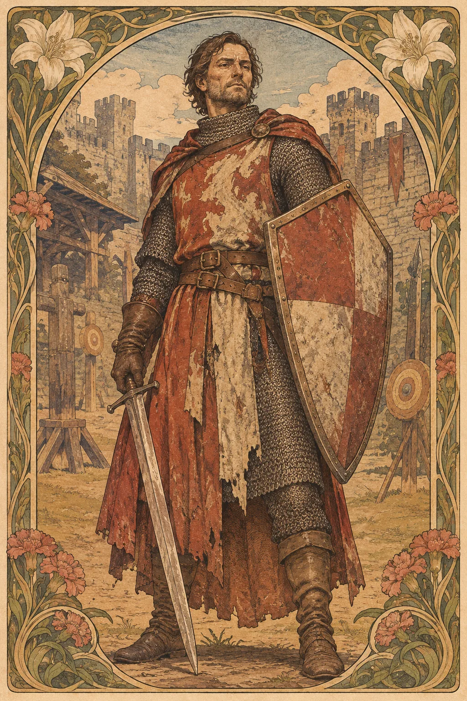

---
povolani:
  nazev: Fighter
  zdroj: Player's Handbook (2024)
  overeno:
    - https://dnd2024.wikidot.com/fighter:main
---

# Fighter

## Přehled

Fighter ovládá boj jako řemeslo: vybírá si zbraně, čte pohyb protivníka a rozhoduje, kdy má smysl riskovat další úder. Třída není svázána s jediným původem ani podobou. Postava může být členem stráže, duelantem, lovcem příšer, veteránem nebo člověkem, který se učil bránit rodinu na cestách. V družině přináší spolehlivou bojovou přítomnost, ale jeho příběh může stát stejně silně na disciplíně, pochybnostech i odpovědnosti za druhé.

## Fantazie a role ve skupině

Fighter mění výběr výstroje a taktiku v konkrétní výsledky. Může zadržet průchod, doprovázet zranitelného spojence, ohrozit vzdálený cíl nebo přejít z obrany do rychlého tlaku. Weapon Mastery dává zbraním odlišný charakter; výběr proto ovlivňuje i to, jak se vaše postava chová na bojišti. Mimo boj může Fighter využít atletiku, vojenské zkušenosti, vztahy s kolegy nebo schopnost zachovat klid, když ostatní čekají na rozkaz.

Třída dobře doplňuje sesilatele, ale nemusí být pouhou ochrankou. Domluvte se, jaké rozhodnutí chce postava činit sama a kdy naslouchá veliteli či skupině. Vlastní hodnoty jsou pro Fightera stejně důležité jako výcvik.

## Jak se hraje

Před střetem si prohlédněte prostor a určete, kdo může obejít vaši linii. V prvních kolech hledejte příležitost, která vytvoří výhodu pro dalšího člena skupiny: zatlačení, zpomalení, blokovaný průchod nebo rychlé odstranění nebezpečného cíle. Sledujte Second Wind a Action Surge jako zdroje pro důležitý okamžik, ne jako povinnost využít je co nejdřív.

Po boji si poznamenejte, které zbraně a mastery fungovaly v konkrétním prostředí. Short Rest může být příležitostí projít výstroj a domluvit se na postupu; před Long Restem si ujasněte, zda se družina připravuje na přepadení, obranu nebo vyjednávání. Fighter může při rozhovoru předat iniciativu jiné postavě a stále být důležitým členem scény.

## Základní údaje

<!-- udaje:povolani -->

## Postup po úrovních

<!-- mechaniky:povolani -->

## Podtřídy

<!-- podtridy:povolani -->

## Doporučené volby 2024

Soldier je zřejmý background pro veterána, ale Scribe, Guard nebo Artisan mohou vysvětlit, proč Fighter zná taktiku, zákony či zbrojířství. V [katalogu pozadí](/pozadi/) hledejte volbu, která dává postavě cíl mimo boj. Origin feat Alert pomáhá připravenému průzkumníkovi; Savage Attacker nebo Tavern Brawler mohou odpovídat jiné představě. Weapon Mastery plánujte podle skupiny protivníků i terénu: Push může otevřít prostor, Slow ztížit pronásledování a Vex podpořit další útok. V [katalogu featů](/featy/) a výbavy porovnejte výhody s tím, co už umí vaši spojenci.

## Multiclass

Fighter vyžaduje Strength 13 nebo Dexterity 13. Vstup může doplnit sesilatele o zbroj, bojovou odolnost a Weapon Mastery, zatímco další kombinace mohou přidat kouzla či zvláštní manévry. Rozhodněte se, zda potřebujete jen jednu úroveň pro jasný herní prvek, nebo zda má být Fighter hlavní identitou. Každá úroveň mimo Fightera odloží další útoky a třídní schopnosti, proto zvažte, jak dlouho bude vaše postava fungovat podle zamýšleného plánu.

## Tipy pro hráče a DM

Hráč může popsat boj jedním konkrétním návykem: hlídá dveře, počítá kroky, hledá kryt nebo před útokem zkontroluje terén. DM by měl odlišit ověřenou vojenskou zkušenost od politické loajality; voják není automaticky věrný režimu. Nabízejte protivníky, kteří vyžadují změnu taktik, nikoli jen větší počet životů. Před bojem připomeňte důležité objekty a únikové cesty, aby rozhodnutí Fightera mělo smysl i bez složité mapy.

## 3 háčky

1. Někdo pozná způsob, jakým držíte štít, a tvrdí, že sloužil u stejné jednotky, kterou jste nikdy neznali.
2. Zbrojíř vám vrátí čepel, kterou jste před lety nechali v troskách, dokonale nabroušenou a s novým jménem.
3. V průvodu zmizí prapor a obě strany sporu vás žádají, abyste dosvědčili, komu patřil.

## V Montelienu

> **Stav:** návrh

Fighter může být součástí městské stráže, karavany, námořní posádky nebo neformální skupiny, která se naučila přežít. Návrh nezakládá nové vojsko ani nepřepisuje existující přísahy: DM a hráč určí, zda postava bývalou službu opustila, stále ji vykonává, nebo se jí nikdy neúčastnila. Vztahy existujících Fighterů k Wortmiru, Zairamu či jiným místům přidává automatický seznam z postavy_indexu.

<!-- vazby:povolani -->

## Postavy tohoto povolání

<!-- postavy:povolani -->

## Zdroje

- *Player's Handbook* (2024).
- https://dnd2024.wikidot.com/fighter:main
