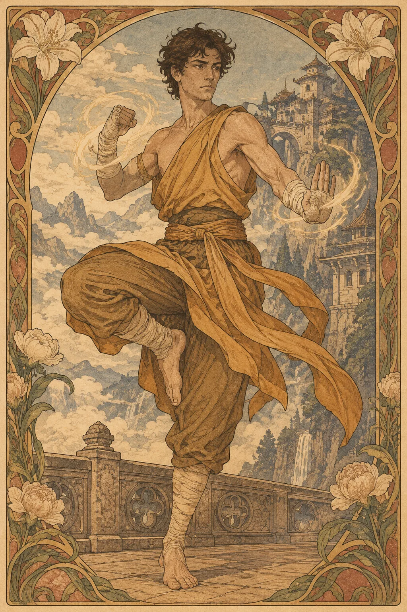

---
povolani:
  nazev: Monk
  zdroj: Player's Handbook (2024)
  overeno:
    - https://dnd2024.wikidot.com/monk:main
---

# Monk

## Přehled

Monk rozvíjí tělo a pozornost tak, aby z pohybu, načasování a kázně vytvořil bojovou výhodu. Jeho síla nemusí pocházet z kláštera ani z jediné filozofie: může se učit od potulného učitele, v zápasnické škole, na palubě lodi nebo v komunitě, která chrání své domovy. Třída nabízí rychlé přesuny, útoky a schopnosti, které odměňují dobrý odhad situace.

## Fantazie a role ve skupině

Monk dokáže dorazit k cíli dříve než většina spojenců a ovlivnit boj tam, kde je třeba. Jeho odolnost však nezaručuje bezpečí proti přesile, takže pozice a úniková cesta jsou důležité. Mimo boj může být tichým pozorovatelem, houževnatým poutníkem nebo učitelem, který se snaží rozhodnout, zda se jeho metoda dá předat dál. Vyhněte se představě, že Monk musí být asketický nebo odříznutý od společnosti; jeho disciplína se může projevit i v každodenní práci.

Ve skupině se Monk hodí k rychlým úkolům, průzkumu a boji proti protivníkům, jejichž přítomnost narušuje ostatní. Dejte spojencům vědět, kdy potřebujete prostor k manévru a kdy naopak chcete zůstat poblíž, abyste mohli chránit zranitelnou postavu.

## Jak se hraje

Před každým střetem si prohlédněte vzdálenosti, úkryty a možné trasy. V prvním tahu rozhodněte, zda je třeba dostat se k sesilateli, odvést pozornost od spojence, nebo počkat na příležitost k protiútoku. Focus Points jsou prostředkem pro rozhodující chvíle; jejich využití plánujte podle délky výpravy a očekávaných odpočinků. Pokud se boj protáhne, změňte taktiku místo opakování jediné kombinace.

Po Short Restu zkontrolujte, jaké zdroje se vrátily a zda družina potřebuje průzkumníka. Long Rest může být chvílí, kdy si postava zrekapituluje, co se naučila, aniž by každá scéna musela být duchovním cvičením. Při popisu pohybu dejte DM jasně najevo, kam Monk míří a co chce svou akcí umožnit.

## Základní údaje

<!-- udaje:povolani -->

## Postup po úrovních

<!-- mechaniky:povolani -->

## Podtřídy

<!-- podtridy:povolani -->

## Doporučené volby 2024

Guide, Sailor nebo Hermit jsou dobré výchozí body, ale Monk může pocházet z jakéhokoli zázemí. Hledejte v [katalogu pozadí](/pozadi/) kombinaci dovedností, která podporuje průzkum, cestování nebo práci s lidmi. Origin feat Alert pomáhá rychlé reakci, zatímco Tavern Brawler může vyjádřit zápasnický styl. Při volbě species zvažte spíš pohyb a příběhovou motivaci než stereotyp „východního mnicha“. V katalogu [featů](/featy/) ověřte, zda nová volba skutečně doplní vaši akční ekonomiku, a nebere vám prostředky, které chcete používat pro Monk’s Focus.

## Multiclass

Monk vyžaduje Dexterity 13 a Wisdom 13. Přidání bojových schopností nebo magie může vytvořit osobitou kombinaci, ale obvykle zpomalí růst Martial Arts a Focus Points. Ještě před volbou sepište, jaké tahové rozhodnutí multiclass přidá a co jste ochotni odložit. V příběhu se zaměřte na konkrétního učitele, spor nebo metodu, kterou postava převzala; kombinace tříd nemusí znamenat, že opustila předchozí výcvik.

## Tipy pro hráče a DM

Hráč může Monkovu kázeň ukázat tím, že pozorně sleduje spoluhráče a mění plán podle jejich potřeb. DM by měl dávat do prostředí překážky, které lze obejít, překonat nebo využít, a neomezit Monka na souboje na otevřené ploše. Připomínejte si pravidla pohybu, ale nevyžadujte přesné choreografie; stručný popis akce stačí. Mimo boj může Monk přispět znalostí těla, řemesla nebo tradice, kterou si sám zvolil.

## 3 háčky

1. Váš učitel posílá zprávy v podobě oprav na pohybech, které jste už dávno přestali používat.
2. Zápasnická škola žádá, abyste rozhodli spor o pravidlo, které se změnilo po zmizení jejího zakladatele.
3. Někdo kopíruje váš bojový styl, ale tvrdí, že se jej naučil z knihy, kterou nikdy neviděl.

## V Montelienu

> **Stav:** návrh

Monkova tradice může být osobním výcvikem, rodinnou disciplínou nebo novou cestou, kterou postava sestavila z několika zkušeností. Návrh nepřidává Montelienu žádný nový klášter ani instituci. DM může vybrat existující místo, kde se postava učila, a hráč určit, zda ji tam přijali, vyhnali, nebo zda výcvik probíhal mimo formální řád. Automatické odkazy níže ukazují vazby skutečných postav tohoto povolání.

<!-- vazby:povolani -->

## Postavy tohoto povolání

<!-- postavy:povolani -->

## Zdroje

- *Player's Handbook* (2024).
- https://dnd2024.wikidot.com/monk:main
