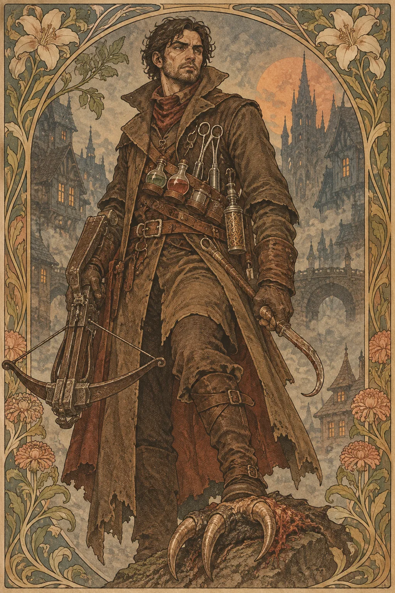

---
povolani:
  nazev: Monster Hunter
  zdroj: "Grim Hollow: Player's Guide"
  status: neověřeno
---

# Monster Hunter

## Přehled

Monster Hunter je třetistranné povolání spojované s prostředím Grim Hollow. Jeho herní fantazie se soustředí na člověka, který zná nebezpečné bytosti z vlastního výzkumu, zkušenosti nebo ceny, kterou zaplatil. V dostupných datech nejsou potvrzené základní parametry třídy, tabulka postupu ani úplné popisy rysů; tuto stránku proto nelze používat jako ověřený návod k level-upu. Konkrétní čísla a pravidla je nutné zkontrolovat v původní knize.

## Fantazie a role ve skupině

Lovec nestvůr nemusí být jen bojovník, který zabíjí všechno neznámé. Může vyhledávat důkazy, studovat chování nepřítele, hledat způsob, jak jej zahnat, nebo chránit vesnici před další obětí. Základem postavy je vztah ke konkrétnímu nebezpečí: co ji naučilo být připravená, koho se jí nepodařilo zachránit a jak pozná, že se její jistota mění v posedlost.

V družině může přinést průzkum a plán pro zvláštního protivníka, ale neměl by automaticky vědět vše o každé nestvůře. Jeho odbornost se nejlépe hraje prostřednictvím konkrétních stop a otázek. Předem si domluvte, jak často má jeho minulost ovlivňovat děj a zda chce hráč, aby se v příběhu objevilo něco osobního.

## Jak se hraje

Dokud není ověřený class chassis, nepoužívejte tuto stránku k určení životů, záchran, spell slots ani výhod získaných na jednotlivých úrovních. Pravidlový editor má pro Monster Huntera level-up výpočty zablokovat s českým upozorněním. Pro vyprávění si hráč může připravit deník stop, seznam známých rizik a jasnou hranici toho, co postava považuje za nestvůru; tato volba ale není náhradou za pravidlové hodnoty.

V jednotlivém střetu sledujte, jakou informaci lovec získal a co z ní vyvozuje. Nechte ostatní postavy přidat vlastní odbornosti, připravit únikovou cestu a rozhodnout, zda je boj opravdu nutný. Po výpravě proberte, co se změnilo v jeho metodě a zda konkrétní zkušenost nepotvrdila nebo nevyvrátila jeho předchozí názor.

## Základní údaje

<!-- udaje:povolani -->

> **Pozor:** chassis Monster Huntera je neověřeno. Hit Die, proficiencies, saving throws a postup po úrovních nejsou potvrzené; bez tabulky nelze bezpečně počítat level-up ani spell slots.

## Postup po úrovních

<!-- mechaniky:povolani -->

## Podtřídy

<!-- podtridy:povolani -->

## Doporučené volby 2024

Dokud není Monster Hunterův základní chassis ověřený, používejte doporučení jen jako příběhové směry, nikoli jako návod k tvorbě postavy. Soldier nebo Guide mohou představit minulost s nebezpečnými výpravami; Sage či Hermit zase člověka, který zaznamenává stopy. V [katalogu pozadí](/pozadi/) si vyberte dovednosti, které odpovídají kampani, a v [katalogu featů](/featy/) zvažte obecné volby pouze po kontrole jejich předpokladů. Zbraně, zbroj, kouzla i případné species volte podle ověřených pravidel tablestolu. Nepředpokládejte, že Monster Hunter automaticky sesílá kouzla nebo získává konkrétní zbroj.

## Multiclass

Předpoklady a příspěvek Monster Huntera k multiclass spell slots nejsou ověřené. Nekombinujte jej s jinou třídou podle odhadu a nepočítejte jeho úrovně jako půlčí či plný sesílací postup, dokud nebude prověřena původní tabulka. Pokud hráč potřebuje pokračovat v kampani, domluvte se s DM na dočasném použití jiné ověřené třídy; taková náhrada je samostatná dohoda a nepřepisuje pravidla Grim Hollow.

## Tipy pro hráče a DM

Hráč si může vybudovat postavu kolem poznámek, rituálů, nástrojů a nevyřešené chyby z minulé výpravy, aniž by si domýšlel čísla. DM by měl rozlišovat mezi charakterovým názorem a skutečným pravidlovým poznatkem: lovec se může mýlit, ale jeho omyl by měl vycházet z příběhu, ne z chybějících dat. Pokud chcete mechanicky hrát tuto třídu, získejte text z původní publikace a ověřte všech dvacet úrovní, záchrany, proficiencies, rysy i interakci s multiclass pravidly.

Před hrou se domluvte, zda bude postava zatím používat ověřenou alternativu 2024, nebo zda kampaň počká na kontrolu původního zdroje. Pokud se skupina rozhodne pro dočasnou náhradu, zapište ji jako zvláštní dohodu pro danou postavu a jasně odlište, které schopnosti patří náhradní třídě. Nepřenášejte automaticky guildové názvy na pravidlové účinky a neodvozujte počet útoků či životů z podobné třídy. Po ověření zdroje znovu projděte postavu s DM; změna má být společným rozhodnutím, které zachová její dosavadní příběh i rovnováhu skupiny.

## 3 háčky

1. Vaše staré poznámky popisují nestvůru, kterou dosud nikdo nepotkal, a její stopy se právě objevily u obydlené cesty.
2. Zraněný protivník se pokusí předat mapu k místu, kde podle vašeho výcviku žádná nestvůra nemůže přežít.
3. Člověk, kterého jste kdysi označili za lovce, žádá, abyste společně přehodnotili svůj nejstarší zápis.

## V Montelienu

> **Stav:** návrh

Pro Montelien lze Monster Huntera nabídnout jako postavu, která hledá konkrétní hrozbu nebo se snaží rozlišit mezi nestvůrou a člověkem, kterého společnost takto označila. To je návrh pro DM, ne tvrzení, že Grim Hollow již v tomto světě má vlastní školu či cech. Výchozím bodem může být existující město, frakce nebo NPC z rejstříku; jejich zapojení je nutné potvrdit u stolu. Dokud není ověřené povolání mechanicky, žádné příběhové doporučení nesmí být zaměněno za jeho oficiální schopnost.

<!-- vazby:povolani -->

## Postavy tohoto povolání

<!-- postavy:povolani -->

## Zdroje

- *Grim Hollow: Player's Guide*; class chassis a úplný postup zůstávají neověřené.
- https://ghostfiregaming.com/
