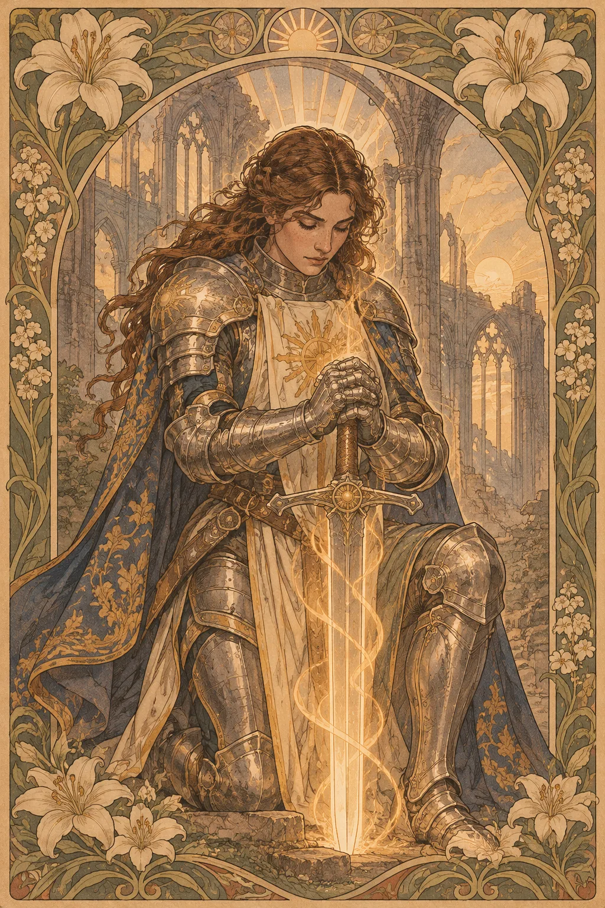

---
povolani:
  nazev: Paladin
  zdroj: Player's Handbook (2024)
  overeno:
    - https://dnd2024.wikidot.com/paladin:main
---

# Paladin

## Přehled

Paladin propojuje bojový výcvik s posvátným závazkem. Jeho síla vychází z přísahy, která určuje, co je ochoten chránit, co považuje za nepřijatelné a jakou cenu připouští za vítězství. Přísaha nemusí být slibem dokonalosti ani poslušností instituci; může být osobní, komunitní nebo stále ještě neúplná. Paladin je nejzajímavější, když má jasné hranice i otázky, které se o ně opírají.

## Fantazie a role ve skupině

V boji Paladin propojuje zbroj, zbraně, léčení a kouzla. Může stát poblíž spojenců, chránit průchod nebo rychle zasáhnout protivníka, jehož čin ohrožuje ostatní. Mimo boj nabízí schopnost jednat s autoritou, ale jeho přísaha sama o sobě nezaručuje, že mu někdo uvěří. Rozhodující je, zda jeho činy odpovídají slovům a zda je ochoten nést důsledky.

Paladin nemusí být moralizující ani vždy první v čele. Hráč si může zvolit tišší podobu služby: přijímat nevděčnou práci, dodržovat dohodu, nebo odmítnout vítězství, které by zničilo nevinné. Ve skupině se domluvte, jak Paladin řeší spory s postavami, jejichž hodnoty jsou jiné.

## Jak se hraje

Před výpravou připravte kouzla s ohledem na úkol družiny; Paladin má často méně prostoru pro improvizaci než plný sesilatel, proto záleží na prioritách. V prvním kole střetu zvažte, zda použít bonusovou akci k podpoře, přiblížit se k ohroženému spojenci, nebo otevřít cestu přes obranu nepřítele. Divine Smite je kouzlo a jeho využití soupeří o prostředky s jinými dobrými možnostmi; neodkládejte si každé použití na „ještě lepší“ chvíli.

Short Rest využijte k ošetření a rozhovoru o tom, zda poslední rozhodnutí odpovídalo přísaze. Při Long Restu upravte připravená kouzla podle dalších známých překážek. Hraní Paladina není soutěž o to, kdo vysloví největší slib: malé, důsledné činy mohou být přesvědčivější.

## Základní údaje

<!-- udaje:povolani -->

## Postup po úrovních

<!-- mechaniky:povolani -->

## Podtřídy

<!-- podtridy:povolani -->

## Doporučené volby 2024

Noble nebo Soldier mohou vysvětlit veřejný závazek a výcvik, ale Acolyte, Guard či Folk Hero nabídnou jiné vztahy k lidem, které Paladin chrání. V [katalogu pozadí](/pozadi/) hledejte dovednosti, které vám pomohou jednat i mimo boj. Origin feat Alert podporuje bdělého ochránce; Magic Initiate může představit dřívější magickou tradici. Při výběru kouzel zvažte Bless pro skupinovou podporu, Shield of Faith pro obranu nebo Cure Wounds pro pomoc mimo nejtěžší chvíle. Přehled najdete v [katalogu kouzel](/kouzla/?trida=Paladin). Vybírejte zbraně podle přísahy i taktické role.

## Multiclass

Paladin vyžaduje Strength 13 a Charisma 13. Kombinace se sesilatelem může otevřít nové možnosti kouzel, ale oddaluje Extra Attack a další paladinské rysy. Před rozdělením úrovní zvažte, zda skutečně potřebujete odolnost jiné třídy, nebo zda stejnou fikční změnu vyjádříte novým výcvikem v rámci Paladina. Důležitý je také vztah k přísaze: multiclass může být jejím rozšířením, krizí nebo praktickou odpovědí na úkol, nikoli automatickým odklonem.

## Tipy pro hráče a DM

Hráč by měl s DM sdílet, které části přísahy chce rozvíjet a kde připouští nejednoznačnost. DM může vytvořit situace, v nichž se střetnou dvě legitimní povinnosti, místo aby Paladin dostával pouze jednoduché zkoušky správné odpovědi. Dejte ostatním postavám možnost spolurozhodovat, koho a jak chránit. Mechanicky plánujte bonusové akce a koncentraci, aby popis víry nezahltil každé kolo boje.

## 3 háčky

1. Svědek vás žádá, abyste dodrželi slib, který jste pronesli jen v soukromí a už si na něj nepamatujete.
2. Dva lidé se stejnou insignií žádají o ochranu před sebou navzájem.
3. Při obřadu se ozve hlas, který zná přesné znění vaší přísahy, ale přidá k němu jednu větu navíc.

## V Montelienu

> **Stav:** návrh

Paladin může sloužit místní komunitě, být nositelem vlastní přísahy nebo mít složitý vztah k mocenskému řádu. Tato představa sama neurčuje, že Orden Paladiny schvaluje, vlastní nebo pronásleduje; o takovém propojení rozhodne DM. Navrhuji začít u konkrétní povinnosti: koho postava chrání, kdo její závazek zná a co by znamenalo jej porušit. Níže uvedené vazby vycházejí z existujících postav a jejich zaznamenaných míst.

<!-- vazby:povolani -->

## Postavy tohoto povolání

<!-- postavy:povolani -->

## Zdroje

- *Player's Handbook* (2024).
- https://dnd2024.wikidot.com/paladin:main
