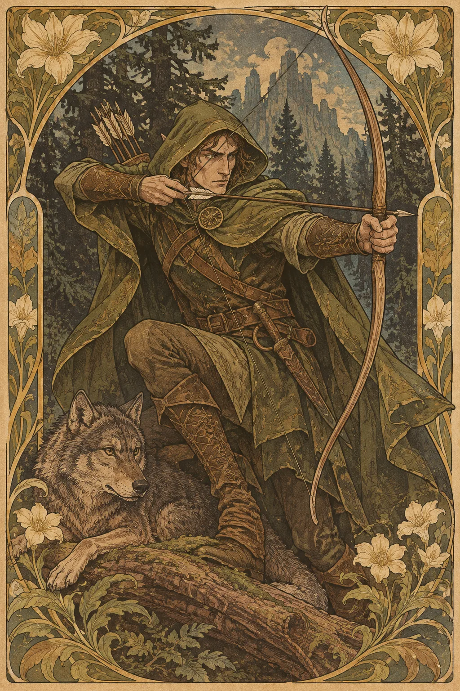

---
povolani:
  nazev: Ranger
  zdroj: Player's Handbook (2024)
  overeno:
    - https://dnd2024.wikidot.com/ranger:main
---

# Ranger

## Přehled

Ranger přežívá na hranici známého a neznámého. Umí sledovat stopy, číst krajinu a přizpůsobit boj prostředí, ale není omezen na lov ani na odlehlé oblasti. Může být průvodcem, hlídkou, pašerákem, poslem nebo člověkem, který se naučil orientovat tam, kam se ostatní bojí vstoupit. Jeho magie a zbraně doplňují praktické znalosti, nikoli je nahrazují.

## Fantazie a role ve skupině

Ranger pomáhá družině dostat se k cíli a vrátit se zpět. V boji může fungovat na dálku, kombinovat zbraně s kouzly nebo bojovat zblízka podle zvoleného stylu. Mimo boj si všímá počasí, cest, potravy a toho, co chybí na zdánlivě běžném místě. Jeho odborné znalosti by měly vytvářet nové otázky a možnosti, ne automaticky odstraňovat všechny překážky.

Postava může mít hluboký vztah k jedné krajině, nebo naopak znát mnoho cest, ale žádný domov nepovažovat za trvalý. Vyberte si, co Ranger chrání a před kým; povolání samo neurčuje, zda je lovec příšer, strážce hranice či průvodce karavan.

## Jak se hraje

Před začátkem výpravy zjistěte, kde se bude cestovat a jaké informace družina už má. Na začátku boje se rozhodněte, zda má smysl zaujmout střeleckou pozici, vyhledat kryt, nebo chránit spojence v dosahu. Kouzla připravujte podle očekávaných problémů; koncentrace, bonusové akce a útoky mohou soupeřit o stejný čas, proto si předem vyjasněte pořadí.

Při průzkumu sdílejte, co stopa opravdu dokazuje a co je jen domněnka. Short Rest je vhodný k opravě výstroje, plánování další etapy a rozdělení zásob. Long Rest využijte k úpravě kouzel a kontrole, zda družina nepřehlédla bezpečnější cestu. Rangerova odbornost nejlépe vynikne, když ostatní dostanou čas na vlastní reakci.

## Základní údaje

<!-- udaje:povolani -->

## Postup po úrovních

<!-- mechaniky:povolani -->

## Podtřídy

<!-- podtridy:povolani -->

## Doporučené volby 2024

Guide, Outlander nebo Sailor mohou vysvětlit, jak Ranger získal orientační schopnosti; Criminal, Farmer či Soldier se hodí stejně dobře pro jiné životní příběhy. Prohlédněte [pozadí](/pozadi/) podle dovedností, které chcete používat i v civilních scénách. Origin feat Alert pomáhá průzkumníkovi, Magic Initiate může naznačit zvláštní tradici a Skilled rozšíří praktické zázemí. Mezi kouzly zvažte Hunter's Mark, Cure Wounds či Entangle podle toho, zda se vaše role zaměřuje na poškození, podporu nebo kontrolu; [katalog kouzel](/kouzla/?trida=Ranger) nabízí úplný přehled. Zbraně vyberte tak, aby se doplňovaly s obvyklým terénem a stylem družiny.

## Multiclass

Ranger vyžaduje Dexterity 13 a Wisdom 13. Další bojová třída může rozšířit styl zbraní, zatímco přidání sesílání může změnit práci s kouzly; obojí ale odloží Rangerovy pozdější rysy a sloty. Před kombinací si určete, zda chcete větší mobilitu, obranu, nebo jiný způsob boje, a ověřte, jak se zdroje obnovují. Příběhově může multiclass vzniknout z práce s novým průvodcem nebo z povinnosti, kterou postava přijala na cestě.

## Tipy pro hráče a DM

Hráč by měl popisovat konkrétní pozorování a oddělovat jistotu od odhadu. DM může připravit několik tras s odlišnými riziky a nechat volbu na skupině; průzkum nemá být testem toho, zda Ranger uhodne jediné správné řešení. Připomeňte, jaké informace může postava zjistit bez hodu, a nabídněte jí příležitost využít znalost kraje, když na ní záleží. V boji se domluvte, kdo potřebuje Rangerovu podporu a jak bude družina reagovat na změnu pozice.

## 3 háčky

1. Stopy na prašné cestě vedou oběma směry, ale jedna sada otisků je starší než samotná cesta.
2. Místní žádají o doprovod přes známou trasu a odmítají říct, proč dnes potřebují tolik průvodců.
3. Vaše stará mapa obsahuje bezpečný přechod přes místo, kde teď stojí nová strážní věž.

## V Montelienu

> **Stav:** návrh

Ranger může být průvodcem mezi městy, stopařem na hranicích nebo člověkem, který se živí hledáním cest pro ostatní. Návrh nevytváří novou hlídku ani neoznačuje konkrétní les za území této třídy. DM může rozhodnout, zda se Ranger cítí doma v karavanové cestě, v městských průchodech nebo v krajině poškozené konfliktem. Rejstřík postav níže automaticky propojuje existující Rangery s jejich městy, zeměmi a frakcemi.

<!-- vazby:povolani -->

## Postavy tohoto povolání

<!-- postavy:povolani -->

## Zdroje

- *Player's Handbook* (2024).
- https://dnd2024.wikidot.com/ranger:main
