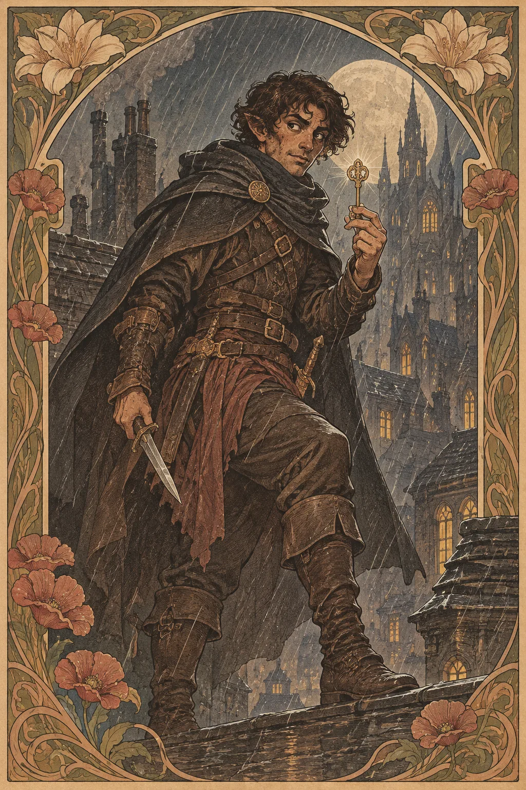

---
povolani:
  nazev: Rogue
  zdroj: Player's Handbook (2024)
  overeno:
    - https://dnd2024.wikidot.com/rogue:main
---

# Rogue

## Přehled

Rogue se prosazuje přesnou volbou okamžiku. Jeho odbornost, obratnost a schopnost využít mezer v obraně fungují v boji i při průzkumu, ale z Rogua automaticky nedělají zloděje ani samotáře. Může to být vyšetřovatel, diplomat, špeh, pouliční přeživší, průzkumník nebo člověk, který si vytvořil vlastní metodu, protože pravidla jiných lidí mu nestačila.

## Fantazie a role ve skupině

Rogue využívá dovednosti k otevření možností pro ostatní. V boji mu záleží na pozici, výběru cíle a spolupráci, protože přesný zásah často potřebuje správnou příležitost. Mimo boj může pátrat, číst řeč těla, procházet kolem hlídek nebo jednat s lidmi, kteří nechtějí mluvit se stráží. Jeho přínos roste, když skupina sdílí informace a Rogue nemusí každou scénu řešit sám.

Zvažte, jak postava získala důvěru svých spojenců a jaký druh hranic respektuje. Rogue může být věrný člověk, který někdy porušuje zákon, nebo zákon respektující vyšetřovatel, který se umí dostat do míst, kam jiní nesmějí. Třída nevyžaduje krádeže od družiny ani tajemství před spoluhráči.

## Jak se hraje

Na začátku střetu zjistěte, odkud můžete bezpečně zaútočit a komu pomůže vaše přítomnost. Sneak Attack je snazší uplatnit, když se domluvíte se spojencem a nehledáte jen příležitost být stranou. Sledujte pohyb, kryt a únikové cesty; dobrý Rogue nemusí každé kolo riskovat život kvůli nejvyššímu číslu poškození.

Při průzkumu řekněte, co přesně chcete zjistit nebo změnit. Pokud odemykáte dveře, sledujete cíl či přehráváte dokument, popište záměr a dejte ostatním možnost přidat vlastní schopnosti. Short Rest využijte pro rychlou kontrolu výstroje a nové role v plánu. Long Rest může znamenat změnu krycí identity, doplnění zásob nebo rozhovor o tom, komu se skupina rozhodla důvěřovat.

## Základní údaje

<!-- udaje:povolani -->

## Postup po úrovních

<!-- mechaniky:povolani -->

## Podtřídy

<!-- podtridy:povolani -->

## Doporučené volby 2024

Criminal je jedna z možností, nikoli předpoklad; Charlatan, Guide, Merchant nebo Sage mohou vytvořit jiný vztah k dovednostem. Vyberte v [katalogu pozadí](/pozadi/) to, které vysvětlí, proč vám ostatní svěřují citlivou práci. Origin feat Alert se hodí bdělému průzkumníkovi, Skilled podpoří odborníka na různé oblasti a Lucky může odpovídat člověku, který často riskuje. Vybírejte dovednosti podle konkrétních scén kampaně. Prohlédněte [katalog featů](/featy/) a zvažte, zda nová volba nepřekrývá odbornost, kterou už máte.

## Multiclass

Rogue vyžaduje Dexterity 13. Jiná třída může dodat bojový styl, kouzla nebo zbroj, ale odložení Rogue zpomaluje Sneak Attack a další třídní rysy. Pokud zvažujete bojovníka, paladina nebo sesilatele, určete, jak se jejich schopnosti doplní s vaší akcí a pohybem. Multiclass může v příběhu znamenat nové zaměstnání, školení nebo dohodu, ne nutně ztrátu dosavadní identity. Doporučujeme předem projít celou cestu postavy, ne jen jeden krátký kombinovaný tah.

## Tipy pro hráče a DM

Hráč může Rogua hrát jako součást týmu tím, že předem sdílí plán vstupu, úniku a záložní signál. DM by měl dát bezpečnostní hranice pro scény s vloupáním, podvody či sledováním; zábavný risk se nesmí změnit v automatickou zradu družiny. Překážky nabídněte s více přístupy a dovolte, aby selhání posunulo příběh, místo aby zastavilo pátrání. Rogue může zazářit i v situaci, kde nejde nic ukrást.

## 3 háčky

1. Zámek na dveřích reaguje na váš starý signál, ačkoli jste jej nikomu neukázali.
2. Dlužník vrací peníze v podobě klíče, který odemyká něco, co jste nikdy nehledali.
3. Svědek vás pozná podle přezdívky, kterou jste používali pouze v jiném městě.

## V Montelienu

> **Stav:** návrh

Rogue může sloužit jako zprostředkovatel informací, vyšetřovatel, kurýr nebo člověk, který si vynutil cestu z nebezpečné situace. Návrh mu nepřiděluje členství v žádné existující pašerácké ani politické skupině. DM může rozhodnout, zda postava zná Wortmir díky práci, přátelům nebo minulému konfliktu, ale vazbu je třeba potvrdit u stolu. Následující rejstříkové odkazy ukazují skutečné osoby a místa spojené s Roguy.

<!-- vazby:povolani -->

## Postavy tohoto povolání

<!-- postavy:povolani -->

## Zdroje

- *Player's Handbook* (2024).
- https://dnd2024.wikidot.com/rogue:main
