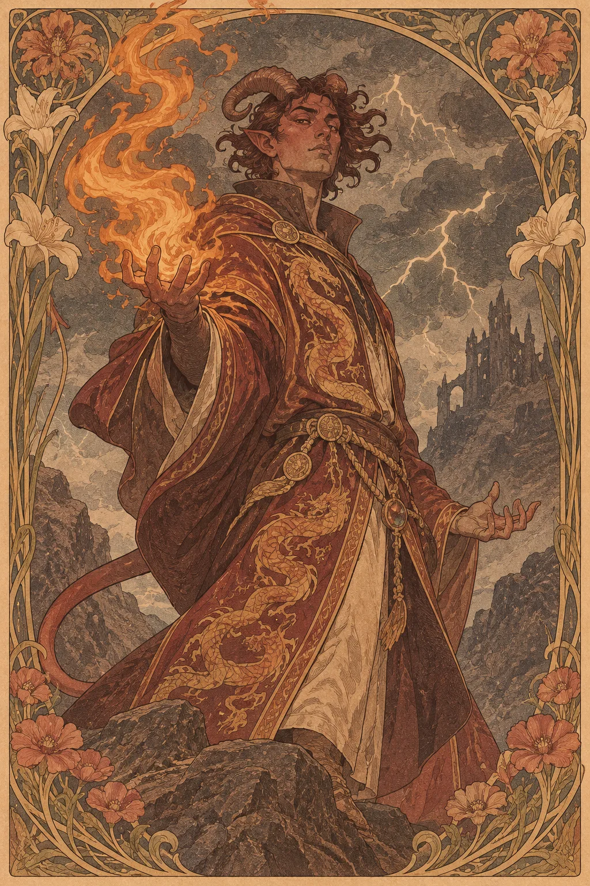

---
povolani:
  nazev: Sorcerer
  zdroj: Player's Handbook (2024)
  overeno:
    - https://dnd2024.wikidot.com/sorcerer:main
---

# Sorcerer

## Přehled

Sorcererova magie vychází z vrozeného, probuzeného nebo jinak osobního zdroje. Postava si může své schopnosti vysvětlovat rodovou linií, událostí, kterou přežila, nebo silou, které zatím nerozumí. Třída dává hráči pružnou magickou identitu a možnost upravovat kouzla, ale současně vyžaduje pečlivé rozhodování o omezených zdrojích.

## Fantazie a role ve skupině

Sorcerer je sesilatel, který často zná své kouzla důkladně a mění je podle zvoleného stylu. V boji může působit rozsáhlou magickou změnu, chránit spojence nebo zacílit útok na konkrétní hrozbu. Mimo boj jeho původ může vyvolávat otázky, strach či zájem, ale postava sama určuje, zda o něm mluví. Její schopnosti nejsou automaticky nestabilní ani nebezpečné pro okolí.

Ve skupině se vyplatí říct, jak se Sorcererova magie projevuje: barvou světla, zvukem, změnou teploty nebo zcela nenápadně. Tím se DM může opřít o jasné motivy a ostatní vědí, kdy mají reagovat. Role třídy nevyžaduje, aby Sorcerer všechno vysvětloval svou rodinou.

## Jak se hraje

Po Long Restu promyslete, které známé kouzlo se bude hodit na známý plán a které vám poskytne pružnost, když informace nejsou úplné. V boji si hlídejte koncentraci a Sorcery Points. Metamagic použijte tehdy, kdy mění nejen čísla, ale i taktické možnosti; pokud má kouzlo zasáhnout více cílů nebo obejít překážku, domluvte si postup se skupinou. V prvním kole nemusíte použít nejsilnější zdroj, jestliže teprve zjišťujete protivníkovy schopnosti.

Mimo boj se ptejte, zda umíte kouzlem něco zjistit, nebo jen chcete ovlivnit situaci. Short Rest není náhradou za plánování slotů; před Long Restem přehodnoťte kouzla podle směru výpravy a zkušeností, které postava získala. Sdílejte se skupinou, jakou cenu má vaše magie v příběhu, pokud ji vůbec nějakou má.

## Základní údaje

<!-- udaje:povolani -->

## Postup po úrovních

<!-- mechaniky:povolani -->

## Podtřídy

<!-- podtridy:povolani -->

## Doporučené volby 2024

Sage nebo Hermit mohou vysvětlit hledání původu magie, ale Charlatan, Noble či Urchin nabídnou jiný kontrast mezi schopností a zázemím. V [katalogu pozadí](/pozadi/) vyberte dovednosti a Origin feat, které podporují konkrétní společenskou roli. Alert pomůže postavě, která chce jednat dříve, Magic Initiate může představit druhou magickou tradici a Skilled nabídne všestrannost mimo boj. Kouzla vybírejte podle toho, zda potřebujete obranu, oblastní účinek nebo řešení překážek; [katalog pro Sorcerera](/kouzla/?trida=Sorcerer) umožňuje porovnat možnosti. Neberte si kouzlo jen kvůli působivému popisu, pokud se s ním vaše taktika pere.

## Multiclass

Sorcerer vyžaduje Charisma 13. Jiná třída může přidat zbroj, dovednosti nebo nové kouzlové možnosti, ale pozdější přístup k Metamagic a vyšším kouzlům se tím odkládá. Spell slots v multiclassu neurčují, kolik kouzel znáte nebo připravujete. Před kombinací si projděte, zda se obě třídy budou opírat o stejné vlastnosti a zda máte dost akcí pro jejich schopnosti. Příběhově může Sorcererův původ zůstat stejný, zatímco další výcvik mu dá lepší kontrolu.

## Tipy pro hráče a DM

Hráč by měl DM sdělit, zda chce rozvíjet otázku původu, nebo ji ponechat jako nevyřešené pozadí. DM může nabídnout stopy a svědectví, ale neměl by původ schopností odhalit bez souhlasu hráče. V boji popisujte účinek kouzel tak, aby se ostatní snadno zorientovali. Sorcerer má obvykle omezený počet známých kouzel; nabídněte mu prostor, aby každé působilo jedinečně, ne aby musel být všestranný jako celý tým.

## 3 háčky

1. Starý předmět reaguje pouze na vaše kouzla, ale jeho původní majitel tvrdí, že žádnou magii neměl.
2. Několik cizích lidí sní o stejném výboji světla, který jste spatřili při prvním probuzení schopností.
3. Léčitel vám doporučí, abyste nikdy neopakovali kouzlo, které vás kdysi zachránilo.

## V Montelienu

> **Stav:** návrh

Sorcererova moc může být v Montelienu považována za dar, dědictví, nehody nebo osobní tajemství. Žádný z těchto výkladů není stanoven jako kánon a tato stránka nevytváří nový původ ani frakci. Hráč s DM může zvolit, zda postava hledá odpověď, chrání své soukromí, nebo si vytvořila vlastní vysvětlení. Rejstříkové vazby níže odkazují na skutečné postavy Sorcererů a jejich zaznamenané vztahy.

<!-- vazby:povolani -->

## Postavy tohoto povolání

<!-- postavy:povolani -->

## Zdroje

- *Player's Handbook* (2024).
- https://dnd2024.wikidot.com/sorcerer:main
