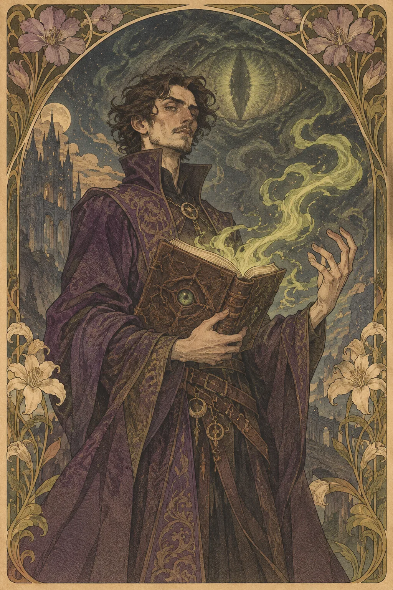

---
povolani:
  nazev: Warlock
  zdroj: Player's Handbook (2024)
  overeno:
    - https://dnd2024.wikidot.com/warlock:main
---

# Warlock

## Přehled

Warlock získává magii prostřednictvím vztahu s mocným patronem, který může mít různé podoby a motivace. Dohoda nemusí být podpisem krví ani úplným podrobením: může jít o nejasný závazek, dědictví, výměnu služeb nebo spojení, jehož pravidlům nerozumí ani jedna strana. Třída spojuje výrazná kouzla, Eldritch Invocations a krátký, intenzivní způsob práce se sloty.

## Fantazie a role ve skupině

Warlockova síla vytváří napětí mezi možností a závazkem. V družině může zajišťovat opakovatelný magický útok, specializované schopnosti nebo silné kouzlo ve správný okamžik. Mimo boj se vztah s patronem může rozvíjet jako vyjednávání, rodinné dědictví či nevyžádaná pozornost; nemusí však každé sezení přinášet příkazy a hrozby. Dohodněte se, jak často chce hráč tuto část příběhu otevírat.

Warlock může být otevřený, praktický nebo nedůvěřivý, ale žádná z těchto povah nevyplývá z třídy. Zajímavá postava má vlastní cíle, které se mohou s patronem překrývat jen někdy. To dává skupině důvod mluvit o riziku a důvěře, aniž by Warlock musel tajit informace před spoluhráči.

## Jak se hraje

Před výpravou si prohlédněte invocations a známá kouzla; u Warlocka záleží na tom, jak se omezené sloty obnovují a co umíte bez jejich použití. Na začátku střetu se rozhodněte, zda je čas pro Pact Magic, Eldritch Blast nebo pohyb k lepší pozici. Neutrácejte vše na první hrozbu, pokud neznáte délku výpravy. V dalších kolech koordinujte koncentraci a opakované schopnosti s ostatními sesilateli.

Short Rest může být pro Warlocka významným bodem dne; připomeňte družině, kdy se vyplatí zastavit a co při tom riskuje. Při Long Restu zkontrolujte připravená kouzla a zároveň si řekněte, jestli se ve vztahu s patronem něco změnilo. Hráč i DM by měli vědět, jaké druhy kontaktu s patronem jsou vítané a jaké se mají vyhnout.

## Základní údaje

<!-- udaje:povolani -->

## Postup po úrovních

<!-- mechaniky:povolani -->

## Podtřídy

<!-- podtridy:povolani -->

## Doporučené volby 2024

Charlatan, Sage, Noble nebo Hermit mohou vysvětlit první kontakt s patronem, ale pozadí nemusí být temné ani tajemné. Prohlédněte [katalog pozadí](/pozadi/) a vyberte si, jakou dovednost postava přinesla do vztahu. Origin feat Magic Initiate může ukázat dřívější magický výcvik, zatímco Alert pomáhá Warlockovi, který nechce být zaskočen. Při výběru invocations vytvořte kombinaci pro konkrétní herní roli, ne jen seznam nejvyšších čísel. Kouzla lze filtrovat v [katalogu pro Warlocka](/kouzla/?trida=Warlock); ověřte také, která fungují při omezeném počtu slotů.

## Multiclass

Warlock vyžaduje Charisma 13. Kombinace se Sorcererem nebo Bardskou tradicí může sdílet Charisma, ale sloty a třídní zdroje stále vyžadují samostatné sledování. Přidání bojové třídy může Warlocka přiblížit k první linii; zvažte, zda jeho zbroj a životy dovolí tento styl. Každá odložená úroveň Warlocka zpomalí pact sloty, invocations a další rysy. Příběhově si ujasněte, zda patron ví o novém výcviku a zda ho považuje za porušení dohody.

## Tipy pro hráče a DM

Hráč může předem určit, jaké hranice má patronova přítomnost a zda chce, aby patron někdy ovládal scény. DM by měl používat závazky jako nabídku rozhodnutí, ne jako trest za to, že hráč odmítl příkaz. Vysvětlete, které zdroje se obnovují při Short Restu a jak se liší od jiných spell slots. Warlock ocení protivníky a problémy, kde se dá jeho specializace uplatnit i mimo přímý útok.

## 3 háčky

1. Patron nabídne odpověď na otázku, kterou jste nikdy nevyslovili, ale vyžaduje, abyste si nejdřív vzpomněli, komu jste ji položili.
2. Dva lidé tvrdí, že jejich dohoda s vaším patronem je starší a důležitější než vaše vlastní.
3. Zpráva zanechaná vaším podpisem obsahuje závazek, který si nepamatujete a který odmítáte uznat.

## V Montelienu

> **Stav:** návrh

Warlockův patron může zůstat osobním tajemstvím, ale jeho vliv může také zasahovat do práce, rodiny či politiky. Tento návrh nepřiřazuje existující bytosti novou moc ani nevytváří novou frakci. Hráč a DM mohou určit, zda je dohoda známá, utajená, nebo se teprve začíná projevovat; žádný obyvatel Montelienu není automaticky „patronem“ jen proto, že se hodí k třídě. Automatický seznam propojuje skutečné postavy Warlocků s jejich zaznamenanými místy.

<!-- vazby:povolani -->

## Postavy tohoto povolání

<!-- postavy:povolani -->

## Zdroje

- *Player's Handbook* (2024).
- https://dnd2024.wikidot.com/warlock:main
