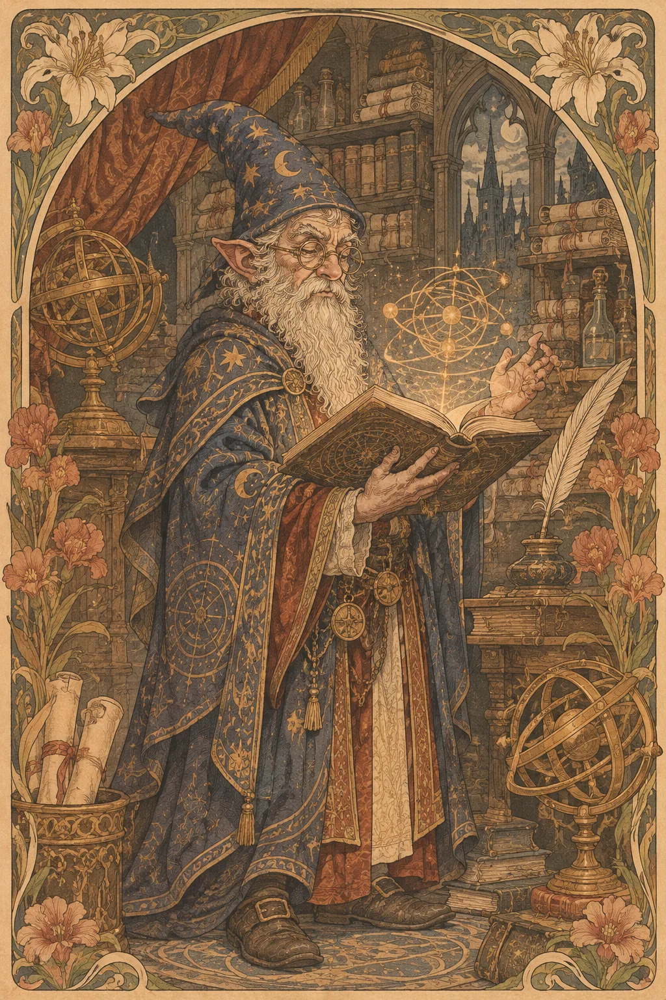

---
povolani:
  nazev: Wizard
  zdroj: Player's Handbook (2024)
  overeno:
    - https://dnd2024.wikidot.com/wizard:main
---

# Wizard

## Přehled

Wizard získává magii studiem, přesným pozorováním a opakovaným cvičením. Jeho spellbook zachycuje cestu, jakou postava znalosti získala, a může být stejně osobní jako deník. Třída nabízí široké možnosti kouzel, ale jejich síla závisí na přípravě, dostupných informacích a schopnosti rozhodnout se, co je v danou chvíli opravdu nutné.

## Fantazie a role ve skupině

Wizard může být akademik, samouk, archivář, mág u dvora nebo někdo, kdo studuje zakázané jevy z obavy, že se budou opakovat. V boji ovlivňuje prostor, brání spojence a vybírá vhodné kouzlo proti konkrétní hrozbě. Mimo boj vyhledává informace, interpretuje magické stopy a rozumí způsobům, jakými se kouzla zapisují nebo předávají. Znalost však není vševědoucnost; dobrý Wizard se ptá a přiznává, co ještě neví.

Ve skupině sdílejte, jaké kouzlo může řešit daný problém, ale dejte ostatním možnost navrhnout i nemagické řešení. Wizard je často nejzajímavější, když musí vybírat mezi několika dobrými možnostmi, nikoli když má připravenou odpověď na každou situaci.

## Jak se hraje

Po Long Restu připravte kouzla podle výpravy a záznamů, které družina skutečně získala. V prvním kole boje určete, zda je důležitější udržet protivníka mimo dosah, oslabit jeho útok, nebo chránit spojence. Nezapomínejte, že koncentrace a akce mají cenu i tehdy, když vám zbývají sloty. Při výběru cíle přemýšlejte, které kouzlo změní další tahy všech účastníků.

Mimo boj si veďte stručný seznam zdrojů, svitků a otevřených výzkumných otázek. Short Rest využijte k Arcane Recovery a rozhovoru se skupinou o tom, jaké informace jí chybí. Při Long Restu můžete znovu připravit kouzla, ale spellbook zůstává součástí fikce: řekněte, kde jej chráníte a komu dovolíte jej číst.

## Základní údaje

<!-- udaje:povolani -->

## Postup po úrovních

<!-- mechaniky:povolani -->

## Podtřídy

<!-- podtridy:povolani -->

## Doporučené volby 2024

Sage je zřejmá volba pro akademické studium; Scribe, Noble, Hermit nebo Criminal mohou nabídnout výraznější spojení s kampaní. V [katalogu pozadí](/pozadi/) hledejte dovednostní výbavu, která vám umožní pracovat s lidmi i knihami. Origin feat Magic Initiate může vyjadřovat učitele mimo Wizardovu školu, zatímco Skilled podpoří výzkumníka se širokým záběrem. Mezi kouzly zvažte Shield pro obranu, Detect Magic pro průzkum a kouzlo, které ovlivňuje prostor, například Web; [katalog kouzel](/kouzla/?trida=Wizard) lze filtrovat podle třídy. Připravujte kombinaci pro družinu, ne jen oblíbená kouzla.

## Multiclass

Wizard vyžaduje Intelligence 13. Přidání bojového výcviku může zvýšit odolnost, ale zpomalí vyšší kouzla; další sesilatel může sdílet sloty, nikoli spellbook nebo připravená kouzla. Zvažte, zda chcete přístup k určité zbroji, dovednosti, nebo konkrétnímu rysu. Pokud je důvod pouze „více magie“, porovnejte jej s pokračováním ve Wizardovi, kde se rozšiřují kouzla a možnosti přípravy.

## Tipy pro hráče a DM

Hráč by měl DM sdělit, jaké výzkumné otázky ho zajímají, aby se spellbook nestal pouhou sbírkou statistik. DM může občas nabídnout možnost získat nové zápisy, ale neměl by předpokládat, že Wizard chce řešit každou záhadu prostřednictvím magie. V boji je užitečné krátce popsat zamýšlený efekt kouzla před hodem, aby skupina věděla, zda má přidat další útok. Vyhraďte čas pro ostatní postavy a jejich odbornosti.

## 3 háčky

1. Ve spellbooku se objeví zápis kouzla, který jste nikdy nekopírovali, ale je psán vaší rukou.
2. Archiv odmítne přístup ke knize, kterou podle katalogu nikdo nikdy nevlastnil.
3. Váš učitel vás žádá, abyste zničili poznámky, jejichž závěry už zveřejnil někdo jiný.

## V Montelienu

> **Stav:** návrh

Wizard může zkoumat magii v soukromí, ve službě, v dílně nebo jako součást putovní družiny. Návrh neurčuje, kdo smí v Montelienu studovat, ani nepřidává žádnou akademii. DM a hráč mohou společně vybrat existující archiv, učitele či problém, který postava sleduje, a rozhodnout, zda její výzkum vítá Orden nebo mu překáží. Rejstřík níže propojuje skutečné Wizardy s jejich místy a frakcemi.

<!-- vazby:povolani -->

## Postavy tohoto povolání

<!-- postavy:povolani -->

## Zdroje

- *Player's Handbook* (2024).
- https://dnd2024.wikidot.com/wizard:main
