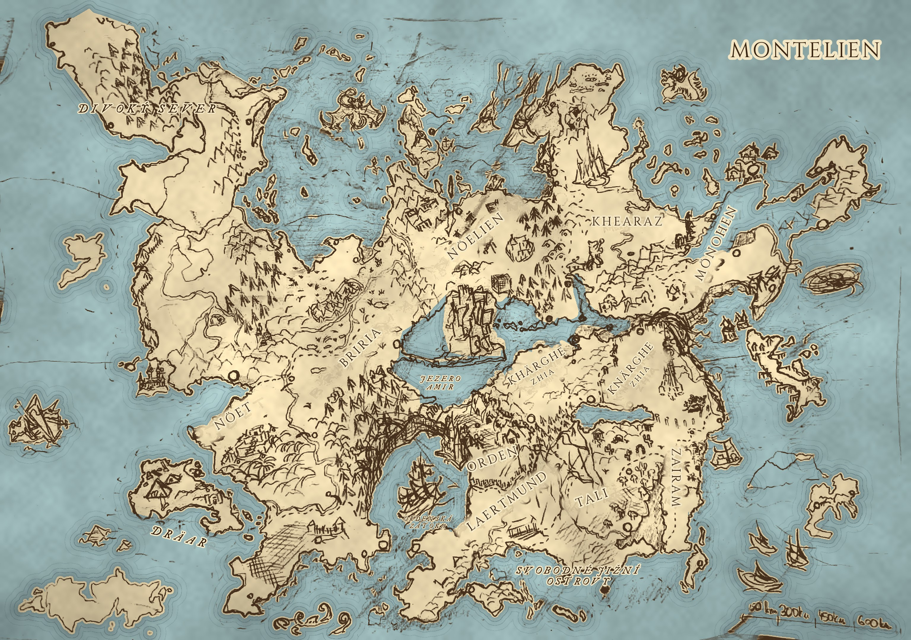

# Montelien – D&D 5e (2024) kampaň a univerzum

Svět, který stvořil uprchlý Ferienec **Ertus Potřísněný** a jeho děti – **Turandar (Stavitelé)**. Po **Temném dni** leží slavná říše v troskách, lidé vládnou rozdrobeným zemím a poslední dva roky nad nimi tiše vládne **Ordenský řád** Otce Samuela. V podzemí měst se ozývá **Odboj Svobodných**.

- Začni u: [Historie Montelienu](01_Svet/Historie_Montelienu.md)
- Rozpory a otázky k rozhodnutí: [Otevrene_otazky.md](Otevrene_otazky.md)
- Pravidla psaní a kánonu: [AGENTS.md](AGENTS.md)
- Šablony: [_Sablony/](_Sablony/)
- Mapa: [11_Mapy/](11_Mapy/Geografie.md)
- Web (wiki s vyhledáváním a interaktivní mapou na localhostu): `pip install -r web/requirements.txt && web/serve.sh` → http://localhost:8000
- Pravidla: **D&D 5e 2024** (PHB 2024, DMG 2024, MM 2025)

## Struktura

| Složka | Obsah |
|---|---|
| `01_Svet/` | Historie, kosmologie, panteon; `Mista/` = divoké regiony a mýtická místa |
| `02_Zeme/` | Státy a regiony |
| `03_Mesta/` | Města a pevnosti |
| `04_Postavy/` | Stavitelé a bohové, vládci, NPC kampaně |
| `05_Frakce/` | Ordenský řád, Odboj Svobodných, cechy, kulty |
| `06_Knihy_a_Dokumenty/` | Herní texty / handouty pro hráče |
| `07_Kampane/` | Kampaně (oblouky příběhu) |
| `08_Questy/` | Questy a dobrodružství |
| `09_Hadanky/` | Hádanky, šifry, pasti |
| `10_Sezeni/` | Záznamy z odehraných sezení |
| `11_Mapy/` | Mapy |

Po přidání souborů spusť `python3 tools/kontrola.py --index` – přegeneruje obsah níže a zkontroluje odkazy.
Repo je kompatibilní i s [Obsidianem](https://obsidian.md) (stačí otevřít složku jako vault).

## Obsah

<!-- INDEX -->

### [01_Svet](01_Svet/)
- **Mista**
  - [Divoký Sever](01_Svet/Mista/Divoky_Sever.md)
  - [Fornheim – Zamrzlá tvrz](01_Svet/Mista/Fornheim.md)
  - [Hinai Mihi – Prales neviditelných](01_Svet/Mista/Hinai_Mihi.md)
  - [Jezero Amir a Kop Aram](01_Svet/Mista/Jezero_Amir_a_Kop_Aram.md)
  - [Moře a ostrovy Montelienu](01_Svet/Mista/More_a_ostrovy.md)
  - [Tali](01_Svet/Mista/Tali.md)
  - [Trosky Dräaru](01_Svet/Mista/Trosky_Draaru.md)
  - [Urkal a Urkalský palác](01_Svet/Mista/Urkal.md)
  - [Východní hvozd – Tirentova říše](01_Svet/Mista/Vychodni_hvozd.md)
  - [Západní hvozd a Ertinova hora](01_Svet/Mista/Zapadni_hvozd_a_Ertinova_hora.md)
- [Kompletní Historie a Základ Světa Montelienu](01_Svet/Historie_Montelienu.md)
- [Kosmologie – Ferien a svět Montelien](01_Svet/Kosmologie_Ferien.md)
- [Panteon – Turandar (Stavitelé)](01_Svet/Panteon.md)

### [02_Zeme](02_Zeme/)
- [Nezávislá Država Knärghae Zia](02_Zeme/Drzava_Knarghae_Zia.md)
- [Elfský Stát Nöelien](02_Zeme/Elfsky_Stat_Noelien.md)
- [Khaeraz](02_Zeme/Khaeraz.md)
- [Klanové Země Mönohen](02_Zeme/Klanove_Zeme_Monohen.md)
- [Království Briria](02_Zeme/Kralovstvi_Briria.md)
- [Království Imonir](02_Zeme/Kralovstvi_Imonir.md)
- [Knížectví Khärghae Zia](02_Zeme/Kralovstvi_Kharghae_Zia.md)
- [Království Laertmund](02_Zeme/Kralovstvi_Laertmund.md)
- [Provincie Nöet](02_Zeme/Provincie_Noet.md)
- [Svobodné Jižní Ostrovy](02_Zeme/Svobodne_Jizni_Ostrovy.md)
- [Svobodné Město Miria](02_Zeme/Svobodne_Mesto_Miria.md)
- [Svobodné Město Werenor](02_Zeme/Svobodne_Mesto_Werenor.md)
- [Teokracie Orden](02_Zeme/Teokracie_Orden.md)
- [Země Zairam](02_Zeme/Zeme_Zairam.md)

### [03_Mesta](03_Mesta/)
- [Město Dar Kemmar](03_Mesta/Mesto_Dar_Kemmar.md)
- [Město Imonir](03_Mesta/Mesto_Imonir.md)
- [Město Kaer](03_Mesta/Mesto_Kaer.md)
- [Město Kop Aram](03_Mesta/Mesto_Kop_Aram.md)
- [Město Menkant](03_Mesta/Mesto_Menkant.md)
- [Město Mictima](03_Mesta/Mesto_Mictima.md)
- [Město Miria](03_Mesta/Mesto_Miria.md)
- [Město Octowerin](03_Mesta/Mesto_Octowerin.md)
- [Město Owappa](03_Mesta/Mesto_Owappa.md)
- [Město Pertam](03_Mesta/Mesto_Pertam.md)
- [Město Tel Palentin](03_Mesta/Mesto_Tel_Palentin.md)
- [Město Werenor](03_Mesta/Mesto_Werenor.md)
- [Město Wortmir](03_Mesta/Mesto_Wortmir.md)
- [Město Yotter](03_Mesta/Mesto_Yotter.md)
- [Město Orden (Pevnost)](03_Mesta/Pevnost_Orden.md)

### [04_Postavy](04_Postavy/)
- **NPC**
  - ["Slepý" Corvin (Vůdce Odboje)](04_Postavy/NPC/Postava_Corvin.md)
  - [Kazi Nocostřel (Průvodce)](04_Postavy/NPC/Postava_Kazi.md)
  - [Inkvizitor Vaelen (NPC Antagonista)](04_Postavy/NPC/Postava_Vaelen.md)
- **Stavitele a Bohove**
  - [Antemius – Pán Snů a Strachu](04_Postavy/Stavitele_a_Bohove/Postava_Antemius.md)
  - [Corthrin](04_Postavy/Stavitele_a_Bohove/Postava_Corthrin.md)
  - [Eligon](04_Postavy/Stavitele_a_Bohove/Postava_Eligon.md)
  - [Ertin](04_Postavy/Stavitele_a_Bohove/Postava_Ertin.md)
  - [Ertus Potřísněný](04_Postavy/Stavitele_a_Bohove/Postava_Ertus.md)
  - [Irtis "Ohnivá"](04_Postavy/Stavitele_a_Bohove/Postava_Irtis.md)
  - [Tirent "Moudrý"](04_Postavy/Stavitele_a_Bohove/Postava_Tirent.md)
  - [Zaira – Patronka Života](04_Postavy/Stavitele_a_Bohove/Postava_Zaira.md)
- **Vladci**
  - [Arcimág Breffan](04_Postavy/Vladci/Postava_Breffan.md)
  - [Král Forpa VII.](04_Postavy/Vladci/Postava_Forpa_VII.md)
  - [Král Iridin III.](04_Postavy/Vladci/Postava_Iridin_III.md)
  - [Král Istuvion](04_Postavy/Vladci/Postava_Istuvion.md)
  - [Kněžka Mi-Komde](04_Postavy/Vladci/Postava_Mi_Komde.md)
  - [Náčelník Oltar](04_Postavy/Vladci/Postava_Oltar.md)
  - [Otec Samuel (Hlava Ordenu)](04_Postavy/Vladci/Postava_Otec_Samuel.md)
  - [Primas Pertham](04_Postavy/Vladci/Postava_Pertham.md)
  - [Aettar Szkunzi](04_Postavy/Vladci/Postava_Szkunzi.md)
  - [Konzul Timopeus](04_Postavy/Vladci/Postava_Timopeus.md)
  - [Král Veanor I.](04_Postavy/Vladci/Postava_Veanor_I.md)
  - [Vévoda Wort XXIV.](04_Postavy/Vladci/Postava_Wort_XXIV.md)
  - [Královna Yuthika](04_Postavy/Vladci/Postava_Yuthika.md)

### [05_Frakce](05_Frakce/)
- [Odboj Svobodných](05_Frakce/Odboj_Svobodnych.md)
- [Ordenský řád](05_Frakce/Ordensky_Rad.md)

### [06_Knihy_a_Dokumenty](06_Knihy_a_Dokumenty/)
- [Odpárané oči Urkalu](06_Knihy_a_Dokumenty/Kniha_01_Odparane_Oci_Urkalu.md)
- [Kodex Řádu a Pořádku (Kniha I.)](06_Knihy_a_Dokumenty/Kniha_02_Kodex_Radu_a_Poradku.md)
- [Průvodce Divokými Kraji](06_Knihy_a_Dokumenty/Kniha_03_Zapisnik_Stareho_Cestovatele.md)
- [Píseň o Prvním ostrově](06_Knihy_a_Dokumenty/Kniha_04_Pisen_o_Prvnim_ostrove.md)
- [O pěti dětech Ertusových](06_Knihy_a_Dokumenty/Kniha_05_O_peti_detech.md)
- [Kronika Temného dne (Zkáza Werenoru)](06_Knihy_a_Dokumenty/Kniha_06_Kronika_Temneho_dne.md)
- [Šest set let koruny](06_Knihy_a_Dokumenty/Kniha_07_Sest_set_let_koruny.md)
- [Rejstřík správy Ordenu (Tajné)](06_Knihy_a_Dokumenty/Kniha_08_Rejstrik_spravy_Ordenu.md)
- [Dvě sestry Zhie](06_Knihy_a_Dokumenty/Kniha_09_Dve_sestry_Zhie.md)
- [Deník z Dräaru](06_Knihy_a_Dokumenty/Kniha_10_Denik_z_Draaru.md)
- [Sny ze severu](06_Knihy_a_Dokumenty/Kniha_11_Sny_ze_severu.md)
- [Poslední listy z Hinai Mihi](06_Knihy_a_Dokumenty/Kniha_12_Posledni_listy_z_Hinai_Mihi.md)
- [O Ferienu a jeho knězích](06_Knihy_a_Dokumenty/Kniha_13_O_Ferienu_a_jeho_knezich.md)
- [Elfské letopisy Nöelienu](06_Knihy_a_Dokumenty/Kniha_14_Elfske_letopisy.md)
- [Zaiřin herbář](06_Knihy_a_Dokumenty/Kniha_15_Zairin_herbar.md)
- [Kodex Řádu a Pořádku (Kniha II.) – Dodatek o správě zemí](06_Knihy_a_Dokumenty/Kniha_16_Kodex_Radu_a_Poradku_II.md)
- [Lodní deník z Menkantu](06_Knihy_a_Dokumenty/Kniha_17_Lodni_denik_z_Menkantu.md)
- [Regule šedých kutn](06_Knihy_a_Dokumenty/Kniha_18_Regule_sedych_kuten.md)
- [Zeměpis známých zemí](06_Knihy_a_Dokumenty/Kniha_19_Zemepis_znamych_zemi.md)

### [07_Kampane](07_Kampane/)
_(zatím prázdné)_

### [08_Questy](08_Questy/)
_(zatím prázdné)_

### [09_Hadanky](09_Hadanky/)
_(zatím prázdné)_

### [10_Sezeni](10_Sezeni/)
_(zatím prázdné)_

### [11_Mapy](11_Mapy/)
- [Analýza mapy po dílech](11_Mapy/Analyza_mapy.md)
- [Geografie Montelienu (podle mapy DM)](11_Mapy/Geografie.md)
<!-- /INDEX -->
